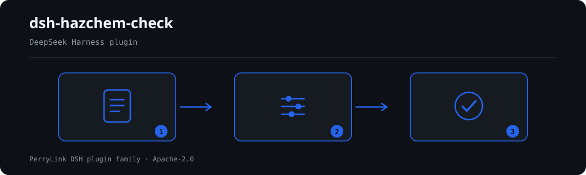

# dsh-hazchem-check — खतरनाक रसायन रजिस्टर और बृहत्-स्रोत पहचान की जाँच

[English](README.md) · [简体中文](README-zh.md) · [Español](README-es.md) · [Português](README-pt.md) · [हिन्दी](README-hi.md)

[](https://dsh.market/)
[](https://dshfind.com/en/plugins/PerryLink/dsh-hazchem-check?ref=badge)

`dsh-hazchem-check` खतरनाक रसायनों के रजिस्टर और उसके बृहत्-स्रोत (major hazard source) पहचान रिकॉर्ड को पढ़ता है — साइट हेडर और प्रत्येक रसायन की एक पंक्ति — और उसी रजिस्टर की पूर्णता तथा अंकगणित की जाँच करता है: क्या प्रत्येक रसायन का नाम और खतरा-वर्ग दर्ज है, क्या भंडारित मात्रा संख्या के रूप में पढ़ी जा सकती है, क्या सीमा-मात्रा (threshold) दर्ज है, क्या «बृहत् स्रोत» का निर्णय भंडारित मात्रा और रजिस्टर में लिखी सीमा-मात्रा के संबंध से मेल खाता है, क्या भंडारित रसायन का सुरक्षा डेटा शीट (SDS) क्रमांक दर्ज है, क्या CAS क्रमांक दोहराए नहीं गए हैं, क्या हेडर पहचान का आधार घोषित करता है, और क्या नाम-कॉलम में कोई टेम्पलेट प्लेसहोल्डर शेष नहीं है।

## Install

```sh
dsh plugin --profile <name> add dsh-hazchem-check
dsh --profile <name> --dump-config | grep 'dsh-hazchem-check'
```

## आउटपुट कैसा दिखता है



*कार्यप्रवाह: दस्तावेज़ → नियम → निष्कर्ष। नीचे के उदाहरण वास्तविक कमांड सतह का उपयोग करते हैं।*


इस प्लगइन का अपने ही `HZ-002` टेस्ट फ़िक्स्चर पर वास्तविक आउटपुट — कोई नकली चित्र नहीं। नियम-पैक उद्धरण नहीं गढ़ता, इसलिए हर निष्कर्ष लागू किए गए खंड का नाम और यह भी बताता है कि उसका मूल पाठ इस बार प्राप्त नहीं हुआ।

## यह किन सवालों का जवाब देता है

### उदाहरण

नीचे दी गई तालिका उदाहरण-समुच्चय है: पहली पंक्ति विस्तृत केस है, बाकी संक्षिप्त केस हैं।


| आपका सवाल | इसका जवाब |
|---|---|
| रजिस्टर में «否» लिखा है, पर भंडारित मात्रा उसके साथ लिखी सीमा-मात्रा से अधिक है — क्या यह पकड़ में आता है? | हाँ। `HZ-003` रजिस्टर में लिखे दोनों अंकों की तुलना करता है और जहाँ निर्णय उस संबंध से मेल नहीं खाता वह पंक्ति दर्ज करता है। कोई इकाई वास्तव में बृहत् स्रोत है या नहीं, यह नहीं तय करता। |
| किसी पंक्ति में सीमा-मात्रा ही नहीं है। क्या कुछ बताया जाता है? | हाँ। `HZ-004` हर पंक्ति में सीमा-मात्रा भरी होने की अपेक्षा करता है। यह देखता है कि कोई मान मौजूद है, यह नहीं कि वह उस रसायन के लिए सही मान है — `0` भी पास हो जाता है। |
| रसायन का नाम भरा है, पर खतरा-वर्ग खाली है। | `HZ-001` हर पंक्ति में दोनों की अपेक्षा करता है और जिस पंक्ति में एक भी न हो उसे दर्ज करता है। वर्ग सही है या नहीं, यह नहीं आँकता। |
| मात्रा `1,500 kg` लिखी है — क्या यह पढ़ी जाएगी? | हाँ। `HZ-002` उसमें से संख्यात्मक भाग लेता है; केवल वह मात्रा दर्ज होती है जिसे पढ़ा न जा सके। अंक सच है या नहीं, या डिज़ाइन-अधिकतम के अनुसार लिया गया है या नहीं, यह नहीं जाँचा जाता। |
| किन पंक्तियों में सुरक्षा डेटा शीट क्रमांक होना चाहिए? | `HZ-006`: हर उस पंक्ति में जिसमें भंडारित मात्रा दर्ज है। नियम यह देखता है कि क्रमांक भरा है, यह नहीं कि शीट पूरी है या उसी रसायन की है। |
| एक ही CAS क्रमांक दो गोदामों में दो बार आया है। | `HZ-007` दोहराया गया CAS क्रमांक दर्ज करता है, क्योंकि इससे न दोहराव हटता है न मात्राओं का जोड़ सही रहता है। एक ही रसायन का कई गोदामों में होना सामान्य है: भंडारण-स्थान कॉलम में उसे अलग दिखाएँ, या इस नियम को बंद कर दें। CAS कॉलम न हो तो यह नियम चुपचाप पास होने के बजाय बताता है कि वह चल नहीं सका। |

## यह किन मानकों पर आधारित है

| दस्तावेज़ | संख्यांक | इन्हें उद्धृत करने वाले नियम |
|---|---|---|
| 《危险化学品安全管理条例》 | 国务院令第591号（2002年1月26日国务院令第344号公布，2011年2月16日国务院第144次常务会议修订通过，自2011年12月1日起施行） | HZ-001, HZ-002, HZ-003, HZ-004, HZ-006, HZ-008 |
| 《危险化学品重大危险源辨识》 | GB 18218—2018（2018-11-19发布，2019-03-01实施；全部技术内容为强制性；代替GB 18218—2009） | HZ-002, HZ-003 |
| 《危险化学品重大危险源辨识》 | GB 18218—2018（本次未取得条文） | HZ-005 |
| 《危险化学品安全管理条例》 | 国务院令第591号（本次未取得条文） | HZ-007 |

**Boundary:** this plugin checks a **危险化学品台账与重大危险源辨识记录** for completeness and arithmetic — that
each chemical names itself and its hazard class, that the stored quantity parses, that a threshold is recorded,
that **the major-hazard-source verdict agrees with how the stored quantity compares to the threshold the register
states**, that a stored chemical records its safety data sheet number, that CAS numbers are not duplicated, that
the register declares its identification basis, and that no placeholder survives. It does **not** decide whether a
unit constitutes a major hazard source, whether it must be registered, whether a safety assessment is required, or
whether it is a major hidden danger.

> ### ⚠️ What the standard says, and the four errors this plugin cannot find
>
> **GB 18218—2018 was obtained and read verbatim** (see `rules/evidence/clause-verification-tables.md`):
> issued **2018-11-19, in force 2019-03-01**, with the foreword stating 「**本标准的全部技术内容为强制性的**」 —
> the whole standard is mandatory — and it **supersedes GB 18218—2009** (the 2000 and 2009 editions are both
> withdrawn, so citing them is simply wrong). The definitions of 临界量 (3.3), 单元 (3.2) and 重大危险源 (3.4),
> the determination rule 4.1.2, and **table 1's first 35 rows** are all quoted in that report.
>
> **Table 1 is complete only to row 35 and table 2 was not obtained**, so no threshold value is built in and none
> can be checked. `HZ-003` compares the stored quantity against the threshold **the register itself records** and
> checks that the verdict agrees. It therefore **cannot find four classes of error**, and its own note says so:
>
> 1. **A threshold taken from the wrong substance or hazard class** — 4.1.2 requires table 1 for listed
>    substances and table 2 otherwise.
> 2. **A multi-hazard substance not given its lowest threshold** — 4.1.2 b): 「若一种危险化学品具有多种危险性，
>    按其中最低的临界量确定」. Registers carry one figure, so rounding up misses a major hazard source.
> 3. **The multi-substance correction** — within one unit, `S = q₁/Q₁ + q₂/Q₂ + … + qₙ/Qₙ ≥ 1` also constitutes a
>    major hazard source. **This plugin does not perform that summation**, because identification works per
>    **production or storage unit** (3.2, 3.5, 3.6) while a register lists substances without unit grouping.
> 4. **The quantity basis** — 4.2.2 requires the quantity to be taken **at the design maximum**, while a register
>    may record stock on hand.
>
> ⚠️ **Stay inside the standard's scope.** Clause 1 excludes **off-site transport of hazardous chemicals**
> (rail, road, water, air, pipeline), nuclear and military facilities, mining (except processing and storage), and
> offshore oil and gas extraction. Using this plugin on a **transport** consignment is out of scope — that is
> governed by dangerous-goods transport rules, not by GB 18218.
>
> A finding therefore means only "**the two numbers you wrote do not agree with your own verdict**". The four
> items above need a unit-by-unit calculation under the standard, which is a safety-assessment and
> regulator-determination task. **Every `excerpt` still says "本次未取得" and every rule stays `warn` or `info`**,
> because what this plugin checks is a register's internal consistency, not whether a threshold value is correct.

## Compatibility

| सतह | स्थिति |
|---|---|
| Harness | peer रेंज `>=0.1.2-rc.1 <0.2.0 \|\| >=0.2.0-0 <0.3.0` — `0.2.0-rc.2` और `0.2.1-rc.2` दोनों को स्वीकार करने के लिए सत्यापित। **`engines.dsh` `>=0.2.1-0 <0.3.0` के रूप में घोषित है** और 0.2.1 से होस्ट इसे लागू करता है |
| Node | `^22.19.0 || >=24.0.0` |
| प्लेटफ़ॉर्म | सभी (शुद्ध ESM; कोई नेटिव कोड नहीं, कोई नेटवर्क नहीं, कोई मॉडल कॉल नहीं) |
| टूल मोड | `native` और `ptc` में काम करता है; पूरे फ़ोल्डर के लिए `ptc` चुनें |

## What it does

नियम-सूची, फ़ील्ड और विस्तृत व्यवहार [README.md](README.md#what-it-does) (अंग्रेज़ी मुख्य संस्करण) में हैं। यह प्लगइन केवल उद्धृत धाराओं के सामने शाब्दिक अंतर सूचीबद्ध करता है और हर न चल पाई जाँच को `skipped` में बताता है।

## Configuration

सभी समायोज्य पैरामीटर `src/config.ts` की Schemastery स्कीमा में हैं, इसलिए कोड बदले बिना `cordis.yml` से बदले जा सकते हैं; प्रति-नियम सीमाएँ `rules/` के नियम-पैक में हैं।

| कुंजी | प्रकार | डिफ़ॉल्ट | विवरण |
|---|---|---|---|
| `rulesFile` | string | `rules/hazchem-check.yaml` | नियम-पैक का पथ, पैकेज रूट के सापेक्ष |
| `disabledRules` | string[] | `[]` | बंद करने वाले नियम id; प्रत्येक `skipped` में दिखता है |
| `onlyRules` | string[] | `[]` | केवल ये नियम चलाएँ; खाली होने पर सभी नियम चलते हैं |
| `skipNotes` | string | `""` | हर `skipped` कारण के आगे जोड़ी जाने वाली टिप्पणी |
| `timeoutMs` | number | `120000` | उपकरण का सहकारी समय-सीमा बजट |

## Material format

JSON या YAML स्वीकार्य है। पूरा फ़ील्ड उदाहरण [README.md](README.md#material-format) (अंग्रेज़ी मुख्य संस्करण) में है। पढ़ने की परत में फ़ील्ड वैकल्पिक हैं और जाँच इंजन उन्हें सत्यापित करता है, इसलिए आंशिक निर्यात पर क्रैश के बजाय "अनुपस्थित" श्रेणी के निष्कर्ष मिलते हैं।

## Rule sources

नियम-डेटा कोड से अलग है: प्रत्येक नियम में दस्तावेज़, संख्या, स्रोत की अपनी क्रमांकन-प्रणाली के अनुसार धारा, शब्दशः उद्धरण और स्रोत URL होता है। लोडर लागू करता है कि उद्धरण कम से कम आठ अक्षरों का वास्तविक उद्धरण हो, और जिस जाँच का आधार केवल सामान्य सिद्धांत (`kind: derived-from-principle`, अधिकतम `warn`) या स्थानीय नीति (`kind: institutional-configuration`, अधिकतम `info`) हो, उसे कभी `error` घोषित न किया जाए।

सत्यापित सीमाएँ और जान-बूझकर **न** कहे गए निष्कर्ष [README.md](README.md#rule-sources) (अंग्रेज़ी मुख्य संस्करण) और `rules/evidence/` में हैं।

## Troubleshooting

- **प्लगइन इंस्टॉल हो गया पर टूल दिखता नहीं**: जाँचें कि `main` `lib/index.mjs` पर जाता है और `pnpm run build` ने उसे बनाया है।
- **`dsh plugin add` असंगत बताकर मना करता है**: peer range `0.1.x` और `0.2.x` दोनों को कवर करती है; बाहर होने पर स्पष्ट छूट दें: `dsh plugin --profile <name> allow-version <pkg@ver> --dsh-version <runtime> --accept-risk`।
- **कोई नियम नहीं चला**: `skipped` सरणी देखें।
- **`check` में `manifest-peers` विफल दिखता है**: यह `dsh-plugin-dev` की ज्ञात अपस्ट्रीम समस्या है; रनटाइम इंस्टॉल के समय अनुकूलता लागू करता है।
- **समय खिसका हुआ लगता है**: सारी गणना दिए गए स्ट्रिंग पर वॉल-क्लॉक है।

## Development

```sh
pnpm install
pnpm run typecheck
pnpm test
pnpm run build
node ../scripts/sync-shared.mjs dsh-hazchem-check
```

अंतिम कमांड `../_shared` का साझा किट `src/shared/` में कॉपी करता है; हर साझा बदलाव के बाद इसे दोबारा चलाएँ।

## PerryLink DSH Plugin Family

यह प्रोजेक्ट [PerryLink](https://github.com/PerryLink) के DeepSeek Harness प्लगइन परिवार का हिस्सा है। पूरी सूची नीचे संक्षिप्त रखी गई है ताकि हर README की पहली स्क्रीन छोटी रहे; हर पंक्ति और उसकी स्थिति देखने के लिए इसे खोलें।

<details>
<summary>सभी प्लगइन खोलें</summary>

| प्लगइन | स्थिति |
|---|---|
| **[dsh-aqua-input-check](https://github.com/PerryLink/dsh-aqua-input-check)** |  |
| **[dsh-archive-check](https://github.com/PerryLink/dsh-archive-check)** |  |
| **[dsh-auto-review](https://github.com/PerryLink/dsh-auto-review)** |  |
| **[dsh-autotier](https://github.com/PerryLink/dsh-autotier)** |  |
| **[dsh-bid-ca-precheck](https://github.com/PerryLink/dsh-bid-ca-precheck)** |  |
| **[dsh-bid-qual-check](https://github.com/PerryLink/dsh-bid-qual-check)** |  |
| **[dsh-cert-mcp](https://github.com/PerryLink/dsh-cert-mcp)** |  |
| **[dsh-checkpoint-rewind](https://github.com/PerryLink/dsh-checkpoint-rewind)** |  |
| **[dsh-click](https://github.com/PerryLink/dsh-click)** |  |
| **[dsh-composer-history](https://github.com/PerryLink/dsh-composer-history)** |  |
| **[dsh-contract-stance](https://github.com/PerryLink/dsh-contract-stance)** |  |
| **[dsh-customs-doc-check](https://github.com/PerryLink/dsh-customs-doc-check)** |  |
| **[dsh-data-quality](https://github.com/PerryLink/dsh-data-quality)** |  |
| **[dsh-demurrage-ledger](https://github.com/PerryLink/dsh-demurrage-ledger)** |  |
| **[dsh-doublecheck](https://github.com/PerryLink/dsh-doublecheck)** |  |
| **[dsh-drill-script-check](https://github.com/PerryLink/dsh-drill-script-check)** |  |
| **[dsh-eia-guide-check](https://github.com/PerryLink/dsh-eia-guide-check)** |  |
| **[dsh-emergency-plan](https://github.com/PerryLink/dsh-emergency-plan)** |  |
| **[dsh-essay-rubric-check](https://github.com/PerryLink/dsh-essay-rubric-check)** |  |
| **[dsh-evidence-check](https://github.com/PerryLink/dsh-evidence-check)** |  |
| **[dsh-export-ctl-check](https://github.com/PerryLink/dsh-export-ctl-check)** |  |
| **[dsh-fast](https://github.com/PerryLink/dsh-fast)** |  |
| **[dsh-fmea-table-check](https://github.com/PerryLink/dsh-fmea-table-check)** |  |
| **[dsh-forecast-penalty](https://github.com/PerryLink/dsh-forecast-penalty)** |  |
| **[dsh-fund-research](https://github.com/PerryLink/dsh-fund-research)** |  |
| **[dsh-github](https://github.com/PerryLink/dsh-github)** |  |
| **[dsh-gongwen-flow-check](https://github.com/PerryLink/dsh-gongwen-flow-check)** |  |
| **[dsh-gongwen-word-check](https://github.com/PerryLink/dsh-gongwen-word-check)** |  |
| **[dsh-guard-plan-qc](https://github.com/PerryLink/dsh-guard-plan-qc)** |  |
| **[dsh-hazchem-check](https://github.com/PerryLink/dsh-hazchem-check)** |  |
| **[dsh-hazplan-check](https://github.com/PerryLink/dsh-hazplan-check)** |  |
| **[dsh-hidden-risk-map](https://github.com/PerryLink/dsh-hidden-risk-map)** |  |
| **[dsh-hs-classify](https://github.com/PerryLink/dsh-hs-classify)** |  |
| **[dsh-icd-rule-check](https://github.com/PerryLink/dsh-icd-rule-check)** |  |
| **[dsh-industry-research](https://github.com/PerryLink/dsh-industry-research)** |  |
| **[dsh-lawcite-adapter](https://github.com/PerryLink/dsh-lawcite-adapter)** |  |
| **[dsh-laya](https://github.com/PerryLink/dsh-laya)** |  |
| **[dsh-lc-doc-check](https://github.com/PerryLink/dsh-lc-doc-check)** |  |
| **[dsh-learning-gap-check](https://github.com/PerryLink/dsh-learning-gap-check)** |  |
| **[dsh-library](https://github.com/PerryLink/dsh-library)** |  |
| **[dsh-local-ai](https://github.com/PerryLink/dsh-local-ai)** |  |
| **[dsh-lsp-actions](https://github.com/PerryLink/dsh-lsp-actions)** |  |
| **[dsh-mask](https://github.com/PerryLink/dsh-mask)** |  |
| **[dsh-mcp-panel](https://github.com/PerryLink/dsh-mcp-panel)** |  |
| **[dsh-medrec-qc](https://github.com/PerryLink/dsh-medrec-qc)** |  |
| **[dsh-memento](https://github.com/PerryLink/dsh-memento)** |  |
| **[dsh-nsfc-form-check](https://github.com/PerryLink/dsh-nsfc-form-check)** |  |
| **[dsh-nurse-record-check](https://github.com/PerryLink/dsh-nurse-record-check)** |  |
| **[dsh-observe](https://github.com/PerryLink/dsh-observe)** |  |
| **[dsh-origin-rvc-check](https://github.com/PerryLink/dsh-origin-rvc-check)** |  |
| **[dsh-ota-review-check](https://github.com/PerryLink/dsh-ota-review-check)** |  |
| **[dsh-output-styles](https://github.com/PerryLink/dsh-output-styles)** |  |
| **[dsh-paper-doc-adapter](https://github.com/PerryLink/dsh-paper-doc-adapter)** |  |
| **[dsh-permission-rules](https://github.com/PerryLink/dsh-permission-rules)** |  |
| **[dsh-permit-report-check](https://github.com/PerryLink/dsh-permit-report-check)** |  |
| **[dsh-pipeline-check](https://github.com/PerryLink/dsh-pipeline-check)** |  |
| **[dsh-pleading-draft](https://github.com/PerryLink/dsh-pleading-draft)** |  |
| **[dsh-plugin-doctor](https://github.com/PerryLink/dsh-plugin-doctor)** |  |
| **[dsh-plugin-guide](https://github.com/PerryLink/dsh-plugin-guide)** |  |
| **[dsh-plugin-kit](https://github.com/PerryLink/dsh-plugin-kit)** |  |
| **[dsh-plugin-upgrade](https://github.com/PerryLink/dsh-plugin-upgrade)** |  |
| **[dsh-policy-brief-draft](https://github.com/PerryLink/dsh-policy-brief-draft)** |  |
| **[dsh-power-loss-split](https://github.com/PerryLink/dsh-power-loss-split)** |  |
| **[dsh-power-ticket-check](https://github.com/PerryLink/dsh-power-ticket-check)** |  |
| **[dsh-ppap-check](https://github.com/PerryLink/dsh-ppap-check)** |  |
| **[dsh-protest-deadline](https://github.com/PerryLink/dsh-protest-deadline)** |  |
| **[dsh-railway-window](https://github.com/PerryLink/dsh-railway-window)** |  |
| **[dsh-repair-order-qc](https://github.com/PerryLink/dsh-repair-order-qc)** |  |
| **[dsh-research-report](https://github.com/PerryLink/dsh-research-report)** |  |
| **[dsh-review-reply-check](https://github.com/PerryLink/dsh-review-reply-check)** |  |
| **[dsh-rulefile-check](https://github.com/PerryLink/dsh-rulefile-check)** |  |
| **[dsh-safety-brief-check](https://github.com/PerryLink/dsh-safety-brief-check)** |  |
| **[dsh-score](https://github.com/PerryLink/dsh-score)** |  |
| **[dsh-session-sync](https://github.com/PerryLink/dsh-session-sync)** |  |
| **[dsh-site-log-check](https://github.com/PerryLink/dsh-site-log-check)** |  |
| **[dsh-skill-pack-security](https://github.com/PerryLink/dsh-skill-pack-security)** |  |
| **[dsh-soe-decision-check](https://github.com/PerryLink/dsh-soe-decision-check)** |  |
| **[dsh-soilwater-check](https://github.com/PerryLink/dsh-soilwater-check)** |  |
| **[dsh-sop-sync-check](https://github.com/PerryLink/dsh-sop-sync-check)** |  |
| **[dsh-spc-gbt-adapter](https://github.com/PerryLink/dsh-spc-gbt-adapter)** |  |
| **[dsh-talk](https://github.com/PerryLink/dsh-talk)** |  |
| **[dsh-tender-extract](https://github.com/PerryLink/dsh-tender-extract)** |  |
| **[dsh-tender-matrix](https://github.com/PerryLink/dsh-tender-matrix)** |  |
| **[dsh-test-drive](https://github.com/PerryLink/dsh-test-drive)** |  |
| **[dsh-ticktick](https://github.com/PerryLink/dsh-ticktick)** |  |
| **[dsh-translate](https://github.com/PerryLink/dsh-translate)** |  |
| **[dsh-warranty-calc](https://github.com/PerryLink/dsh-warranty-calc)** |  |
| **[dsh-budget](https://github.com/PerryLink/dsh-budget)** | 🧊 फ़्रोज़न — रिपॉज़िटरी README देखें |
| **[dsh-claude-move](https://github.com/PerryLink/dsh-claude-move)** | 🧊 फ़्रोज़न — रिपॉज़िटरी README देखें |
| **[dsh-defend](https://github.com/PerryLink/dsh-defend)** | 🧊 फ़्रोज़न — रिपॉज़िटरी README देखें |
| **[dsh-draw](https://github.com/PerryLink/dsh-draw)** | 🧊 फ़्रोज़न — रिपॉज़िटरी README देखें |
| **[dsh-reach](https://github.com/PerryLink/dsh-reach)** | 🧊 फ़्रोज़न — रिपॉज़िटरी README देखें |
| **[dsh-background-agents](https://github.com/PerryLink/dsh-background-agents)** | 🚫 सेवानिवृत्त — रिपॉज़िटरी README देखें |
| **[dsh-session-pin](https://github.com/PerryLink/dsh-session-pin)** | 🚫 सेवानिवृत्त — रिपॉज़िटरी README देखें |
| **[dsh-team-rooms](https://github.com/PerryLink/dsh-team-rooms)** | 🚫 सेवानिवृत्त — रिपॉज़िटरी README देखें |

</details>

## License

[Apache License 2.0](LICENSE) © 2026 dsh-hazchem-check contributors.
