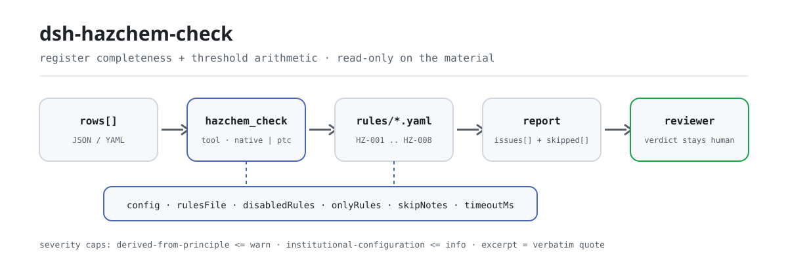

<div align="center">

<picture>
  <source media="(prefers-color-scheme: dark)" srcset="docs/assets/dsh-hazchem-check-flow-dark.svg">
  
</picture>

# dsh-hazchem-check

**Check a hazardous-chemical register and its major-hazard-source record for completeness and threshold arithmetic — you get a list of which row, which column, and what to fix; the verdict stays with the reviewer.**

A data-only checker plugin for DeepSeek Harness: it reads one hazardous-chemical register (the site header plus one row per substance), applies the versioned rule pack it ships (HZ-001..HZ-008), and lists only the differences it can point to inside the register — never a compliance verdict, never a liability finding.

[Install](#three-step-setup) · [Configuration](#configuration) · [FAQ](#faq) · [简体中文](README.md) · [English](README.en.md) · [Español](README.es.md) · [Português](README.pt.md) · [हिन्दी](README.hi.md)

[](LICENSE)
[](#compatibility)
[](https://www.npmjs.com/package/dsh-hazchem-check)
[](https://github.com/PerryLink/dsh-hazchem-check/actions/workflows/ci.yml)
[](#compatibility)

[](https://github.com/PerryLink/dsh-hazchem-check/stargazers)
[](https://www.npmjs.com/package/dsh-hazchem-check)
[](https://dshfind.com/plugins/PerryLink/dsh-hazchem-check?ref=badge)
[](https://securityscorecards.dev/viewer/?uri=github.com/PerryLink/dsh-hazchem-check)
[](https://dsh.market/)
[](https://gitee.com/perrylink/dsh-hazchem-check)

```sh
dsh plugin --profile <name> add dsh-hazchem-check
```

</div>

<sub>Community plugin, not affiliated with DeepSeek. Canonical repository: <https://github.com/PerryLink/dsh-hazchem-check> (Gitee is a mirror).</sub>

## What it is

`dsh-hazchem-check` reads one hazardous-chemical register together with its major-hazard-source identification record — the site header plus one row per substance — and checks that register's own completeness and arithmetic: that each substance carries a name and a hazard class, that the stored quantity parses as a number, that a threshold is recorded, that the "major hazard source" verdict agrees with how the stored quantity compares with the threshold the register itself states, that a stored substance records its safety data sheet number, that no CAS number is repeated, that the header declares the identification basis, and that no template placeholder survives in the name column.

It does not decide whether a unit constitutes a major hazard source, whether it must be registered, whether a safety assessment is required, or whether it is a major hidden danger.

- **Who it is for**: safety and hazardous-chemicals managers; no command line required — hand the material over in chat.
- **What you give it**: the source material the check works on (a table, register, or document); the original is never modified. Excel can be converted to JSON/YAML first, in chat if the platform supports it.
- **What you get back**: a list of "which row, which column, what is missing, how to fix it"; every check that could not run is listed in `skipped` with its reason.

## Three-step setup

1. **Install** (pick one channel):

   ```sh
   # git channel (latest main; equivalent to git+https://github.com/PerryLink/dsh-hazchem-check.git)
   dsh plugin --profile <name> add github:PerryLink/dsh-hazchem-check
   # npm channel (published releases)
   dsh plugin --profile <name> add dsh-hazchem-check
   # tarball channel: pnpm pack in this repo, then
   dsh plugin --profile <name> add ./dsh-hazchem-check-<version>.tgz
   ```

2. **Minimal config** (sane defaults; a bundle row without `config` uses every default, with the rule-pack path pointing at the bundled `rules/hazchem-check.yaml`):

   ```yaml
   - insert:
       - id: dsh-hazchem-check
         name: dsh-hazchem-check
   ```

3. **Verify it mounts** (the sample run needs `pnpm run build` first to produce `lib/`):

   ```sh
   dsh --profile <name> --dump-config | grep 'dsh-hazchem-check'
   node samples/quickstart/run.mjs --json
   # => {"tool":"hazchem_check","issueCount":1,"summary":{"error":0,"warn":1,"info":0},"skippedCount":0}
   ```

**Uninstall**: `dsh plugin --profile <name> remove dsh-hazchem-check` (or remove the row from the profile patch).

<details>
<summary>Use it in WorkBuddy / Coze</summary>

Search "Safety Compliance Suite" in WorkBuddy / Coze (this check is one part of it; availability as listed) to call the same checking capability without a command line.

</details>

<details>
<summary>Install from the DSH Desktop market</summary>

Every PerryLink plugin is listed in the built-in DSH Desktop market: **Market → Sources → Add source → paste** `https://perrylink-dsh-catalog.perrylink.workers.dev/catalog-source.json` **→ select**. Installation still requires the market's npm identity check and your confirmation.

</details>

## Core capabilities

`dsh-hazchem-check` registers the `hazchem_check` tool: it reads one hazardous-chemical register, applies a versioned rule pack, and returns a report.

- **Eight rules in one data pack** — the rule pack is data, not code (`rules/hazchem-check.yaml`); replacing it switches the whole rule set without touching a line of TypeScript.
- **Read-only on the material** — accepts JSON or YAML and never modifies the original; pure ESM, no network requests, no model calls.
- **No fabricated citations** — every rule carries `document` / `number` / `clause` / `excerpt` / `kind` / `source`; `excerpt` must be a verbatim quotation, and rules whose clause text could not be obtained this pass say so in the `excerpt` itself and stay marked `derived-from-principle`.
- **Severity follows the evidence** — `derived-from-principle` is capped at `warn`, institutional configuration (`institutional-configuration`) at `info`, and a test asserts it.
- **An empty issue list is never "nothing is wrong"** — every check that could not run is reported in `skipped` with its reason; a rule whose required list is unset reports itself in `skipped` rather than passing silently.
- **No adjudicating wording** — the report lists differences and never pronounces on compliance, liability, or correctness; a wording guard enforces this and every report carries the disclaimer.

| Rule | Check | Severity | Basis kind |
|---|---|---|---|
| `HZ-001` | the name and hazard class are recorded | warn | principle |
| `HZ-002` | the stored quantity parses as a number | warn | principle |
| `HZ-003` | the verdict agrees with quantity and threshold | warn | principle |
| `HZ-004` | a threshold is recorded | warn | principle |
| `HZ-005` | the header declares the identification basis | warn | principle |
| `HZ-006` | a stored chemical records its SDS number | warn | principle |
| `HZ-007` | CAS numbers are not duplicated | warn | principle |
| `HZ-008` | the name column holds no unreplaced placeholder | warn | principle |

### Examples

These are the plugin's real entry points; install once, then call one. The first row of the table below is the detailed walkthrough, the remaining rows are short cases. The detailed walkthrough is this plugin's **real output** on its own `HZ-002` test fixture — not a mock-up: the rule pack never fabricates citations, so every finding names the clause it applies and states that the clause text was not obtained this pass.

**Detailed example** — tool `hazchem_check`, input:

```json
{"rows":[{"化学品名称":"甲醇","最大储存量":"满罐","计量单位":"t"}]}
```

Output:

```json
{
  "id": "dsh-hazchem-check.HZ-002.de09b5a6",
  "ruleId": "HZ-002",
  "severity": "warn",
  "locator": {
    "field": "maxStorage",
    "row": 1
  },
  "found": "第 1 行「maxStorage」的值「满罐」无法解析为数字",
  "expected": "「maxStorage」应填写数字",
  "fix": "储存量应填写数值；本条只核对可解析性，不判断数量是否真实"
}
```

*Observed from `tests/fixtures/HZ-002/HZ-002-unsafe.json (cases.json expects HZ-002 count 1); run via lib/index.mjs rules/hazchem-check.yaml`*

| You ask | What it answers |
|---|---|
| The register says "no", but the stored quantity is above the threshold written beside it — is that caught? | Yes. `HZ-003` compares the two numbers the register itself carries and reports the row when the verdict disagrees with them. It does not decide whether the unit really is a major hazard source. |
| A row has no threshold at all. Does the check say anything? | Yes. `HZ-004` requires the threshold column to be filled on every row. It checks that a value is present, not that it is the right value for that substance — a `0` passes. |
| The chemical name is filled in but the hazard class is blank. | `HZ-001` requires both on each row and reports the row missing either one. It does not judge whether the class is correct. |
| The quantity column reads `1,500 kg` — will that still be read? | Yes. `HZ-002` takes the numeric part; only a quantity it cannot parse is reported. Whether the figure is true, or taken at the design maximum, is not checked. |
| Which rows must carry a safety data sheet number? | `HZ-006`: every row that has a stored quantity. The rule checks that the number is filled in, not that the sheet is complete or belongs to that substance. |
| The same CAS number appears twice, in two warehouses. | `HZ-007` reports a repeated CAS number, because it defeats both de-duplication and the quantity total. One substance split across warehouses is a legitimate shape: distinguish it in the storage-location column, or disable the rule. With no CAS column the rule reports that it could not run instead of passing silently. |

## Standards it follows

| Document | Number | Cited by rules |
|---|---|---|
| Regulation on the Safety Management of Hazardous Chemicals (canonical Chinese title recorded in `rules/evidence/`) | State Council Decree No. 591 (promulgated 2002-01-26 as Decree No. 344, revised at the 144th State Council executive meeting on 2011-02-16, in force 2011-12-01) | HZ-001, HZ-002, HZ-003, HZ-004, HZ-006, HZ-008 |
| Identification of Major Hazard Sources for Hazardous Chemicals | GB 18218—2018 (issued 2018-11-19, in force 2019-03-01; all technical content mandatory; supersedes GB 18218—2009) | HZ-002, HZ-003 |
| Identification of Major Hazard Sources for Hazardous Chemicals | GB 18218—2018 (clause text not obtained this pass) | HZ-005 |
| Regulation on the Safety Management of Hazardous Chemicals | State Council Decree No. 591 (clause text not obtained this pass) | HZ-007 |

**Boundary:** this plugin checks a **hazardous-chemical register together with its major-hazard-source identification record** for completeness and arithmetic — that each chemical names itself and its hazard class, that the stored quantity parses, that a threshold is recorded, that **the major-hazard-source verdict agrees with how the stored quantity compares to the threshold the register states**, that a stored chemical records its safety data sheet number, that CAS numbers are not duplicated, that the register declares its identification basis, and that no placeholder survives. It does **not** decide whether a unit constitutes a major hazard source, whether it must be registered, whether a safety assessment is required, or whether it is a major hidden danger.

> ### ⚠️ What the standard says, and the four errors this plugin cannot find
>
> **GB 18218—2018 was obtained and read verbatim** (see `rules/evidence/clause-verification-tables.md`): issued **2018-11-19, in force 2019-03-01**, with the foreword stating that **the entire technical content of this standard is mandatory** (quoted here in translation; the verbatim Chinese original is recorded in that evidence file) — the whole standard is mandatory — and it **supersedes GB 18218—2009** (the 2000 and 2009 editions are both withdrawn, so citing them is simply wrong). The definitions of threshold quantity (3.3), unit (3.2) and major hazard source (3.4), the determination rule 4.1.2, and **table 1's first 35 rows** are all quoted in that report.
>
> **Table 1 is complete only to row 35 and table 2 was not obtained**, so no threshold value is built in and none can be checked. `HZ-003` compares the stored quantity against the threshold **the register itself records** and checks that the verdict agrees. It therefore **cannot find four classes of error**, and its own note says so:
>
> 1. **A threshold taken from the wrong substance or hazard class** — 4.1.2 requires table 1 for listed substances and table 2 otherwise.
> 2. **A multi-hazard substance not given its lowest threshold** — 4.1.2 b) requires that where one hazardous chemical has several hazards, the lowest threshold among them applies (quoted in translation). Registers carry one figure, so rounding up misses a major hazard source.
> 3. **The multi-substance correction** — within one unit, `S = q₁/Q₁ + q₂/Q₂ + … + qₙ/Qₙ ≥ 1` also constitutes a major hazard source. **This plugin does not perform that summation**, because identification works per **production or storage unit** (3.2, 3.5, 3.6) while a register lists substances without unit grouping.
> 4. **The quantity basis** — 4.2.2 requires the quantity to be taken **at the design maximum**, while a register may record stock on hand.
>
> ⚠️ **Stay inside the standard's scope.** Clause 1 excludes **off-site transport of hazardous chemicals** (rail, road, water, air, pipeline), nuclear and military facilities, mining (except processing and storage), and offshore oil and gas extraction. Using this plugin on a **transport** consignment is out of scope — that is governed by dangerous-goods transport rules, not by GB 18218.
>
> A finding therefore means only "**the two numbers you wrote do not agree with your own verdict**". The four items above need a unit-by-unit calculation under the standard, which is a safety-assessment and regulator-determination task. **Every `excerpt` still says the clause text was not obtained, and every rule stays `warn` or `info`**, because what this plugin checks is a register's internal consistency, not whether a threshold value is correct.

## Configuration

All tunables are Schemastery `Config` fields in `src/config.ts` (changeable from cordis.yml); the per-rule thresholds live in the rule pack under `rules/`. An id-targeted override replaces the whole row — restate every key you need.

| Key | Type | Default | Description |
|---|---|---|---|
| `rulesFile` | string | `rules/hazchem-check.yaml` | Rule-pack path, relative to the package root |
| `disabledRules` | string[] | `[]` | Rule ids to stop running; each appears in `skipped` |
| `onlyRules` | string[] | `[]` | Run only these rule ids; empty runs every rule |
| `skipNotes` | string | `""` | Note appended to every `skipped` reason |
| `timeoutMs` | number | `120000` | Cooperative tool timeout budget |

Rule-level parameters worth knowing:

- `HZ-003` `valueField` / `limitField` / `verdictField` / `overValues` / `atMostValues` / `tolerance` — the stored-quantity, threshold and verdict columns plus the two verdict vocabularies. The shipped defaults are the Chinese register wording, so a register written in Chinese needs no configuration (see the block below).
- `HZ-008` `terms` — the placeholders to look for in the name column.

Default verdict vocabularies for `HZ-003`:

```yaml
overValues: [是, Y, yes, true, 构成, 重大危险源, √]
atMostValues: [否, N, no, false, 不构成, 未构成]
```

Example override in your profile patch:

```yaml
- insert:
    - id: dsh-hazchem-check
      name: dsh-hazchem-check
      config:
        disabledRules: [HZ-007]
        timeoutMs: 180000
```

## Material format

The tool accepts JSON or YAML:

```yaml
company: 某某化工有限公司
site: 某某厂区
assessmentAt: 2026-03-01
basis: GB 18218—2018 与 2025 年版危险化学品目录
rows:
  - { 序号: '1', 化学品名称: 甲醇, CAS号: 67-56-1, 危险性类别: 易燃液体,
      储存位置: 罐区 T-01, 最大储存量: '80', 计量单位: t, 临界量: '500',
      是否重大危险源: 否, 安全技术说明书编号: SDS-2026-0018, 保管人: 李工 }
```

Column names are matched case-insensitively and ignoring spaces, underscores and hyphens; the register's own column names are kept, so a finding names the column it read. Fields are optional at the reader layer and validated by the check engine, so a partially exported register produces "missing item" findings instead of a crash.

## Rule sources

Rule data lives in `rules/hazchem-check.yaml`, separated from the code: every rule carries document, number, clause in the source's own numbering, a verbatim excerpt, and a source URL. The pack's header states that the plugin holds no threshold table and performs no multi-substance correction, and each rule's `note` repeats the part that matters for that rule. The load-time guard still requires `document`, `clause`, `excerpt` and `source` on every rule, and still forbids a check whose basis is a principle only (`kind: derived-from-principle`, capped at `warn`) or an institutional configuration (`kind: institutional-configuration`, capped at `info`) from being marked `error`; an `excerpt` must be a real quotation of at least eight characters. A pack that overstates its basis fails at load time instead of producing a confident-looking report. The boundaries confirmed during verification and the conclusions deliberately **not** drawn ship in the bundled `rules/evidence/` directory.

## FAQ

<details>
<summary>Does it decide compliance for us?</summary>

No. It lists only the differences it can point to inside the material (which row, which column, what is missing, how to fix it) and decides neither facts nor compliance — the conclusion always stays with the reviewer. A wording guard enforces the report's wording, and every report carries the disclaimer.

</details>

<details>
<summary>My register is an Excel file. Can I use it directly?</summary>

Yes — convert it to JSON or YAML first; in chat the platform can do the conversion for you if supported. The tool only reads the material and never modifies the original.

</details>

<details>
<summary>Why did `HZ-003` not catch a unit that really is a major hazard source?</summary>

Because the pack ships no threshold value at all and does not perform GB 18218's multi-substance summation. `HZ-003` compares the stored quantity against the threshold **the register itself states** and checks that the verdict agrees with that comparison. Whether the threshold belongs to the right substance, whether a multi-hazard substance got its lowest threshold, and whether the quantity was taken at the design maximum all need a unit-by-unit calculation under the standard, done by a person.

</details>

<details>
<summary>Can an empty `issues` list be read as "nothing is wrong"?</summary>

No. Every check that could not run is listed in `skipped` with its reason (a missing CAS column, an unset required list). Some rules also check presence only: `HZ-004` passes a threshold of `0`. Read `issues` and `skipped` together before drawing any conclusion from a report.

</details>

<details>
<summary>Will it cope with a few hundred register rows at once?</summary>

The tool works in both `native` and `ptc` modes; for batch work (a whole register or directory) use `ptc`, where the schema cost is paid once. The checks themselves are local column matching and numeric comparison — no network requests, no model calls; `timeoutMs` (default 120 s) is the cooperative timeout budget.

</details>

## Troubleshooting

- **`HZ-003` passed a threshold I know is wrong.** It compares against the threshold the register states. Whether that value belongs to the right substance and hazard class is a substantive question it does not touch.
- **It did not flag a unit that should be a major hazard source.** It has no threshold table and does not perform GB 18218's multi-substance summation. Work the unit out under the standard yourself.
- **`HZ-004` passes a threshold of `0`.** The rule checks that the column is filled, not what it contains. Only a person comparing against the standard can judge the value.
- **`HZ-007` never runs.** The register records no CAS numbers. Without a unique identifier the rule reports that it could not run rather than checking the wrong column.
- **`HZ-007` fires on one substance in two warehouses.** That is a legitimate register shape — say so in the storage-location column and disable the rule if your register is organised that way.
- **A rule did not run.** Read the `skipped` array; it names the rule id and the reason.
- **The plugin installs but the tool never appears.** Check that `main` resolves to `lib/index.mjs` and that `pnpm run build` produced it; a wrong `main` makes the loader skip the entry silently.
- **`dsh plugin add` refuses the package as incompatible.** The peer range covers `0.1.x` and `0.2.x`; if your runtime sits outside it, grant an explicit exemption: `dsh plugin --profile <name> allow-version dsh-hazchem-check@0.1.0 --dsh-version <runtime> --accept-risk`
- **`check` reports `manifest-peers` as failed.** The static checker compares against a hard-coded peer range that predates the 0.2 line. The runtime enforces peer compatibility at install time, so the declared range is the correct one; this is a known upstream issue in `dsh-plugin-dev`.
- **Times look shifted.** All arithmetic is wall-clock on the input strings, with no timezone conversion.

## Compatibility

| Surface | Status |
|---|---|
| Harness | Peer range `>=0.1.2-rc.1 <0.2.0 \|\| >=0.2.0-0 <0.3.0` — verified to accept both `0.2.0-rc.2` and `0.2.1-rc.2`. `engines.dsh` is declared as `>=0.2.1-0 <0.3.0` and is enforced by the host since 0.2.1 |
| Node | `^22.19.0 \|\| >=24.0.0` |
| Platforms | All (plain ESM; no native code, no network, no model call) |
| Tool mode | Works in `native` and `ptc`; for a whole register use `ptc` |

## Ecosystem & quality

- [Gitee mirror](https://gitee.com/perrylink/dsh-hazchem-check) (sync mirror; GitHub is canonical)
- [dshfind plugin page](https://dshfind.com/plugins/PerryLink/dsh-hazchem-check) (installs and ranking)
- [OpenSSF Scorecard report](https://securityscorecards.dev/viewer/?uri=github.com/PerryLink/dsh-hazchem-check) (driven by [.github/workflows/scorecard.yml](.github/workflows/scorecard.yml))
- [DSH Market](https://dsh.market/) (listed)
- **1024 store channel**: `npm i -g dsh1024` once, then `dsh1024 plugin --profile <name> add dsh-hazchem-check` (counts toward the [deepseek1024.com](https://deepseek1024.com) install ranking)
- [Ecosystem knowledge base](https://perrylink.github.io/dsh-plugin-guide/) — plugin development guide · measured selection data · maintenance criteria

## Development

```sh
pnpm install                                        # node ^22.19 || >=24
pnpm run typecheck                                  # tsc --noEmit
pnpm test                                           # vitest: shared table-plugin suite + paired fixtures
pnpm run build                                      # tsdown -> lib/index.mjs + lib/index.d.mts
pnpm run verify:self-contained                      # dependency specs resolve from the registry
pnpm run check:lockfile                             # lockfile drift check
pnpm run check:readmes                              # five-language README consistency
pnpm run check:citations                            # rule-pack citation baseline
node ../scripts/sync-shared.mjs dsh-hazchem-check   # refresh src/shared from ../_shared
pnpm pack                                           # the published tarball
```

The plugin is **data-only**: `src/model.ts` declares the table shape, the shared kit supplies the reader and the check engine, and the rule pack declares every check. Local sample run (needs `pnpm run build` first to produce `lib/`):

```sh
node samples/quickstart/run.mjs --json
# => {"tool":"hazchem_check","issueCount":1,"summary":{"error":0,"warn":1,"info":0},"skippedCount":0}
```

The sample input lives in `samples/quickstart/input/`, the expected output in `samples/quickstart/expected/result.json`, and a screenshot in `docs/assets/quickstart.png`. The README images are generated programmatically by [`scripts/gen-readme-assets.py`](scripts/gen-readme-assets.py) (Python + Pillow) and are safe to re-run; the older single-skin flow diagram and demo images stay in `docs/assets/` for external deep links, while the READMEs reference only the new light/dark pair.

Topics: `deepseek-harness`, `dsh`, `dsh-plugin`, `cordis`, `hazchem`

## Family & thanks

This project is part of the DeepSeek Harness plugin family from [PerryLink](https://github.com/PerryLink) (all Apache-2.0). Full family index: [choose a checker by material](https://perrylink.github.io/zh/checkers/choose/) and [all plugins](https://github.com/PerryLink). If it is useful, **a star helps the next person find it** — nothing is gated behind it.

- [@PerryLink](https://github.com/PerryLink) — creator and maintainer: the data-only rule pack (HZ-001..HZ-008), the `hazchem_check` tool, the GB 18218—2018 clause-verification record, and the five-language docs.

<details>
<summary>Expand all plugins</summary>

| Plugin | Status |
|---|---|
| **[dsh-aqua-input-check](https://github.com/PerryLink/dsh-aqua-input-check)** |  |
| **[dsh-archive-check](https://github.com/PerryLink/dsh-archive-check)** |  |
| **[dsh-auto-review](https://github.com/PerryLink/dsh-auto-review)** |  |
| **[dsh-autotier](https://github.com/PerryLink/dsh-autotier)** | 🧊 FROZEN — see the repo README |
| **[dsh-bid-ca-precheck](https://github.com/PerryLink/dsh-bid-ca-precheck)** |  |
| **[dsh-bid-qual-check](https://github.com/PerryLink/dsh-bid-qual-check)** |  |
| **[dsh-cert-mcp](https://github.com/PerryLink/dsh-cert-mcp)** | 🧊 FROZEN — see the repo README |
| **[dsh-checkpoint-rewind](https://github.com/PerryLink/dsh-checkpoint-rewind)** |  |
| **[dsh-click](https://github.com/PerryLink/dsh-click)** |  |
| **[dsh-composer-history](https://github.com/PerryLink/dsh-composer-history)** |  |
| **[dsh-contract-stance](https://github.com/PerryLink/dsh-contract-stance)** |  |
| **[dsh-customs-doc-check](https://github.com/PerryLink/dsh-customs-doc-check)** |  |
| **[dsh-data-quality](https://github.com/PerryLink/dsh-data-quality)** | 🧊 FROZEN — see the repo README |
| **[dsh-demurrage-ledger](https://github.com/PerryLink/dsh-demurrage-ledger)** |  |
| **[dsh-doublecheck](https://github.com/PerryLink/dsh-doublecheck)** |  |
| **[dsh-drill-script-check](https://github.com/PerryLink/dsh-drill-script-check)** |  |
| **[dsh-eia-guide-check](https://github.com/PerryLink/dsh-eia-guide-check)** |  |
| **[dsh-emergency-plan](https://github.com/PerryLink/dsh-emergency-plan)** |  |
| **[dsh-essay-rubric-check](https://github.com/PerryLink/dsh-essay-rubric-check)** |  |
| **[dsh-evidence-check](https://github.com/PerryLink/dsh-evidence-check)** |  |
| **[dsh-export-ctl-check](https://github.com/PerryLink/dsh-export-ctl-check)** |  |
| **[dsh-fast](https://github.com/PerryLink/dsh-fast)** |  |
| **[dsh-fmea-table-check](https://github.com/PerryLink/dsh-fmea-table-check)** |  |
| **[dsh-forecast-penalty](https://github.com/PerryLink/dsh-forecast-penalty)** |  |
| **[dsh-fund-research](https://github.com/PerryLink/dsh-fund-research)** |  |
| **[dsh-github](https://github.com/PerryLink/dsh-github)** |  |
| **[dsh-gongwen-flow-check](https://github.com/PerryLink/dsh-gongwen-flow-check)** |  |
| **[dsh-gongwen-word-check](https://github.com/PerryLink/dsh-gongwen-word-check)** |  |
| **[dsh-guard-plan-qc](https://github.com/PerryLink/dsh-guard-plan-qc)** |  |
| **[dsh-hazchem-check](https://github.com/PerryLink/dsh-hazchem-check)** |  |
| **[dsh-hazplan-check](https://github.com/PerryLink/dsh-hazplan-check)** |  |
| **[dsh-hidden-risk-map](https://github.com/PerryLink/dsh-hidden-risk-map)** |  |
| **[dsh-hs-classify](https://github.com/PerryLink/dsh-hs-classify)** |  |
| **[dsh-icd-rule-check](https://github.com/PerryLink/dsh-icd-rule-check)** |  |
| **[dsh-industry-research](https://github.com/PerryLink/dsh-industry-research)** |  |
| **[dsh-lawcite-adapter](https://github.com/PerryLink/dsh-lawcite-adapter)** |  |
| **[dsh-laya](https://github.com/PerryLink/dsh-laya)** |  |
| **[dsh-lc-doc-check](https://github.com/PerryLink/dsh-lc-doc-check)** |  |
| **[dsh-learning-gap-check](https://github.com/PerryLink/dsh-learning-gap-check)** |  |
| **[dsh-library](https://github.com/PerryLink/dsh-library)** |  |
| **[dsh-local-ai](https://github.com/PerryLink/dsh-local-ai)** |  |
| **[dsh-lsp-actions](https://github.com/PerryLink/dsh-lsp-actions)** |  |
| **[dsh-mask](https://github.com/PerryLink/dsh-mask)** |  |
| **[dsh-mcp-panel](https://github.com/PerryLink/dsh-mcp-panel)** |  |
| **[dsh-medrec-qc](https://github.com/PerryLink/dsh-medrec-qc)** |  |
| **[dsh-memento](https://github.com/PerryLink/dsh-memento)** | 🧊 FROZEN — see the repo README |
| **[dsh-nsfc-form-check](https://github.com/PerryLink/dsh-nsfc-form-check)** |  |
| **[dsh-nurse-record-check](https://github.com/PerryLink/dsh-nurse-record-check)** |  |
| **[dsh-observe](https://github.com/PerryLink/dsh-observe)** |  |
| **[dsh-origin-rvc-check](https://github.com/PerryLink/dsh-origin-rvc-check)** |  |
| **[dsh-ota-review-check](https://github.com/PerryLink/dsh-ota-review-check)** |  |
| **[dsh-output-styles](https://github.com/PerryLink/dsh-output-styles)** |  |
| **[dsh-paper-doc-adapter](https://github.com/PerryLink/dsh-paper-doc-adapter)** |  |
| **[dsh-permission-rules](https://github.com/PerryLink/dsh-permission-rules)** |  |
| **[dsh-permit-report-check](https://github.com/PerryLink/dsh-permit-report-check)** |  |
| **[dsh-pipeline-check](https://github.com/PerryLink/dsh-pipeline-check)** |  |
| **[dsh-pleading-draft](https://github.com/PerryLink/dsh-pleading-draft)** |  |
| **[dsh-plugin-doctor](https://github.com/PerryLink/dsh-plugin-doctor)** | 🚫 RETIRED (repo archived) |
| **[dsh-plugin-guide](https://github.com/PerryLink/dsh-plugin-guide)** |  |
| **[dsh-plugin-kit](https://github.com/PerryLink/dsh-plugin-kit)** | 🚫 RETIRED (repo archived) |
| **[dsh-plugin-upgrade](https://github.com/PerryLink/dsh-plugin-upgrade)** | 🚫 RETIRED (repo archived) |
| **[dsh-policy-brief-draft](https://github.com/PerryLink/dsh-policy-brief-draft)** |  |
| **[dsh-power-loss-split](https://github.com/PerryLink/dsh-power-loss-split)** |  |
| **[dsh-power-ticket-check](https://github.com/PerryLink/dsh-power-ticket-check)** |  |
| **[dsh-ppap-check](https://github.com/PerryLink/dsh-ppap-check)** |  |
| **[dsh-protest-deadline](https://github.com/PerryLink/dsh-protest-deadline)** |  |
| **[dsh-railway-window](https://github.com/PerryLink/dsh-railway-window)** |  |
| **[dsh-repair-order-qc](https://github.com/PerryLink/dsh-repair-order-qc)** |  |
| **[dsh-research-report](https://github.com/PerryLink/dsh-research-report)** |  |
| **[dsh-review-reply-check](https://github.com/PerryLink/dsh-review-reply-check)** |  |
| **[dsh-rulefile-check](https://github.com/PerryLink/dsh-rulefile-check)** |  |
| **[dsh-safety-brief-check](https://github.com/PerryLink/dsh-safety-brief-check)** |  |
| **[dsh-score](https://github.com/PerryLink/dsh-score)** | 🧊 FROZEN — see the repo README |
| **[dsh-session-sync](https://github.com/PerryLink/dsh-session-sync)** |  |
| **[dsh-site-log-check](https://github.com/PerryLink/dsh-site-log-check)** |  |
| **[dsh-skill-pack-security](https://github.com/PerryLink/dsh-skill-pack-security)** |  |
| **[dsh-soe-decision-check](https://github.com/PerryLink/dsh-soe-decision-check)** |  |
| **[dsh-soilwater-check](https://github.com/PerryLink/dsh-soilwater-check)** |  |
| **[dsh-sop-sync-check](https://github.com/PerryLink/dsh-sop-sync-check)** |  |
| **[dsh-spc-gbt-adapter](https://github.com/PerryLink/dsh-spc-gbt-adapter)** |  |
| **[dsh-talk](https://github.com/PerryLink/dsh-talk)** |  |
| **[dsh-tender-extract](https://github.com/PerryLink/dsh-tender-extract)** |  |
| **[dsh-tender-matrix](https://github.com/PerryLink/dsh-tender-matrix)** |  |
| **[dsh-test-drive](https://github.com/PerryLink/dsh-test-drive)** |  |
| **[dsh-ticktick](https://github.com/PerryLink/dsh-ticktick)** | 🚫 RETIRED (repo archived) |
| **[dsh-translate](https://github.com/PerryLink/dsh-translate)** |  |
| **[dsh-warranty-calc](https://github.com/PerryLink/dsh-warranty-calc)** |  |
| **[dsh-budget](https://github.com/PerryLink/dsh-budget)** | 🧊 FROZEN — see the repo README |
| **[dsh-claude-move](https://github.com/PerryLink/dsh-claude-move)** | 🧊 FROZEN — see the repo README |
| **[dsh-defend](https://github.com/PerryLink/dsh-defend)** | 🧊 FROZEN — see the repo README |
| **[dsh-draw](https://github.com/PerryLink/dsh-draw)** | 🧊 FROZEN — see the repo README |
| **[dsh-reach](https://github.com/PerryLink/dsh-reach)** | 🧊 FROZEN — see the repo README |
| **[dsh-background-agents](https://github.com/PerryLink/dsh-background-agents)** | 🚫 RETIRED (repo archived) |
| **[dsh-session-pin](https://github.com/PerryLink/dsh-session-pin)** | 🚫 RETIRED (repo archived) |
| **[dsh-team-rooms](https://github.com/PerryLink/dsh-team-rooms)** | 🚫 RETIRED (repo archived) |

</details>

## License

[LICENSE](LICENSE) (Apache License 2.0) © 2026 dsh-hazchem-check contributors

<p align="center"><sub>Apache-2.0 · Community plugin, not affiliated with DeepSeek.</sub></p>
