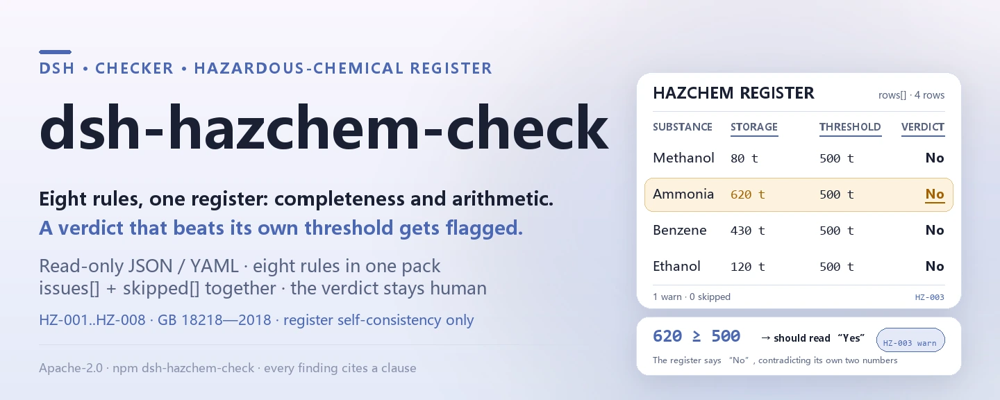
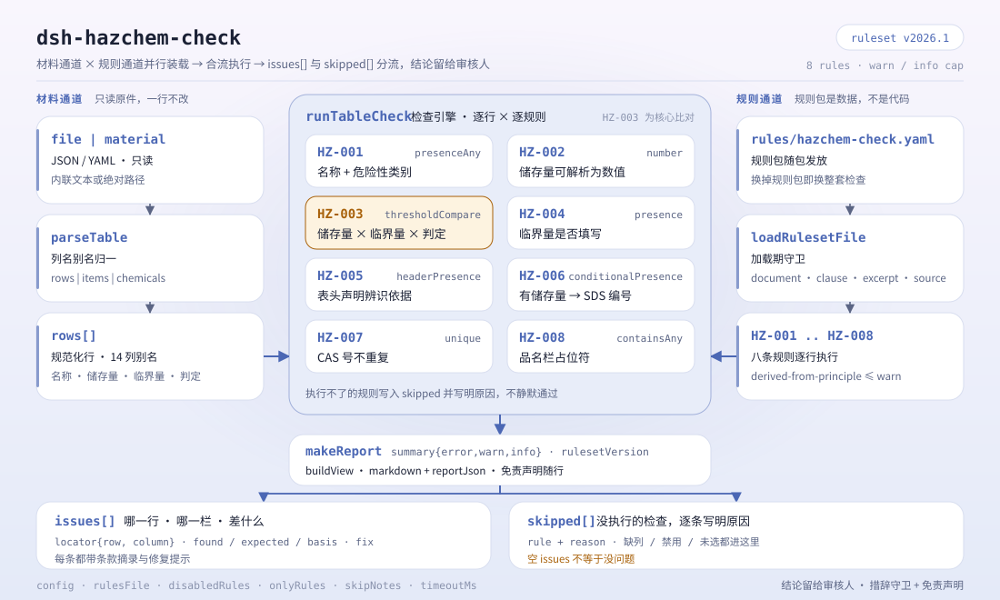

<div align="center">

<picture>
  <source media="(prefers-color-scheme: dark)" srcset="docs/assets/dsh-hazchem-check-hero-en-dark.webp">
  
</picture>

# dsh-hazchem-check

**Comprueba la completitud y la aritmética de umbrales de un registro de productos químicos peligrosos y de su identificación de fuentes de peligro mayor: obtiene una lista de qué fila, qué columna y qué falta; el veredicto queda en manos del revisor.**

Complemento verificador de solo datos para DeepSeek Harness: lee un registro de productos químicos peligrosos (la cabecera del emplazamiento más una fila por sustancia), aplica el paquete de reglas versionado que trae (HZ-001..HZ-008) y enumera solo las diferencias que puede señalar dentro del registro: nunca un veredicto de cumplimiento, nunca una atribución de responsabilidad.

[Instalar](#instalación-en-tres-pasos) · [Configuración](#configuración) · [FAQ](#faq) · [简体中文](README.md) · [English](README.en.md) · [Español](README.es.md) · [Português](README.pt.md) · [हिन्दी](README.hi.md)

[](LICENSE)
[](#compatibilidad)
[](https://www.npmjs.com/package/dsh-hazchem-check)
[](https://github.com/PerryLink/dsh-hazchem-check/actions/workflows/ci.yml)
[](#compatibilidad)

[](https://github.com/PerryLink/dsh-hazchem-check/stargazers)
[](https://www.npmjs.com/package/dsh-hazchem-check)
[](https://dshfind.com/plugins/PerryLink/dsh-hazchem-check?ref=badge)
[](https://securityscorecards.dev/viewer/?uri=github.com/PerryLink/dsh-hazchem-check)
[](https://dsh.market/)
[](https://gitee.com/perrylink/dsh-hazchem-check)

```sh
dsh plugin --profile <name> add dsh-hazchem-check
```

</div>

<sub>Complemento de la comunidad, sin relación con DeepSeek. Repositorio canónico: <https://github.com/PerryLink/dsh-hazchem-check> (Gitee es un espejo).</sub>

## Qué es

`dsh-hazchem-check` lee un registro de productos químicos peligrosos junto con su registro de identificación de fuentes de peligro mayor —la cabecera del emplazamiento más una fila por sustancia— y comprueba la completitud y la aritmética de ese mismo registro: que cada sustancia lleve nombre y clase de peligro, que la cantidad almacenada se pueda analizar como número, que haya un umbral registrado, que el veredicto de «fuente de peligro mayor» concuerde con la relación entre la cantidad almacenada y el umbral que el propio registro declara, que toda sustancia almacenada registre su número de ficha de datos de seguridad, que no se repita ningún número CAS, que la cabecera declare su base de identificación y que no quede ningún marcador de plantilla en la columna de nombre.

No decide si una unidad constituye una fuente de peligro mayor, si debe registrarse, si hace falta una evaluación de seguridad ni si es un peligro oculto mayor.

- **Para quién**: responsables de seguridad y de productos químicos peligrosos; no hace falta usar la línea de comandos, basta con entregar el material en el chat.
- **Qué le entrega**: el material original sobre el que trabaja la comprobación (una tabla, un registro o un documento); el original nunca se modifica. Excel se puede convertir antes a JSON/YAML, incluso en el chat si la plataforma lo permite.
- **Qué recibe**: una lista de «qué fila, qué columna, qué falta, cómo corregirlo»; cada comprobación que no pudo ejecutarse aparece en `skipped` con su motivo.

<picture>
  <source media="(prefers-color-scheme: dark)" srcset="docs/assets/dsh-hazchem-check-flow-v5-dark.svg">
  
</picture>

## Instalación en tres pasos

1. **Instalar** (elija un canal):

   ```sh
   # canal git (último main; equivale a git+https://github.com/PerryLink/dsh-hazchem-check.git)
   dsh plugin --profile <name> add github:PerryLink/dsh-hazchem-check
   # canal npm (versiones publicadas)
   dsh plugin --profile <name> add dsh-hazchem-check
   # canal tarball: tras pnpm pack en este repositorio
   dsh plugin --profile <name> add ./dsh-hazchem-check-<version>.tgz
   ```

2. **Configuración mínima** (los valores por defecto ya sirven; una fila de bundle sin `config` usa todos los valores por defecto, con la ruta del paquete de reglas apuntando al `rules/hazchem-check.yaml` incluido):

   ```yaml
   - insert:
       - id: dsh-hazchem-check
         name: dsh-hazchem-check
   ```

3. **Comprobar que quedó montado** (la prueba de ejemplo requiere `pnpm run build` antes, para generar `lib/`):

   ```sh
   dsh --profile <name> --dump-config | grep 'dsh-hazchem-check'
   node samples/quickstart/run.mjs --json
   # => {"tool":"hazchem_check","issueCount":1,"summary":{"error":0,"warn":1,"info":0},"skippedCount":0}
   ```

**Desinstalar**: `dsh plugin --profile <name> remove dsh-hazchem-check` (o borre la fila del patch del perfil).

<details>
<summary>Usarlo en WorkBuddy / Coze</summary>

Busque «Safety Compliance Suite» en WorkBuddy / Coze (el conjunto completo; esta comprobación es una de sus partes; disponibilidad según el catálogo) para usar la misma capacidad de verificación sin línea de comandos.

</details>

<details>
<summary>Instalar desde el mercado de DSH Desktop</summary>

Todos los complementos de PerryLink aparecen en el mercado integrado de DSH Desktop: **Mercado → Fuentes → Añadir fuente → pegar** `https://perrylink-dsh-catalog.perrylink.workers.dev/catalog-source.json` **→ seleccionar**. La instalación sigue exigiendo la verificación de identidad npm del mercado y su confirmación.

</details>

## Capacidades clave

`dsh-hazchem-check` registra la herramienta `hazchem_check`: lee un registro de productos químicos peligrosos, aplica un paquete de reglas versionado y devuelve un informe.

- **Ocho reglas en un paquete de datos** — el paquete de reglas es datos, no código (`rules/hazchem-check.yaml`); sustituirlo cambia todo el conjunto de reglas sin tocar una línea de TypeScript.
- **Solo lectura sobre el material** — acepta JSON o YAML y nunca modifica el original; ESM puro, sin peticiones de red y sin llamadas al modelo.
- **Ninguna cita inventada** — cada regla lleva `document` / `number` / `clause` / `excerpt` / `kind` / `source`; `excerpt` debe ser una cita literal, y las reglas cuyo texto no se obtuvo en esta pasada lo dicen en el propio `excerpt` y quedan marcadas como `derived-from-principle`.
- **La gravedad sigue a la evidencia** — `derived-from-principle` tiene tope `warn`, la configuración institucional (`institutional-configuration`) tope `info`, y una prueba lo verifica.
- **Una lista vacía nunca significa «no hay nada mal»** — cada comprobación que no pudo ejecutarse se informa en `skipped` con su motivo; una regla cuya lista obligatoria no está configurada se declara a sí misma en `skipped` en lugar de pasar en silencio.
- **Redacción que no adjudica** — el informe enumera diferencias y nunca se pronuncia sobre cumplimiento, responsabilidad o corrección; un guardián de redacción lo impone y todo informe lleva el descargo de responsabilidad.

| Regla | Comprobación | Gravedad | Tipo de base |
|---|---|---|---|
| `HZ-001` | el nombre y la clase de peligro están registrados | warn | principle |
| `HZ-002` | la cantidad almacenada se analiza como número | warn | principle |
| `HZ-003` | el veredicto concuerda con la cantidad y el umbral | warn | principle |
| `HZ-004` | hay un umbral registrado | warn | principle |
| `HZ-005` | la cabecera declara la base de identificación | warn | principle |
| `HZ-006` | una sustancia almacenada registra su número de ficha de datos de seguridad | warn | principle |
| `HZ-007` | los números CAS no se repiten | warn | principle |
| `HZ-008` | la columna de nombre no conserva marcadores sin sustituir | warn | principle |

### Ejemplos

Estos son los puntos de entrada reales del complemento; instálelo una vez y llame a uno. La primera fila de la tabla siguiente es el caso detallado y las demás son casos breves. El caso detallado es la **salida real** de este complemento sobre su propio fixture de prueba `HZ-002`, no un montaje: el paquete de reglas no inventa citas, así que cada hallazgo nombra la cláusula aplicada y advierte que su texto no se obtuvo en esta pasada.

**Ejemplo detallado** — herramienta `hazchem_check`, entrada:

```json
{"rows":[{"化学品名称":"甲醇","最大储存量":"满罐","计量单位":"t"}]}
```

Salida:

```json
{
  "id": "dsh-hazchem-check.HZ-002.de09b5a6",
  "ruleId": "HZ-002",
  "severity": "warn",
  "locator": {
    "field": "maxStorage",
    "row": 1
  },
  "found": "第 1 行「maxStorage」的值「满罐」无法解析为数字",
  "expected": "「maxStorage」应填写数字",
  "fix": "储存量应填写数值；本条只核对可解析性，不判断数量是否真实"
}
```

*Observed from `tests/fixtures/HZ-002/HZ-002-unsafe.json (cases.json expects HZ-002 count 1); run via lib/index.mjs rules/hazchem-check.yaml`*

| Usted pregunta | Qué responde |
|---|---|
| El registro dice «否», pero la cantidad almacenada supera el umbral escrito al lado, ¿se detecta? | Sí. `HZ-003` compara los dos números que el propio registro contiene y señala la fila cuando el veredicto no concuerda con ellos. No decide si la unidad constituye realmente una fuente de peligro mayor. |
| Una fila no tiene umbral. ¿Se informa de algo? | Sí. `HZ-004` exige que la columna de umbral esté completa en todas las filas. Comprueba que haya un valor, no que sea el valor correcto para esa sustancia: un `0` pasa. |
| El nombre está puesto, pero la clase de peligro está vacía. | `HZ-001` exige ambos en cada fila y señala la fila a la que le falta uno de los dos. No juzga si la clase es correcta. |
| La cantidad figura como `1,500 kg`, ¿se lee igualmente? | Sí. `HZ-002` toma la parte numérica y solo informa de una cantidad que no puede analizar. No comprueba si la cifra es real ni si se tomó en el máximo de diseño. |
| ¿Qué filas deben llevar número de ficha de datos de seguridad? | `HZ-006`: toda fila con cantidad almacenada. La regla comprueba que el número esté puesto, no que la ficha esté completa o corresponda a esa sustancia. |
| El mismo número CAS aparece dos veces, en dos almacenes. | `HZ-007` informa de un número CAS repetido, porque impide tanto la deduplicación como el total de cantidades. Una sustancia repartida entre almacenes es una forma legítima: distíngala en la columna de ubicación o desactive la regla. Sin columna CAS, la regla informa de que no pudo ejecutarse en lugar de pasar en silencio. |

## Normas que sigue

| Documento | Número | Reglas que lo citan |
|---|---|---|
| Reglamento de gestión de la seguridad de los productos químicos peligrosos (título chino canónico en `rules/evidence/`) | Decreto del Consejo de Estado n.º 591 (promulgado el 2002-01-26 como Decreto n.º 344, revisado en la 144.ª reunión ejecutiva del Consejo de Estado el 2011-02-16, en vigor desde el 2011-12-01) | HZ-001, HZ-002, HZ-003, HZ-004, HZ-006, HZ-008 |
| Identificación de fuentes de peligro mayor de productos químicos peligrosos | GB 18218—2018 (publicada el 2018-11-19, en vigor el 2019-03-01; todo el contenido técnico es obligatorio; sustituye a GB 18218—2009) | HZ-002, HZ-003 |
| Identificación de fuentes de peligro mayor de productos químicos peligrosos | GB 18218—2018 (texto de los artículos no obtenido en esta pasada) | HZ-005 |
| Reglamento de gestión de la seguridad de los productos químicos peligrosos | Decreto del Consejo de Estado n.º 591 (texto de los artículos no obtenido en esta pasada) | HZ-007 |

**Límite:** este complemento comprueba la completitud y la aritmética de un **registro de productos químicos peligrosos junto con su registro de identificación de fuentes de peligro mayor** — que cada producto químico se nombre a sí mismo y a su clase de peligro, que la cantidad almacenada se analice, que haya un umbral registrado, que **el veredicto de fuente de peligro mayor concuerde con la relación entre la cantidad almacenada y el umbral que el registro declara**, que toda sustancia almacenada registre su número de ficha de datos de seguridad, que los números CAS no se repitan, que el registro declare su base de identificación y que no queden marcadores. **No** decide si una unidad constituye una fuente de peligro mayor, si debe registrarse, si hace falta una evaluación de seguridad ni si es un peligro oculto mayor.

> ### ⚠️ Qué dice la norma y cuáles son los cuatro errores que este complemento no puede encontrar
>
> **GB 18218—2018 se obtuvo y se leyó literalmente** (véase `rules/evidence/clause-verification-tables.md`): publicada el **2018-11-19, en vigor el 2019-03-01**, con un prólogo que declara que **todo el contenido técnico de esta norma es obligatorio** (citado aquí en traducción; el original chino literal está en ese archivo de evidencia) — la norma entera es obligatoria — y **sustituye a GB 18218—2009** (las ediciones de 2000 y 2009 están derogadas, así que citarlas es simplemente un error). Las definiciones de cantidad umbral (3.3), unidad (3.2) y fuente de peligro mayor (3.4), la regla de determinación 4.1.2 y **las primeras 35 filas de la tabla 1** están citadas en ese informe.
>
> **La tabla 1 solo está completa hasta la fila 35 y la tabla 2 no se obtuvo**, así que no hay ningún valor de umbral incorporado y ninguno se puede comprobar. `HZ-003` compara la cantidad almacenada con el umbral **que el propio registro registra** y comprueba que el veredicto concuerde. Por eso **no puede encontrar cuatro clases de error**, y su propia nota lo dice:
>
> 1. **Un umbral tomado de la sustancia o la clase de peligro equivocadas** — 4.1.2 exige la tabla 1 para las sustancias listadas y la tabla 2 en los demás casos.
> 2. **Una sustancia con varias peligrosidades a la que no se le da su umbral más bajo** — 4.1.2 b) exige que, cuando un producto químico peligroso tiene varias peligrosidades, se aplique el umbral más bajo de todas (citado en traducción). El registro lleva una sola cifra, así que redondear hacia arriba deja fuera una fuente de peligro mayor.
> 3. **La corrección multi-sustancia** — dentro de una unidad, `S = q₁/Q₁ + q₂/Q₂ + … + qₙ/Qₙ ≥ 1` también constituye una fuente de peligro mayor. **Este complemento no realiza esa suma**, porque la identificación se hace por **unidad de producción o almacenamiento** (3.2, 3.5, 3.6) y un registro enumera sustancias sin agruparlas por unidad.
> 4. **La base de la cantidad** — 4.2.2 exige tomar la cantidad **en el máximo de diseño**, mientras que un registro puede anotar existencias reales.
>
> ⚠️ **No salga del alcance de la norma.** El artículo 1 excluye el **transporte de productos químicos peligrosos fuera del emplazamiento** (ferrocarril, carretera, vía fluvial, aéreo, tubería), las instalaciones nucleares y militares, la minería (salvo el procesamiento y el almacenamiento) y la extracción marina de petróleo y gas. Usar este complemento con un envío en **transporte** queda fuera de alcance: eso lo rigen las normas de transporte de mercancías peligrosas, no la GB 18218.
>
> Por tanto, un hallazgo solo significa «**los dos números que usted escribió no concuerdan con su propio veredicto**». Los cuatro puntos anteriores requieren un cálculo unidad por unidad bajo la norma, que es tarea de la evaluación de seguridad y de la determinación regulatoria. **Cada `excerpt` sigue diciendo que el texto no se obtuvo, y cada regla sigue en `warn` o `info`**, porque lo que este complemento comprueba es la consistencia interna de un registro, no si un valor de umbral es correcto.

## Configuración

Todos los parámetros ajustables son campos `Config` de Schemastery en `src/config.ts` (modificables desde cordis.yml); los umbrales por regla viven en el paquete de reglas bajo `rules/`. Una anulación dirigida por id reemplaza la fila entera: repita todas las claves que necesite.

| Clave | Tipo | Predeterminado | Descripción |
|---|---|---|---|
| `rulesFile` | string | `rules/hazchem-check.yaml` | Ruta del paquete de reglas, relativa a la raíz del paquete |
| `disabledRules` | string[] | `[]` | Ids de reglas que se dejan de ejecutar; cada una aparece en `skipped` |
| `onlyRules` | string[] | `[]` | Ejecutar solo estas reglas; vacío ejecuta todas |
| `skipNotes` | string | `""` | Nota añadida a cada motivo de `skipped` |
| `timeoutMs` | number | `120000` | Presupuesto de tiempo de espera cooperativo de la herramienta |

Parámetros por regla que conviene conocer:

- `HZ-003` `valueField` / `limitField` / `verdictField` / `overValues` / `atMostValues` / `tolerance` — las columnas de cantidad almacenada, umbral y veredicto, más los dos vocabularios de veredicto. Los valores por defecto son la redacción del registro chino, así que un registro escrito en chino no necesita configuración:

  ```yaml
  overValues: [是, Y, yes, true, 构成, 重大危险源, √]
  atMostValues: [否, N, no, false, 不构成, 未构成]
  ```

- `HZ-008` `terms` — los marcadores que se buscan en la columna de nombre.

Ejemplo de anulación en el patch del perfil:

```yaml
- insert:
    - id: dsh-hazchem-check
      name: dsh-hazchem-check
      config:
        disabledRules: [HZ-007]
        timeoutMs: 180000
```

## Formato del material

La herramienta acepta JSON o YAML:

```yaml
company: 某某化工有限公司
site: 某某厂区
assessmentAt: 2026-03-01
basis: GB 18218—2018 与 2025 年版危险化学品目录
rows:
  - { 序号: '1', 化学品名称: 甲醇, CAS号: 67-56-1, 危险性类别: 易燃液体,
      储存位置: 罐区 T-01, 最大储存量: '80', 计量单位: t, 临界量: '500',
      是否重大危险源: 否, 安全技术说明书编号: SDS-2026-0018, 保管人: 李工 }
```

Los nombres de columna se comparan sin distinguir mayúsculas y minúsculas y omitiendo espacios, guiones bajos y guiones; se conservan los nombres de columna del propio registro, así que el hallazgo nombra la columna que realmente leyó. Los campos son opcionales en la capa de lectura y los valida el motor de comprobación, de modo que un registro exportado parcialmente produce hallazgos de «falta un dato» en lugar de un fallo.

## Fuentes de las reglas

Los datos de las reglas están en `rules/hazchem-check.yaml`, separados del código: cada regla lleva documento, número, cláusula en la numeración propia de la fuente, extracto literal y URL de origen. La cabecera del paquete declara que el complemento no incorpora ninguna tabla de umbrales y no realiza ninguna corrección multi-sustancia, y la `note` de cada regla repite la parte que le concierne. El guardián de carga sigue exigiendo `document`, `clause`, `excerpt` y `source` en cada regla, y sigue prohibiendo que una comprobación basada solo en un principio (`kind: derived-from-principle`, tope `warn`) o en una configuración institucional (`kind: institutional-configuration`, tope `info`) se marque como `error`; un `excerpt` debe ser una cita real de al menos ocho caracteres. Un paquete que exagera su base falla al cargar en lugar de producir un informe de aspecto seguro. Los límites confirmados durante la verificación y las conclusiones deliberadamente **no** afirmadas se distribuyen en el directorio `rules/evidence/` incluido.

## FAQ

<details>
<summary>¿Decide el cumplimiento por nosotros?</summary>

No. Solo enumera las diferencias que puede señalar dentro del material (qué fila, qué columna, qué falta, cómo corregirlo) y no decide hechos ni cumplimiento: la conclusión queda siempre en manos del revisor. Un guardián de redacción impone el texto del informe y todo informe lleva el descargo de responsabilidad.

</details>

<details>
<summary>Mi registro es un archivo Excel, ¿puedo usarlo directamente?</summary>

Sí: conviértalo antes a JSON o YAML; en el chat la plataforma puede hacer la conversión si lo admite. La herramienta solo lee el material y nunca modifica el original.

</details>

<details>
<summary>¿Por qué `HZ-003` no detectó una unidad que sí es una fuente de peligro mayor?</summary>

Porque el paquete no incorpora ningún valor de umbral y no realiza la suma multi-sustancia de la GB 18218. `HZ-003` compara la cantidad almacenada con el umbral **que el propio registro declara** y comprueba que el veredicto concuerde con esa comparación. Si el umbral pertenece a la sustancia correcta, si una sustancia con varias peligrosidades recibió su umbral más bajo y si la cantidad se tomó en el máximo de diseño son cuestiones que exigen un cálculo unidad por unidad bajo la norma, hecho por una persona.

</details>

<details>
<summary>¿Una lista `issues` vacía se puede leer como «no hay nada mal»?</summary>

No. Cada comprobación que no pudo ejecutarse aparece en `skipped` con su motivo (falta la columna CAS, una lista obligatoria sin configurar). Además, algunas reglas solo comprueban presencia: `HZ-004` acepta un umbral `0`. Lea `issues` y `skipped` juntos antes de sacar cualquier conclusión de un informe.

</details>

<details>
<summary>¿Aguantará un registro de varios cientos de filas de una vez?</summary>

La herramienta funciona en los modos `native` y `ptc`; para trabajo por lotes (un registro completo o un directorio) use `ptc`, donde el coste del esquema se paga una sola vez. Las comprobaciones son comparación local de columnas y aritmética numérica: sin peticiones de red y sin llamadas al modelo; `timeoutMs` (120 s por defecto) es el presupuesto cooperativo de tiempo de espera.

</details>

## Solución de problemas

- **`HZ-003` dejó pasar un umbral que sé que es incorrecto.** Compara con el umbral que el registro declara; si ese valor pertenece a la sustancia y la clase de peligro correctas es una cuestión sustantiva que esta regla no toca.
- **No señaló una unidad que debería ser fuente de peligro mayor.** No tiene tabla de umbrales y no realiza la suma multi-sustancia de la GB 18218. Calcule la unidad usted mismo bajo la norma.
- **`HZ-004` acepta un umbral de `0`.** La regla comprueba que la columna esté rellena, no su contenido; solo una persona que compare con la norma puede juzgar el valor.
- **`HZ-007` nunca se ejecuta.** El registro no anota números CAS. Sin identificador único, la regla informa de que no pudo ejecutarse en lugar de revisar la columna equivocada.
- **`HZ-007` señala una sustancia presente en dos almacenes.** Es una forma legítima de registro: indíquelo en la columna de ubicación y desactive la regla si su registro se organiza así.
- **Una regla no se ejecutó.** Lea el arreglo `skipped`; indica el id de la regla y el motivo.
- **El complemento se instala pero la herramienta no aparece.** Compruebe que `main` resuelve a `lib/index.mjs` y que `pnpm run build` lo generó; un `main` incorrecto hace que el cargador omita la entrada en silencio.
- **`dsh plugin add` rechaza el paquete por incompatibilidad.** El rango de peers cubre `0.1.x` y `0.2.x`; si su runtime queda fuera, conceda una exención explícita: `dsh plugin --profile <name> allow-version dsh-hazchem-check@0.1.0 --dsh-version <runtime> --accept-risk`
- **`check` informa `manifest-peers` como fallo.** El verificador estático compara con un rango de peers fijado en el código que es anterior a la línea 0.2; el runtime aplica la compatibilidad de peers al instalar, así que el rango declarado es el correcto. Es un problema conocido de `dsh-plugin-dev`.
- **Los horarios parecen desplazados.** Toda la aritmética es de hora de reloj sobre las cadenas de entrada, sin conversión de zona horaria.

## Compatibilidad

| Superficie | Estado |
|---|---|
| Harness | Rango de peers `>=0.1.2-rc.1 <0.2.0 \|\| >=0.2.0-0 <0.3.0` — verificado para aceptar tanto `0.2.0-rc.2` como `0.2.1-rc.2`. `engines.dsh` se declara como `>=0.2.1-0 <0.3.0` y el host lo aplica desde 0.2.1 |
| Node | `^22.19.0 \|\| >=24.0.0` |
| Plataformas | Todas (ESM puro; sin código nativo, sin red, sin llamada al modelo) |
| Modo de herramienta | Funciona en `native` y `ptc`; para un registro completo use `ptc` |

## Ecosistema y calidad

- [Espejo en Gitee](https://gitee.com/perrylink/dsh-hazchem-check) (espejo sincronizado; GitHub es el canónico)
- [Ficha del complemento en dshfind](https://dshfind.com/plugins/PerryLink/dsh-hazchem-check) (instalaciones y ranking)
- [Informe OpenSSF Scorecard](https://securityscorecards.dev/viewer/?uri=github.com/PerryLink/dsh-hazchem-check) (impulsado por [.github/workflows/scorecard.yml](.github/workflows/scorecard.yml))
- [DSH Market](https://dsh.market/) (publicado)
- **Canal de la tienda 1024**: `npm i -g dsh1024` una vez y luego `dsh1024 plugin --profile <name> add dsh-hazchem-check` (cuenta para el ranking de instalaciones de [deepseek1024.com](https://deepseek1024.com))
- [Base de conocimiento del ecosistema](https://perrylink.github.io/dsh-plugin-guide/) — guía de desarrollo de complementos · datos medidos de selección · criterios de mantenimiento

## Desarrollo

```sh
pnpm install                                        # node ^22.19 || >=24
pnpm run typecheck                                  # tsc --noEmit
pnpm test                                           # vitest: suite compartida de plugins de tabla + fixtures emparejados
pnpm run build                                      # tsdown -> lib/index.mjs + lib/index.d.mts
pnpm run verify:self-contained                      # las dependencias se resuelven desde el registry
pnpm run check:lockfile                             # comprobación de deriva del lockfile
pnpm run check:readmes                              # consistencia de los README en cinco idiomas
pnpm run check:citations                            # línea base de citas del paquete de reglas
node ../scripts/sync-shared.mjs dsh-hazchem-check   # refrescar src/shared desde ../_shared
pnpm pack                                           # el tarball publicado
```

El complemento es **de solo datos**: `src/model.ts` declara la forma de la tabla, el kit compartido aporta el lector y el motor de comprobación, y el paquete de reglas declara cada comprobación. Prueba local con el ejemplo (requiere `pnpm run build` antes para generar `lib/`):

```sh
node samples/quickstart/run.mjs --json
# => {"tool":"hazchem_check","issueCount":1,"summary":{"error":0,"warn":1,"info":0},"skippedCount":0}
```

La entrada del ejemplo está en `samples/quickstart/input/`, la salida esperada en `samples/quickstart/expected/result.json` y una captura en `docs/assets/quickstart.png`. Las imágenes de los README se generan programáticamente con [`scripts/gen-readme-assets.py`](scripts/gen-readme-assets.py) (Python + Pillow) y se pueden volver a ejecutar sin riesgo; el antiguo diagrama de flujo de una sola versión y las imágenes de demostración permanecen en `docs/assets/` para enlaces externos, mientras que los README solo referencian el nuevo par claro/oscuro.

Topics: `deepseek-harness`, `dsh`, `dsh-plugin`, `cordis`, `hazchem`

## Familia y agradecimientos

Este proyecto forma parte de la familia de complementos de DeepSeek Harness de [PerryLink](https://github.com/PerryLink) (todos Apache-2.0). Índice completo de la familia: [elegir un verificador según el material](https://perrylink.github.io/zh/checkers/choose/) y [todos los complementos](https://github.com/PerryLink). Si le resulta útil, **una estrella ayuda a que la siguiente persona lo encuentre** — no desbloquea nada.

- [@PerryLink](https://github.com/PerryLink) — creador y mantenedor: el paquete de reglas de solo datos (HZ-001..HZ-008), la herramienta `hazchem_check`, el registro de verificación de artículos de la GB 18218—2018 y la documentación en cinco idiomas.

<details>
<summary>Desplegar todos los plugins</summary>

| Plugin | Estado |
|---|---|
| **[dsh-aqua-input-check](https://github.com/PerryLink/dsh-aqua-input-check)** |  |
| **[dsh-archive-check](https://github.com/PerryLink/dsh-archive-check)** |  |
| **[dsh-auto-review](https://github.com/PerryLink/dsh-auto-review)** |  |
| **[dsh-autotier](https://github.com/PerryLink/dsh-autotier)** | 🧊 CONGELADO — ver el README del repo |
| **[dsh-bid-ca-precheck](https://github.com/PerryLink/dsh-bid-ca-precheck)** |  |
| **[dsh-bid-qual-check](https://github.com/PerryLink/dsh-bid-qual-check)** |  |
| **[dsh-cert-mcp](https://github.com/PerryLink/dsh-cert-mcp)** | 🧊 CONGELADO — ver el README del repo |
| **[dsh-checkpoint-rewind](https://github.com/PerryLink/dsh-checkpoint-rewind)** |  |
| **[dsh-click](https://github.com/PerryLink/dsh-click)** |  |
| **[dsh-composer-history](https://github.com/PerryLink/dsh-composer-history)** |  |
| **[dsh-contract-stance](https://github.com/PerryLink/dsh-contract-stance)** |  |
| **[dsh-customs-doc-check](https://github.com/PerryLink/dsh-customs-doc-check)** |  |
| **[dsh-data-quality](https://github.com/PerryLink/dsh-data-quality)** | 🧊 CONGELADO — ver el README del repo |
| **[dsh-demurrage-ledger](https://github.com/PerryLink/dsh-demurrage-ledger)** |  |
| **[dsh-doublecheck](https://github.com/PerryLink/dsh-doublecheck)** |  |
| **[dsh-drill-script-check](https://github.com/PerryLink/dsh-drill-script-check)** |  |
| **[dsh-eia-guide-check](https://github.com/PerryLink/dsh-eia-guide-check)** |  |
| **[dsh-emergency-plan](https://github.com/PerryLink/dsh-emergency-plan)** |  |
| **[dsh-essay-rubric-check](https://github.com/PerryLink/dsh-essay-rubric-check)** |  |
| **[dsh-evidence-check](https://github.com/PerryLink/dsh-evidence-check)** |  |
| **[dsh-export-ctl-check](https://github.com/PerryLink/dsh-export-ctl-check)** |  |
| **[dsh-fast](https://github.com/PerryLink/dsh-fast)** |  |
| **[dsh-fmea-table-check](https://github.com/PerryLink/dsh-fmea-table-check)** |  |
| **[dsh-forecast-penalty](https://github.com/PerryLink/dsh-forecast-penalty)** |  |
| **[dsh-fund-research](https://github.com/PerryLink/dsh-fund-research)** |  |
| **[dsh-github](https://github.com/PerryLink/dsh-github)** |  |
| **[dsh-gongwen-flow-check](https://github.com/PerryLink/dsh-gongwen-flow-check)** |  |
| **[dsh-gongwen-word-check](https://github.com/PerryLink/dsh-gongwen-word-check)** |  |
| **[dsh-guard-plan-qc](https://github.com/PerryLink/dsh-guard-plan-qc)** |  |
| **[dsh-hazchem-check](https://github.com/PerryLink/dsh-hazchem-check)** |  |
| **[dsh-hazplan-check](https://github.com/PerryLink/dsh-hazplan-check)** |  |
| **[dsh-hidden-risk-map](https://github.com/PerryLink/dsh-hidden-risk-map)** |  |
| **[dsh-hs-classify](https://github.com/PerryLink/dsh-hs-classify)** |  |
| **[dsh-icd-rule-check](https://github.com/PerryLink/dsh-icd-rule-check)** |  |
| **[dsh-industry-research](https://github.com/PerryLink/dsh-industry-research)** |  |
| **[dsh-lawcite-adapter](https://github.com/PerryLink/dsh-lawcite-adapter)** |  |
| **[dsh-laya](https://github.com/PerryLink/dsh-laya)** |  |
| **[dsh-lc-doc-check](https://github.com/PerryLink/dsh-lc-doc-check)** |  |
| **[dsh-learning-gap-check](https://github.com/PerryLink/dsh-learning-gap-check)** |  |
| **[dsh-library](https://github.com/PerryLink/dsh-library)** |  |
| **[dsh-local-ai](https://github.com/PerryLink/dsh-local-ai)** |  |
| **[dsh-lsp-actions](https://github.com/PerryLink/dsh-lsp-actions)** |  |
| **[dsh-mask](https://github.com/PerryLink/dsh-mask)** |  |
| **[dsh-mcp-panel](https://github.com/PerryLink/dsh-mcp-panel)** |  |
| **[dsh-medrec-qc](https://github.com/PerryLink/dsh-medrec-qc)** |  |
| **[dsh-memento](https://github.com/PerryLink/dsh-memento)** | 🧊 CONGELADO — ver el README del repo |
| **[dsh-nsfc-form-check](https://github.com/PerryLink/dsh-nsfc-form-check)** |  |
| **[dsh-nurse-record-check](https://github.com/PerryLink/dsh-nurse-record-check)** |  |
| **[dsh-observe](https://github.com/PerryLink/dsh-observe)** |  |
| **[dsh-origin-rvc-check](https://github.com/PerryLink/dsh-origin-rvc-check)** |  |
| **[dsh-ota-review-check](https://github.com/PerryLink/dsh-ota-review-check)** |  |
| **[dsh-output-styles](https://github.com/PerryLink/dsh-output-styles)** |  |
| **[dsh-paper-doc-adapter](https://github.com/PerryLink/dsh-paper-doc-adapter)** |  |
| **[dsh-permission-rules](https://github.com/PerryLink/dsh-permission-rules)** |  |
| **[dsh-permit-report-check](https://github.com/PerryLink/dsh-permit-report-check)** |  |
| **[dsh-pipeline-check](https://github.com/PerryLink/dsh-pipeline-check)** |  |
| **[dsh-pleading-draft](https://github.com/PerryLink/dsh-pleading-draft)** |  |
| **[dsh-plugin-doctor](https://github.com/PerryLink/dsh-plugin-doctor)** | 🚫 RETIRADO (repo archivado) |
| **[dsh-plugin-guide](https://github.com/PerryLink/dsh-plugin-guide)** |  |
| **[dsh-plugin-kit](https://github.com/PerryLink/dsh-plugin-kit)** | 🚫 RETIRADO (repo archivado) |
| **[dsh-plugin-upgrade](https://github.com/PerryLink/dsh-plugin-upgrade)** | 🚫 RETIRADO (repo archivado) |
| **[dsh-policy-brief-draft](https://github.com/PerryLink/dsh-policy-brief-draft)** |  |
| **[dsh-power-loss-split](https://github.com/PerryLink/dsh-power-loss-split)** |  |
| **[dsh-power-ticket-check](https://github.com/PerryLink/dsh-power-ticket-check)** |  |
| **[dsh-ppap-check](https://github.com/PerryLink/dsh-ppap-check)** |  |
| **[dsh-protest-deadline](https://github.com/PerryLink/dsh-protest-deadline)** |  |
| **[dsh-railway-window](https://github.com/PerryLink/dsh-railway-window)** |  |
| **[dsh-repair-order-qc](https://github.com/PerryLink/dsh-repair-order-qc)** |  |
| **[dsh-research-report](https://github.com/PerryLink/dsh-research-report)** |  |
| **[dsh-review-reply-check](https://github.com/PerryLink/dsh-review-reply-check)** |  |
| **[dsh-rulefile-check](https://github.com/PerryLink/dsh-rulefile-check)** |  |
| **[dsh-safety-brief-check](https://github.com/PerryLink/dsh-safety-brief-check)** |  |
| **[dsh-score](https://github.com/PerryLink/dsh-score)** | 🧊 CONGELADO — ver el README del repo |
| **[dsh-session-sync](https://github.com/PerryLink/dsh-session-sync)** |  |
| **[dsh-site-log-check](https://github.com/PerryLink/dsh-site-log-check)** |  |
| **[dsh-skill-pack-security](https://github.com/PerryLink/dsh-skill-pack-security)** |  |
| **[dsh-soe-decision-check](https://github.com/PerryLink/dsh-soe-decision-check)** |  |
| **[dsh-soilwater-check](https://github.com/PerryLink/dsh-soilwater-check)** |  |
| **[dsh-sop-sync-check](https://github.com/PerryLink/dsh-sop-sync-check)** |  |
| **[dsh-spc-gbt-adapter](https://github.com/PerryLink/dsh-spc-gbt-adapter)** |  |
| **[dsh-talk](https://github.com/PerryLink/dsh-talk)** |  |
| **[dsh-tender-extract](https://github.com/PerryLink/dsh-tender-extract)** |  |
| **[dsh-tender-matrix](https://github.com/PerryLink/dsh-tender-matrix)** |  |
| **[dsh-test-drive](https://github.com/PerryLink/dsh-test-drive)** |  |
| **[dsh-ticktick](https://github.com/PerryLink/dsh-ticktick)** | 🚫 RETIRADO (repo archivado) |
| **[dsh-translate](https://github.com/PerryLink/dsh-translate)** |  |
| **[dsh-warranty-calc](https://github.com/PerryLink/dsh-warranty-calc)** |  |
| **[dsh-budget](https://github.com/PerryLink/dsh-budget)** | 🧊 CONGELADO — ver el README del repo |
| **[dsh-claude-move](https://github.com/PerryLink/dsh-claude-move)** | 🧊 CONGELADO — ver el README del repo |
| **[dsh-defend](https://github.com/PerryLink/dsh-defend)** | 🧊 CONGELADO — ver el README del repo |
| **[dsh-draw](https://github.com/PerryLink/dsh-draw)** | 🧊 CONGELADO — ver el README del repo |
| **[dsh-reach](https://github.com/PerryLink/dsh-reach)** | 🧊 CONGELADO — ver el README del repo |
| **[dsh-background-agents](https://github.com/PerryLink/dsh-background-agents)** | 🚫 RETIRADO (repo archivado) |
| **[dsh-session-pin](https://github.com/PerryLink/dsh-session-pin)** | 🚫 RETIRADO (repo archivado) |
| **[dsh-team-rooms](https://github.com/PerryLink/dsh-team-rooms)** | 🚫 RETIRADO (repo archivado) |

</details>

## Licencia

[LICENSE](LICENSE) (Apache License 2.0) © 2026 dsh-hazchem-check contributors

<p align="center"><sub>Apache-2.0 · Complemento de la comunidad, sin relación con DeepSeek.</sub></p>
