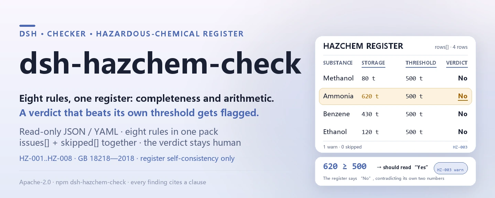
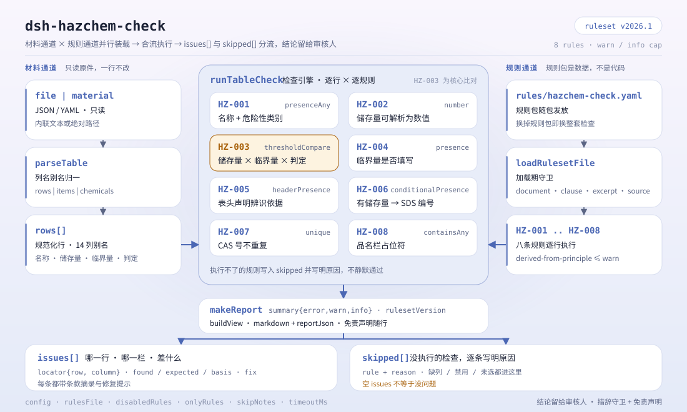

<div align="center">

<picture>
  <source media="(prefers-color-scheme: dark)" srcset="docs/assets/dsh-hazchem-check-hero-en-dark.webp">
  
</picture>

# dsh-hazchem-check

**खतरनाक रसायन रजिस्टर और बृहत्-स्रोत पहचान रिकॉर्ड की पूर्णता तथा सीमा-मात्रा का अंकगणित जाँचता है — आपको यह सूची मिलती है कि कौन-सी पंक्ति, कौन-सा कॉलम, क्या कम है; निर्णय समीक्षक के पास रहता है।**

DeepSeek Harness के लिए केवल-डेटा जाँच प्लगइन: यह एक खतरनाक रसायन रजिस्टर (साइट हेडर और प्रत्येक रसायन की एक पंक्ति) पढ़ता है, साथ आए संस्करण-बद्ध नियम-पैक (HZ-001..HZ-008) को लागू करता है, और केवल वही अंतर गिनाता है जिन्हें रजिस्टर के भीतर इंगित किया जा सकता है — कोई अनुपालन-निर्णय नहीं, कोई दायित्व-निर्धारण नहीं।

[इंस्टॉल](#तीन-चरणों-में-शुरुआत) · [कॉन्फ़िगरेशन](#कॉन्फ़िगरेशन) · [FAQ](#faq) · [简体中文](README.md) · [English](README.en.md) · [Español](README.es.md) · [Português](README.pt.md) · [हिन्दी](README.hi.md)

[](LICENSE)
[](#संगतता)
[](https://www.npmjs.com/package/dsh-hazchem-check)
[](https://github.com/PerryLink/dsh-hazchem-check/actions/workflows/ci.yml)
[](#संगतता)

[](https://github.com/PerryLink/dsh-hazchem-check/stargazers)
[](https://www.npmjs.com/package/dsh-hazchem-check)
[](https://dshfind.com/plugins/PerryLink/dsh-hazchem-check?ref=badge)
[](https://securityscorecards.dev/viewer/?uri=github.com/PerryLink/dsh-hazchem-check)
[](https://dsh.market/)
[](https://gitee.com/perrylink/dsh-hazchem-check)

```sh
dsh plugin --profile <name> add dsh-hazchem-check
```

</div>

<sub>समुदाय प्लगइन, DeepSeek से संबद्ध नहीं। आधिकारिक रेपो: <https://github.com/PerryLink/dsh-hazchem-check> (Gitee इसका मिरर है)।</sub>

## यह क्या है

`dsh-hazchem-check` एक खतरनाक रसायन रजिस्टर और उसके बृहत्-स्रोत पहचान रिकॉर्ड को पढ़ता है — साइट हेडर और प्रत्येक रसायन की एक पंक्ति — और उसी रजिस्टर की पूर्णता तथा अंकगणित की जाँच करता है: क्या प्रत्येक रसायन का नाम और खतरा-वर्ग दर्ज है, क्या भंडारित मात्रा संख्या के रूप में पढ़ी जा सकती है, क्या सीमा-मात्रा दर्ज है, क्या «बृहत् स्रोत» का निर्णय भंडारित मात्रा और रजिस्टर में लिखी सीमा-मात्रा के संबंध से मेल खाता है, क्या भंडारित रसायन का सुरक्षा डेटा शीट क्रमांक दर्ज है, क्या CAS क्रमांक दोहराए नहीं गए हैं, क्या हेडर पहचान का आधार घोषित करता है, और क्या नाम-कॉलम में कोई टेम्पलेट प्लेसहोल्डर शेष नहीं है।

यह यह नहीं तय करता कि कोई इकाई बृहत् स्रोत है या नहीं, उसे पंजीकृत कराना अनिवार्य है या नहीं, सुरक्षा मूल्यांकन आवश्यक है या नहीं, या वह कोई बृहत् छिपा संकट है या नहीं।

- **किसके लिए**: सुरक्षा प्रबंधक और खतरनाक रसायन प्रबंधन कर्मी; कमांड लाइन की जानकारी आवश्यक नहीं — सामग्री चैट में सौंप दें।
- **आप क्या देते हैं**: वह मूल सामग्री जिस पर यह जाँच चलती है (तालिका, रजिस्टर या दस्तावेज़); मूल कभी नहीं बदला जाता। Excel को पहले JSON/YAML में बदला जा सकता है, प्लेटफ़ॉर्म समर्थन दे तो चैट में भी।
- **आपको क्या मिलता है**: «कौन-सी पंक्ति, कौन-सा कॉलम, क्या कम है, कैसे ठीक करें» की सूची; जो जाँच नहीं चल सकीं वे `skipped` में कारण सहित दिखती हैं।

<picture>
  <source media="(prefers-color-scheme: dark)" srcset="docs/assets/dsh-hazchem-check-flow-v5-dark.svg">
  
</picture>

## तीन चरणों में शुरुआत

1. **इंस्टॉल** (कोई एक चैनल चुनें):

   ```sh
   # git चैनल (नवीनतम main; git+https://github.com/PerryLink/dsh-hazchem-check.git के बराबर)
   dsh plugin --profile <name> add github:PerryLink/dsh-hazchem-check
   # npm चैनल (प्रकाशित संस्करण)
   dsh plugin --profile <name> add dsh-hazchem-check
   # tarball चैनल: इस रेपो में pnpm pack के बाद
   dsh plugin --profile <name> add ./dsh-hazchem-check-<version>.tgz
   ```

2. **न्यूनतम कॉन्फ़िगरेशन** (डिफ़ॉल्ट ही काम करते हैं; `config` के बिना bundle पंक्ति सभी डिफ़ॉल्ट लेती है, नियम-पैक पथ साथ आए `rules/hazchem-check.yaml` की ओर जाता है):

   ```yaml
   - insert:
       - id: dsh-hazchem-check
         name: dsh-hazchem-check
   ```

3. **माउंट हुआ या नहीं, जाँचें** (नमूना चलाने के लिए पहले `pnpm run build` से `lib/` बनाना आवश्यक है):

   ```sh
   dsh --profile <name> --dump-config | grep 'dsh-hazchem-check'
   node samples/quickstart/run.mjs --json
   # => {"tool":"hazchem_check","issueCount":1,"summary":{"error":0,"warn":1,"info":0},"skippedCount":0}
   ```

**अनइंस्टॉल**: `dsh plugin --profile <name> remove dsh-hazchem-check` (या प्रोफ़ाइल पैच से वह पंक्ति हटा दें)।

<details>
<summary>WorkBuddy / Coze में उपयोग</summary>

WorkBuddy / Coze में «Safety Compliance Suite» खोजें (पूरा सेट; यह जाँच उसका एक भाग है; उपलब्धता कैटलॉग के अनुसार) — वही जाँच क्षमता बिना कमांड लाइन के मिलती है।

</details>

<details>
<summary>DSH Desktop मार्केट से इंस्टॉल</summary>

सभी PerryLink प्लगइन DSH Desktop के अंतर्निहित मार्केट में मिलते हैं: **मार्केट → स्रोत → स्रोत जोड़ें → चिपकाएँ** `https://perrylink-dsh-catalog.perrylink.workers.dev/catalog-source.json` **→ चुनें**। इंस्टॉल के लिए मार्केट का npm पहचान सत्यापन और आपकी पुष्टि अब भी आवश्यक है।

</details>

## मुख्य क्षमताएँ

`dsh-hazchem-check` `hazchem_check` उपकरण पंजीकृत करता है: एक खतरनाक रसायन रजिस्टर पढ़ता है, संस्करण-बद्ध नियम-पैक लागू करता है और एक रिपोर्ट लौटाता है।

- **एक डेटा-पैक में आठ नियम** — नियम-पैक डेटा है, कोड नहीं (`rules/hazchem-check.yaml`); उसे बदलने से पूरा नियम-समुच्चय बदल जाता है, TypeScript की एक पंक्ति भी नहीं छूनी पड़ती।
- **सामग्री पर केवल-पठन** — JSON या YAML स्वीकार्य, मूल कभी नहीं बदला जाता; शुद्ध ESM, कोई नेटवर्क अनुरोध नहीं, कोई मॉडल कॉल नहीं।
- **कोई गढ़ा उद्धरण नहीं** — हर नियम में `document` / `number` / `clause` / `excerpt` / `kind` / `source` होते हैं; `excerpt` शब्दशः उद्धरण होना चाहिए, और जिन नियमों का मूल पाठ इस बार नहीं मिला वे स्वयं `excerpt` में यह लिखते हैं और `derived-from-principle` चिह्नित रहते हैं।
- **गंभीरता साक्ष्य के अनुसार** — `derived-from-principle` की अधिकतम सीमा `warn`, संस्थागत कॉन्फ़िगरेशन (`institutional-configuration`) की `info`, और एक परीक्षण इसकी पुष्टि करता है।
- **खाली सूची का अर्थ «कुछ भी गलत नहीं» कभी नहीं** — जो जाँच नहीं चल सकी वह कारण सहित `skipped` में आती है; जिस नियम की अनिवार्य सूची सेट नहीं है वह चुपचाप पास होने के बजाय स्वयं को `skipped` में बताता है।
- **निर्णय न देने वाला शब्द-चयन** — रिपोर्ट केवल अंतर गिनाती है और अनुपालन, दायित्व या सत्यता पर कभी निर्णय नहीं देती; शब्द-चयन गार्ड इसे लागू करता है और हर रिपोर्ट के साथ अस्वीकरण रहता है।

| नियम | क्या जाँचता है | गंभीरता | आधार प्रकार |
|---|---|---|---|
| `HZ-001` | नाम और खतरा-वर्ग दर्ज हैं | warn | principle |
| `HZ-002` | भंडारित मात्रा संख्या के रूप में पढ़ी जा सकती है | warn | principle |
| `HZ-003` | निर्णय मात्रा और सीमा-मात्रा के संबंध से मेल खाता है | warn | principle |
| `HZ-004` | सीमा-मात्रा दर्ज है | warn | principle |
| `HZ-005` | हेडर पहचान का आधार घोषित करता है | warn | principle |
| `HZ-006` | भंडारित रसायन का सुरक्षा डेटा शीट क्रमांक दर्ज है | warn | principle |
| `HZ-007` | CAS क्रमांक दोहराए नहीं गए हैं | warn | principle |
| `HZ-008` | नाम-कॉलम में कोई बिना बदला प्लेसहोल्डर नहीं है | warn | principle |

### उदाहरण

ये प्लगइन के वास्तविक प्रवेश-बिंदु हैं; एक बार इंस्टॉल करके किसी एक को चलाएँ। नीचे दी तालिका की पहली पंक्ति विस्तृत केस है, बाकी संक्षिप्त केस हैं। विस्तृत केस इस प्लगइन का अपने ही `HZ-002` टेस्ट फ़िक्स्चर पर **वास्तविक आउटपुट** है, कोई नकली चित्र नहीं: नियम-पैक उद्धरण नहीं गढ़ता, इसलिए हर निष्कर्ष लागू किए गए खंड का नाम और यह भी बताता है कि उसका मूल पाठ इस बार प्राप्त नहीं हुआ।

**विस्तृत उदाहरण** — उपकरण `hazchem_check`, इनपुट:

```json
{"rows":[{"化学品名称":"甲醇","最大储存量":"满罐","计量单位":"t"}]}
```

आउटपुट:

```json
{
  "id": "dsh-hazchem-check.HZ-002.de09b5a6",
  "ruleId": "HZ-002",
  "severity": "warn",
  "locator": {
    "field": "maxStorage",
    "row": 1
  },
  "found": "第 1 行「maxStorage」的值「满罐」无法解析为数字",
  "expected": "「maxStorage」应填写数字",
  "fix": "储存量应填写数值；本条只核对可解析性，不判断数量是否真实"
}
```

*Observed from `tests/fixtures/HZ-002/HZ-002-unsafe.json (cases.json expects HZ-002 count 1); run via lib/index.mjs rules/hazchem-check.yaml`*

| आपका सवाल | इसका जवाब |
|---|---|
| रजिस्टर में «否» लिखा है, पर भंडारित मात्रा उसके साथ लिखी सीमा-मात्रा से अधिक है — क्या यह पकड़ में आता है? | हाँ। `HZ-003` रजिस्टर में लिखे दोनों अंकों की तुलना करता है और जहाँ निर्णय उस संबंध से मेल नहीं खाता वह पंक्ति दर्ज करता है। कोई इकाई वास्तव में बृहत् स्रोत है या नहीं, यह नहीं तय करता। |
| किसी पंक्ति में सीमा-मात्रा ही नहीं है। क्या कुछ बताया जाता है? | हाँ। `HZ-004` हर पंक्ति में सीमा-मात्रा भरी होने की अपेक्षा करता है। यह देखता है कि कोई मान मौजूद है, यह नहीं कि वह उस रसायन के लिए सही मान है — `0` भी पास हो जाता है। |
| रसायन का नाम भरा है, पर खतरा-वर्ग खाली है। | `HZ-001` हर पंक्ति में दोनों की अपेक्षा करता है और जिस पंक्ति में एक भी न हो उसे दर्ज करता है। वर्ग सही है या नहीं, यह नहीं आँकता। |
| मात्रा `1,500 kg` लिखी है — क्या यह पढ़ी जाएगी? | हाँ। `HZ-002` उसमें से संख्यात्मक भाग लेता है; केवल वह मात्रा दर्ज होती है जिसे पढ़ा न जा सके। अंक सच है या नहीं, या डिज़ाइन-अधिकतम के अनुसार लिया गया है या नहीं, यह नहीं जाँचा जाता। |
| किन पंक्तियों में सुरक्षा डेटा शीट क्रमांक होना चाहिए? | `HZ-006`: हर उस पंक्ति में जिसमें भंडारित मात्रा दर्ज है। नियम यह देखता है कि क्रमांक भरा है, यह नहीं कि शीट पूरी है या उसी रसायन की है। |
| एक ही CAS क्रमांक दो गोदामों में दो बार आया है। | `HZ-007` दोहराया गया CAS क्रमांक दर्ज करता है, क्योंकि इससे न दोहराव हटता है न मात्राओं का जोड़ सही रहता है। एक ही रसायन का कई गोदामों में होना सामान्य है: भंडारण-स्थान कॉलम में उसे अलग दिखाएँ, या इस नियम को बंद कर दें। CAS कॉलम न हो तो यह नियम चुपचाप पास होने के बजाय बताता है कि वह चल नहीं सका। |

## यह किन मानकों पर आधारित है

| दस्तावेज़ | संख्यांक | इन्हें उद्धृत करने वाले नियम |
|---|---|---|
| खतरनाक रसायनों के सुरक्षा प्रबंधन का नियम (मूल चीनी शीर्षक `rules/evidence/` में) | राज्य परिषद आदेश संख्या 591 (2002-01-26 को आदेश संख्या 344 के रूप में जारी, 2011-02-16 को राज्य परिषद की 144वीं कार्यकारी बैठक में संशोधित, 2011-12-01 से प्रभावी) | HZ-001, HZ-002, HZ-003, HZ-004, HZ-006, HZ-008 |
| खतरनाक रसायनों के बृहत्-स्रोत की पहचान | GB 18218—2018 (2018-11-19 को जारी, 2019-03-01 से प्रभावी; संपूर्ण तकनीकी सामग्री अनिवार्य; GB 18218—2009 का स्थान लेता है) | HZ-002, HZ-003 |
| खतरनाक रसायनों के बृहत्-स्रोत की पहचान | GB 18218—2018 (इस बार धारा-पाठ नहीं मिला) | HZ-005 |
| खतरनाक रसायनों के सुरक्षा प्रबंधन का नियम | राज्य परिषद आदेश संख्या 591 (इस बार धारा-पाठ नहीं मिला) | HZ-007 |

**सीमा:** यह प्लगइन एक **खतरनाक रसायन रजिस्टर और उसके बृहत्-स्रोत पहचान रिकॉर्ड** की पूर्णता और अंकगणित जाँचता है — कि हर रसायन अपना नाम और खतरा-वर्ग बताता है, भंडारित मात्रा पढ़ी जा सकती है, सीमा-मात्रा दर्ज है, **बृहत्-स्रोत का निर्णय रजिस्टर द्वारा घोषित सीमा-मात्रा के सापेक्ष भंडारित मात्रा की तुलना से मेल खाता है**, भंडारित रसायन सुरक्षा डेटा शीट क्रमांक दर्ज करता है, CAS क्रमांक दोहराए नहीं गए, रजिस्टर पहचान का आधार घोषित करता है, और कोई प्लेसहोल्डर शेष नहीं है। यह **यह नहीं** तय करता कि कोई इकाई बृहत् स्रोत है, उसे पंजीकृत कराना अनिवार्य है, सुरक्षा मूल्यांकन आवश्यक है, या वह बृहत् छिपा संकट है।

> ### ⚠️ मानक क्या कहता है, और वे चार त्रुटियाँ जो यह प्लगइन नहीं खोज सकता
>
> **GB 18218—2018 प्राप्त हुआ और शब्दशः पढ़ा गया** (देखें `rules/evidence/clause-verification-tables.md`): **2018-11-19 को जारी, 2019-03-01 से प्रभावी**, प्राक्कथन में लिखा है कि **इस मानक की संपूर्ण तकनीकी सामग्री अनिवार्य है** (यहाँ अनुवाद में उद्धृत; शब्दशः चीनी मूल उस साक्ष्य फ़ाइल में है) — पूरा मानक अनिवार्य है — और यह **GB 18218—2009 का स्थान लेता है** (2000 और 2009 दोनों संस्करण निरसित हैं, इसलिए उन्हें उद्धृत करना ही त्रुटि है)। सीमा-मात्रा (3.3), इकाई (3.2) और बृहत् स्रोत (3.4) की परिभाषाएँ, निर्धारण नियम 4.1.2, और **तालिका 1 की पहली 35 पंक्तियाँ** उस रिपोर्ट में उद्धृत हैं।
>
> **तालिका 1 केवल पंक्ति 35 तक पूरी है और तालिका 2 नहीं मिली**, इसलिए कोई सीमा-मात्रा मान अंतर्निहित नहीं है और कोई जाँचा नहीं जा सकता। `HZ-003` भंडारित मात्रा की तुलना **रजिस्टर द्वारा स्वयं दर्ज** सीमा-मात्रा से करता है और देखता है कि निर्णय मेल खाता है। इसलिए वह **चार प्रकार की त्रुटियाँ नहीं खोज सकता**, और उसका अपना नोट यही कहता है:
>
> 1. **गलत रसायन या गलत खतरा-वर्ग से ली गई सीमा-मात्रा** — 4.1.2 सूचीबद्ध रसायनों के लिए तालिका 1 और शेष के लिए तालिका 2 माँगता है।
> 2. **कई खतरों वाले रसायन को उसकी न्यूनतम सीमा-मात्रा न देना** — 4.1.2 b) कहता है कि जब एक खतरनाक रसायन में कई खतरे हों, तो उनमें से सबसे कम सीमा-मात्रा लागू होती है (अनुवाद में उद्धृत)। रजिस्टर एक ही आँकड़ा रखता है, इसलिए ऊपर की ओर पूर्णांकन एक बृहत् स्रोत छोड़ देता है।
> 3. **बहु-रसायन सुधार** — एक ही इकाई के भीतर, `S = q₁/Q₁ + q₂/Q₂ + … + qₙ/Qₙ ≥ 1` भी बृहत् स्रोत बनाता है। **यह प्लगइन वह योग नहीं करता**, क्योंकि पहचान **उत्पादन या भंडारण इकाई** (3.2, 3.5, 3.6) के अनुसार होती है, जबकि रजिस्टर रसायनों को इकाई-समूह के बिना सूचीबद्ध करता है।
> 4. **मात्रा का आधार** — 4.2.2 मात्रा को **डिज़ाइन-अधिकतम** पर लेने की माँग करता है, जबकि रजिस्टर वास्तविक भंडार दर्ज कर सकता है।
>
> ⚠️ **मानक के दायरे से बाहर न जाएँ।** धारा 1 **खतरनाक रसायनों के स्थल-बाह्य परिवहन** (रेल, सड़क, जलमार्ग, वायु, पाइपलाइन), परमाणु और सैन्य प्रतिष्ठान, खनन (प्रसंस्करण और भंडारण को छोड़कर), और अपतटीय तेल-गैस निष्कर्षण को बाहर रखती है। किसी **परिवहन** खेप पर इस प्लगइन का उपयोग दायरे से बाहर है — वह खतरनाक माल परिवहन नियमों के अधीन है, GB 18218 के नहीं।
>
> इसलिए एक निष्कर्ष का अर्थ केवल यह है कि «**आपके लिखे दोनों अंक आपके ही निर्णय से मेल नहीं खाते**»। ऊपर के चार बिंदुओं के लिए मानक के अंतर्गत इकाई-दर-इकाई गणना चाहिए, जो सुरक्षा मूल्यांकन और नियामक निर्धारण का कार्य है। **हर `excerpt` अब भी कहता है कि पाठ नहीं मिला, और हर नियम `warn` या `info` ही रहता है**, क्योंकि यह प्लगइन रजिस्टर की आंतरिक संगति जाँचता है, यह नहीं कि कोई सीमा-मात्रा मान सही है।

## कॉन्फ़िगरेशन

सभी समायोज्य पैरामीटर `src/config.ts` की Schemastery `Config` फ़ील्ड हैं (cordis.yml से बदले जा सकते हैं); प्रति-नियम सीमाएँ `rules/` के नियम-पैक में हैं। id के अनुसार ओवरराइड पूरी पंक्ति बदल देता है — जिन कुंजियों की आवश्यकता हो, सब दोबारा लिखें।

| कुंजी | प्रकार | डिफ़ॉल्ट | विवरण |
|---|---|---|---|
| `rulesFile` | string | `rules/hazchem-check.yaml` | नियम-पैक का पथ, पैकेज रूट के सापेक्ष |
| `disabledRules` | string[] | `[]` | बंद करने वाले नियम id; प्रत्येक `skipped` में दिखता है |
| `onlyRules` | string[] | `[]` | केवल ये नियम चलाएँ; खाली होने पर सभी नियम चलते हैं |
| `skipNotes` | string | `""` | हर `skipped` कारण के आगे जोड़ी जाने वाली टिप्पणी |
| `timeoutMs` | number | `120000` | उपकरण का सहकारी समय-सीमा बजट |

जानने योग्य नियम-स्तरीय पैरामीटर:

- `HZ-003` `valueField` / `limitField` / `verdictField` / `overValues` / `atMostValues` / `tolerance` — भंडारित मात्रा, सीमा-मात्रा और निर्णय के तीन कॉलम, तथा दो निर्णय-शब्दावलियाँ। जारी डिफ़ॉल्ट चीनी रजिस्टर की शब्दावली हैं, इसलिए चीनी में लिखे रजिस्टर के लिए कॉन्फ़िगरेशन आवश्यक नहीं:

  ```yaml
  overValues: [是, Y, yes, true, 构成, 重大危险源, √]
  atMostValues: [否, N, no, false, 不构成, 未构成]
  ```

- `HZ-008` `terms` — नाम-कॉलम में खोजे जाने वाले प्लेसहोल्डर।

प्रोफ़ाइल पैच में ओवरराइड का उदाहरण:

```yaml
- insert:
    - id: dsh-hazchem-check
      name: dsh-hazchem-check
      config:
        disabledRules: [HZ-007]
        timeoutMs: 180000
```

## सामग्री प्रारूप

उपकरण JSON या YAML स्वीकार करता है:

```yaml
company: 某某化工有限公司
site: 某某厂区
assessmentAt: 2026-03-01
basis: GB 18218—2018 与 2025 年版危险化学品目录
rows:
  - { 序号: '1', 化学品名称: 甲醇, CAS号: 67-56-1, 危险性类别: 易燃液体,
      储存位置: 罐区 T-01, 最大储存量: '80', 计量单位: t, 临界量: '500',
      是否重大危险源: 否, 安全技术说明书编号: SDS-2026-0018, 保管人: 李工 }
```

कॉलम नाम बड़े/छोटे अक्षर का भेद किए बिना, तथा स्पेस, अंडरस्कोर और हाइफ़न छोड़कर मिलाए जाते हैं; रजिस्टर के अपने कॉलम नाम सुरक्षित रहते हैं, इसलिए निष्कर्ष उसी कॉलम का नाम बताता है जिसे वास्तव में पढ़ा गया। पढ़ने की परत में फ़ील्ड वैकल्पिक हैं और जाँच इंजन उन्हें सत्यापित करता है, इसलिए आंशिक निर्यात पर क्रैश के बजाय «अनुपस्थित» श्रेणी के निष्कर्ष मिलते हैं।

## नियमों के स्रोत

नियम-डेटा `rules/hazchem-check.yaml` में है, कोड से अलग: प्रत्येक नियम में दस्तावेज़, संख्या, स्रोत की अपनी क्रमांकन-प्रणाली के अनुसार धारा, शब्दशः उद्धरण और स्रोत URL होता है। पैक का हेडर घोषित करता है कि प्लगइन कोई सीमा-मात्रा तालिका नहीं रखता और कोई बहु-रसायन सुधार नहीं करता, और हर नियम का `note` उससे संबंधित भाग दोहराता है। लोड-समय गार्ड अब भी हर नियम में `document`, `clause`, `excerpt` और `source` अनिवार्य करता है, और अब भी उस जाँच को `error` चिह्नित करने से रोकता है जिसका आधार केवल सिद्धांत (`kind: derived-from-principle`, अधिकतम `warn`) या संस्थागत कॉन्फ़िगरेशन (`kind: institutional-configuration`, अधिकतम `info`) हो; `excerpt` कम से कम आठ अक्षरों का वास्तविक उद्धरण होना चाहिए। अपना आधार बढ़ा-चढ़ाकर बताने वाला पैक विश्वसनीय दिखने वाली रिपोर्ट बनाने के बजाय लोड होते समय विफल होता है। सत्यापन में पुष्ट सीमाएँ और जान-बूझकर **न** निकाले गए निष्कर्ष साथ आए `rules/evidence/` निर्देशिका में हैं।

## FAQ

<details>
<summary>क्या यह हमारी ओर से अनुपालन तय करता है?</summary>

नहीं। यह केवल वे अंतर गिनाता है जिन्हें सामग्री के भीतर इंगित किया जा सकता है (कौन-सी पंक्ति, कौन-सा कॉलम, क्या कम है, कैसे ठीक करें) और न तथ्य तय करता है न अनुपालन — निर्णय सदा समीक्षक के पास रहता है। शब्द-चयन गार्ड रिपोर्ट का शब्द-चयन लागू करता है और हर रिपोर्ट के साथ अस्वीकरण रहता है।

</details>

<details>
<summary>मेरा रजिस्टर Excel फ़ाइल है, क्या सीधे उपयोग कर सकता हूँ?</summary>

हाँ — पहले उसे JSON या YAML में बदलें; प्लेटफ़ॉर्म समर्थन दे तो चैट में ही रूपांतरण हो जाता है। उपकरण केवल सामग्री पढ़ता है और मूल कभी नहीं बदलता।

</details>

<details>
<summary>`HZ-003` ने वह इकाई क्यों नहीं पकड़ी जो वास्तव में बृहत् स्रोत है?</summary>

क्योंकि पैक में कोई सीमा-मात्रा मान अंतर्निहित नहीं है और वह GB 18218 का बहु-रसायन योग नहीं करता। `HZ-003` भंडारित मात्रा की तुलना **रजिस्टर द्वारा स्वयं घोषित** सीमा-मात्रा से करता है और देखता है कि निर्णय उस तुलना से मेल खाता है। सीमा-मात्रा सही रसायन की है या नहीं, कई खतरों वाले रसायन को उसकी न्यूनतम सीमा मिली या नहीं, और मात्रा डिज़ाइन-अधिकतम पर ली गई या नहीं — ये सब मानक के अंतर्गत इकाई-दर-इकाई गणना माँगते हैं, जो व्यक्ति करता है।

</details>

<details>
<summary>खाली `issues` सूची को «कुछ भी गलत नहीं» माना जा सकता है?</summary>

नहीं। जो जाँच नहीं चल सकी वह कारण सहित `skipped` में है (CAS कॉलम नहीं, अनिवार्य सूची सेट नहीं)। कुछ नियम केवल उपस्थिति देखते हैं: `HZ-004` में `0` सीमा-मात्रा भी पास हो जाती है। किसी भी निष्कर्ष से पहले `issues` और `skipped` दोनों पढ़ें।

</details>

<details>
<summary>कई सौ पंक्तियों का रजिस्टर एक बार में संभलेगा?</summary>

उपकरण `native` और `ptc` दोनों मोड में चलता है; बैच कार्य (पूरा रजिस्टर या निर्देशिका) के लिए `ptc` चुनें, जहाँ स्कीमा लागत एक ही बार लगती है। जाँचें स्थानीय कॉलम-मिलान और संख्यात्मक तुलना हैं — कोई नेटवर्क अनुरोध नहीं, कोई मॉडल कॉल नहीं; `timeoutMs` (डिफ़ॉल्ट 120 सेकंड) सहकारी समय-सीमा बजट है।

</details>

## समस्या निवारण

- **`HZ-003` ने वह सीमा-मात्रा पास कर दी जो मुझे पता है गलत है।** यह रजिस्टर में घोषित सीमा-मात्रा से तुलना करता है; वह मान सही रसायन और खतरा-वर्ग का है या नहीं, यह तथ्यात्मक प्रश्न है जिसे यह नियम नहीं छूता।
- **जो इकाई बृहत् स्रोत होनी चाहिए थी, वह चिह्नित नहीं हुई।** इसके पास सीमा-मात्रा तालिका नहीं है और यह GB 18218 का बहु-रसायन योग नहीं करता। उस इकाई की गणना मानक के अंतर्गत स्वयं करें।
- **`HZ-004` ने `0` सीमा-मात्रा पास कर दी।** नियम देखता है कि कॉलम भरा है, यह नहीं कि उसमें क्या है; मान का निर्णय केवल मानक से तुलना करने वाला व्यक्ति कर सकता है।
- **`HZ-007` कभी नहीं चलता।** रजिस्टर में CAS क्रमांक दर्ज नहीं हैं। विशिष्ट पहचान के बिना नियम गलत कॉलम जाँचने के बजाय बताता है कि वह चल नहीं सका।
- **`HZ-007` एक ही रसायन के दो गोदामों में होने पर चिह्न लगाता है।** यह वैध रजिस्टर-रूप है — भंडारण-स्थान कॉलम में इसे स्पष्ट करें, और यदि आपका रजिस्टर ऐसा ही संगठित है तो नियम बंद कर दें।
- **कोई नियम नहीं चला।** `skipped` सरणी देखें; वह नियम id और कारण बताती है।
- **प्लगइन इंस्टॉल हो गया पर टूल दिखता नहीं।** जाँचें कि `main` `lib/index.mjs` पर जाता है और `pnpm run build` ने उसे बनाया है; गलत `main` पर लोडर उस प्रविष्टि को चुपचाप छोड़ देता है।
- **`dsh plugin add` असंगत बताकर मना करता है।** peer रेंज `0.1.x` और `0.2.x` दोनों को कवर करती है; बाहर होने पर स्पष्ट छूट दें: `dsh plugin --profile <name> allow-version dsh-hazchem-check@0.1.0 --dsh-version <runtime> --accept-risk`
- **`check` में `manifest-peers` विफल दिखता है।** स्थिर जाँचकर्ता 0.2 पंक्ति से पुरानी, कोड में अंकित peer रेंज से तुलना करता है; रनटाइम इंस्टॉल के समय peer अनुकूलता लागू करता है, इसलिए घोषित रेंज ही सही है। यह `dsh-plugin-dev` की ज्ञात अपस्ट्रीम समस्या है।
- **समय खिसका हुआ लगता है।** सारी गणना इनपुट स्ट्रिंग पर वॉल-क्लॉक है, कोई टाइमज़ोन रूपांतरण नहीं।

## संगतता

| सतह | स्थिति |
|---|---|
| Harness | peer रेंज `>=0.1.2-rc.1 <0.2.0 \|\| >=0.2.0-0 <0.3.0` — `0.2.0-rc.2` और `0.2.1-rc.2` दोनों को स्वीकार करने के लिए सत्यापित। `engines.dsh` `>=0.2.1-0 <0.3.0` के रूप में घोषित है और 0.2.1 से होस्ट इसे लागू करता है |
| Node | `^22.19.0 \|\| >=24.0.0` |
| प्लेटफ़ॉर्म | सभी (शुद्ध ESM; कोई नेटिव कोड नहीं, कोई नेटवर्क नहीं, कोई मॉडल कॉल नहीं) |
| टूल मोड | `native` और `ptc` में काम करता है; पूरे रजिस्टर के लिए `ptc` चुनें |

## इकोसिस्टम और गुणवत्ता

- [Gitee मिरर](https://gitee.com/perrylink/dsh-hazchem-check) (सिंक मिरर; आधिकारिक GitHub है)
- [dshfind प्लगइन पेज](https://dshfind.com/plugins/PerryLink/dsh-hazchem-check) (इंस्टॉल और रैंकिंग)
- [OpenSSF Scorecard रिपोर्ट](https://securityscorecards.dev/viewer/?uri=github.com/PerryLink/dsh-hazchem-check) ([.github/workflows/scorecard.yml](.github/workflows/scorecard.yml) द्वारा संचालित)
- [DSH Market](https://dsh.market/) (सूचीबद्ध)
- **1024 स्टोर चैनल**: एक बार `npm i -g dsh1024`, फिर `dsh1024 plugin --profile <name> add dsh-hazchem-check` ([deepseek1024.com](https://deepseek1024.com) की इंस्टॉल रैंकिंग में गिना जाता है)
- [इकोसिस्टम ज्ञान-आधार](https://perrylink.github.io/dsh-plugin-guide/) — प्लगइन विकास मार्गदर्शिका · चयन के मापे गए आँकड़े · रखरखाव के मानदंड

## डेवलपमेंट

```sh
pnpm install                                        # node ^22.19 || >=24
pnpm run typecheck                                  # tsc --noEmit
pnpm test                                           # vitest: साझा टेबल-प्लगइन सूट + युग्मित फ़िक्स्चर
pnpm run build                                      # tsdown -> lib/index.mjs + lib/index.d.mts
pnpm run verify:self-contained                      # निर्भरताएँ registry से हल होती हैं
pnpm run check:lockfile                             # lockfile ड्रिफ़्ट जाँच
pnpm run check:readmes                              # पाँच भाषाओं के README की संगति
pnpm run check:citations                            # नियम-पैक उद्धरण आधार-रेखा
node ../scripts/sync-shared.mjs dsh-hazchem-check   # ../_shared से src/shared ताज़ा करें
pnpm pack                                           # प्रकाशित tarball
```

प्लगइन **केवल-डेटा** है: `src/model.ts` तालिका का आकार घोषित करता है, साझा किट पाठक और जाँच इंजन देता है, और नियम-पैक हर जाँच घोषित करता है। स्थानीय नमूना चलाना (पहले `pnpm run build` से `lib/` बनाना आवश्यक):

```sh
node samples/quickstart/run.mjs --json
# => {"tool":"hazchem_check","issueCount":1,"summary":{"error":0,"warn":1,"info":0},"skippedCount":0}
```

नमूना इनपुट `samples/quickstart/input/` में, अपेक्षित आउटपुट `samples/quickstart/expected/result.json` में और स्क्रीनशॉट `docs/assets/quickstart.png` में है। README की छवियाँ [`scripts/gen-readme-assets.py`](scripts/gen-readme-assets.py) (Python + Pillow) से प्रोग्रामेटिक रूप से बनती हैं और दोबारा चलाई जा सकती हैं; पुराना एकल-संस्करण प्रवाह आरेख और डेमो छवियाँ बाहरी लिंक के लिए `docs/assets/` में रहती हैं, जबकि README केवल नए लाइट/डार्क युग्म का संदर्भ देते हैं।

Topics: `deepseek-harness`, `dsh`, `dsh-plugin`, `cordis`, `hazchem`

## परिवार और आभार

यह परियोजना [PerryLink](https://github.com/PerryLink) द्वारा अनुरक्षित DeepSeek Harness प्लगइन परिवार का सदस्य है (सभी Apache-2.0)। पूरा परिवार सूचकांक: [सामग्री के अनुसार जाँचकर्ता चुनें](https://perrylink.github.io/zh/checkers/choose/) और [सभी प्लगइन](https://github.com/PerryLink)। अगर यह उपयोगी लगे, तो **एक स्टार अगले व्यक्ति को इसे खोजने में मदद करता है** — इससे कोई सुविधा अनलॉक नहीं होती।

- [@PerryLink](https://github.com/PerryLink) — निर्माता और अनुरक्षक: केवल-डेटा नियम-पैक (HZ-001..HZ-008), `hazchem_check` उपकरण, GB 18218—2018 धारा-सत्यापन रिकॉर्ड और पाँच-भाषा दस्तावेज़।

<details>
<summary>सभी प्लगइन खोलें</summary>

| प्लगइन | स्थिति |
|---|---|
| **[dsh-aqua-input-check](https://github.com/PerryLink/dsh-aqua-input-check)** |  |
| **[dsh-archive-check](https://github.com/PerryLink/dsh-archive-check)** |  |
| **[dsh-auto-review](https://github.com/PerryLink/dsh-auto-review)** |  |
| **[dsh-autotier](https://github.com/PerryLink/dsh-autotier)** | 🧊 फ़्रोज़न — रेपो README देखें |
| **[dsh-bid-ca-precheck](https://github.com/PerryLink/dsh-bid-ca-precheck)** |  |
| **[dsh-bid-qual-check](https://github.com/PerryLink/dsh-bid-qual-check)** |  |
| **[dsh-cert-mcp](https://github.com/PerryLink/dsh-cert-mcp)** | 🧊 फ़्रोज़न — रेपो README देखें |
| **[dsh-checkpoint-rewind](https://github.com/PerryLink/dsh-checkpoint-rewind)** |  |
| **[dsh-click](https://github.com/PerryLink/dsh-click)** |  |
| **[dsh-composer-history](https://github.com/PerryLink/dsh-composer-history)** |  |
| **[dsh-contract-stance](https://github.com/PerryLink/dsh-contract-stance)** |  |
| **[dsh-customs-doc-check](https://github.com/PerryLink/dsh-customs-doc-check)** |  |
| **[dsh-data-quality](https://github.com/PerryLink/dsh-data-quality)** | 🧊 फ़्रोज़न — रेपो README देखें |
| **[dsh-demurrage-ledger](https://github.com/PerryLink/dsh-demurrage-ledger)** |  |
| **[dsh-doublecheck](https://github.com/PerryLink/dsh-doublecheck)** |  |
| **[dsh-drill-script-check](https://github.com/PerryLink/dsh-drill-script-check)** |  |
| **[dsh-eia-guide-check](https://github.com/PerryLink/dsh-eia-guide-check)** |  |
| **[dsh-emergency-plan](https://github.com/PerryLink/dsh-emergency-plan)** |  |
| **[dsh-essay-rubric-check](https://github.com/PerryLink/dsh-essay-rubric-check)** |  |
| **[dsh-evidence-check](https://github.com/PerryLink/dsh-evidence-check)** |  |
| **[dsh-export-ctl-check](https://github.com/PerryLink/dsh-export-ctl-check)** |  |
| **[dsh-fast](https://github.com/PerryLink/dsh-fast)** |  |
| **[dsh-fmea-table-check](https://github.com/PerryLink/dsh-fmea-table-check)** |  |
| **[dsh-forecast-penalty](https://github.com/PerryLink/dsh-forecast-penalty)** |  |
| **[dsh-fund-research](https://github.com/PerryLink/dsh-fund-research)** |  |
| **[dsh-github](https://github.com/PerryLink/dsh-github)** |  |
| **[dsh-gongwen-flow-check](https://github.com/PerryLink/dsh-gongwen-flow-check)** |  |
| **[dsh-gongwen-word-check](https://github.com/PerryLink/dsh-gongwen-word-check)** |  |
| **[dsh-guard-plan-qc](https://github.com/PerryLink/dsh-guard-plan-qc)** |  |
| **[dsh-hazchem-check](https://github.com/PerryLink/dsh-hazchem-check)** |  |
| **[dsh-hazplan-check](https://github.com/PerryLink/dsh-hazplan-check)** |  |
| **[dsh-hidden-risk-map](https://github.com/PerryLink/dsh-hidden-risk-map)** |  |
| **[dsh-hs-classify](https://github.com/PerryLink/dsh-hs-classify)** |  |
| **[dsh-icd-rule-check](https://github.com/PerryLink/dsh-icd-rule-check)** |  |
| **[dsh-industry-research](https://github.com/PerryLink/dsh-industry-research)** |  |
| **[dsh-lawcite-adapter](https://github.com/PerryLink/dsh-lawcite-adapter)** |  |
| **[dsh-laya](https://github.com/PerryLink/dsh-laya)** |  |
| **[dsh-lc-doc-check](https://github.com/PerryLink/dsh-lc-doc-check)** |  |
| **[dsh-learning-gap-check](https://github.com/PerryLink/dsh-learning-gap-check)** |  |
| **[dsh-library](https://github.com/PerryLink/dsh-library)** |  |
| **[dsh-local-ai](https://github.com/PerryLink/dsh-local-ai)** |  |
| **[dsh-lsp-actions](https://github.com/PerryLink/dsh-lsp-actions)** |  |
| **[dsh-mask](https://github.com/PerryLink/dsh-mask)** |  |
| **[dsh-mcp-panel](https://github.com/PerryLink/dsh-mcp-panel)** |  |
| **[dsh-medrec-qc](https://github.com/PerryLink/dsh-medrec-qc)** |  |
| **[dsh-memento](https://github.com/PerryLink/dsh-memento)** | 🧊 फ़्रोज़न — रेपो README देखें |
| **[dsh-nsfc-form-check](https://github.com/PerryLink/dsh-nsfc-form-check)** |  |
| **[dsh-nurse-record-check](https://github.com/PerryLink/dsh-nurse-record-check)** |  |
| **[dsh-observe](https://github.com/PerryLink/dsh-observe)** |  |
| **[dsh-origin-rvc-check](https://github.com/PerryLink/dsh-origin-rvc-check)** |  |
| **[dsh-ota-review-check](https://github.com/PerryLink/dsh-ota-review-check)** |  |
| **[dsh-output-styles](https://github.com/PerryLink/dsh-output-styles)** |  |
| **[dsh-paper-doc-adapter](https://github.com/PerryLink/dsh-paper-doc-adapter)** |  |
| **[dsh-permission-rules](https://github.com/PerryLink/dsh-permission-rules)** |  |
| **[dsh-permit-report-check](https://github.com/PerryLink/dsh-permit-report-check)** |  |
| **[dsh-pipeline-check](https://github.com/PerryLink/dsh-pipeline-check)** |  |
| **[dsh-pleading-draft](https://github.com/PerryLink/dsh-pleading-draft)** |  |
| **[dsh-plugin-doctor](https://github.com/PerryLink/dsh-plugin-doctor)** | 🚫 रिटायर्ड (रेपो संग्रहीत) |
| **[dsh-plugin-guide](https://github.com/PerryLink/dsh-plugin-guide)** |  |
| **[dsh-plugin-kit](https://github.com/PerryLink/dsh-plugin-kit)** | 🚫 रिटायर्ड (रेपो संग्रहीत) |
| **[dsh-plugin-upgrade](https://github.com/PerryLink/dsh-plugin-upgrade)** | 🚫 रिटायर्ड (रेपो संग्रहीत) |
| **[dsh-policy-brief-draft](https://github.com/PerryLink/dsh-policy-brief-draft)** |  |
| **[dsh-power-loss-split](https://github.com/PerryLink/dsh-power-loss-split)** |  |
| **[dsh-power-ticket-check](https://github.com/PerryLink/dsh-power-ticket-check)** |  |
| **[dsh-ppap-check](https://github.com/PerryLink/dsh-ppap-check)** |  |
| **[dsh-protest-deadline](https://github.com/PerryLink/dsh-protest-deadline)** |  |
| **[dsh-railway-window](https://github.com/PerryLink/dsh-railway-window)** |  |
| **[dsh-repair-order-qc](https://github.com/PerryLink/dsh-repair-order-qc)** |  |
| **[dsh-research-report](https://github.com/PerryLink/dsh-research-report)** |  |
| **[dsh-review-reply-check](https://github.com/PerryLink/dsh-review-reply-check)** |  |
| **[dsh-rulefile-check](https://github.com/PerryLink/dsh-rulefile-check)** |  |
| **[dsh-safety-brief-check](https://github.com/PerryLink/dsh-safety-brief-check)** |  |
| **[dsh-score](https://github.com/PerryLink/dsh-score)** | 🧊 फ़्रोज़न — रेपो README देखें |
| **[dsh-session-sync](https://github.com/PerryLink/dsh-session-sync)** |  |
| **[dsh-site-log-check](https://github.com/PerryLink/dsh-site-log-check)** |  |
| **[dsh-skill-pack-security](https://github.com/PerryLink/dsh-skill-pack-security)** |  |
| **[dsh-soe-decision-check](https://github.com/PerryLink/dsh-soe-decision-check)** |  |
| **[dsh-soilwater-check](https://github.com/PerryLink/dsh-soilwater-check)** |  |
| **[dsh-sop-sync-check](https://github.com/PerryLink/dsh-sop-sync-check)** |  |
| **[dsh-spc-gbt-adapter](https://github.com/PerryLink/dsh-spc-gbt-adapter)** |  |
| **[dsh-talk](https://github.com/PerryLink/dsh-talk)** |  |
| **[dsh-tender-extract](https://github.com/PerryLink/dsh-tender-extract)** |  |
| **[dsh-tender-matrix](https://github.com/PerryLink/dsh-tender-matrix)** |  |
| **[dsh-test-drive](https://github.com/PerryLink/dsh-test-drive)** |  |
| **[dsh-ticktick](https://github.com/PerryLink/dsh-ticktick)** | 🚫 रिटायर्ड (रेपो संग्रहीत) |
| **[dsh-translate](https://github.com/PerryLink/dsh-translate)** |  |
| **[dsh-warranty-calc](https://github.com/PerryLink/dsh-warranty-calc)** |  |
| **[dsh-budget](https://github.com/PerryLink/dsh-budget)** | 🧊 फ़्रोज़न — रेपो README देखें |
| **[dsh-claude-move](https://github.com/PerryLink/dsh-claude-move)** | 🧊 फ़्रोज़न — रेपो README देखें |
| **[dsh-defend](https://github.com/PerryLink/dsh-defend)** | 🧊 फ़्रोज़न — रेपो README देखें |
| **[dsh-draw](https://github.com/PerryLink/dsh-draw)** | 🧊 फ़्रोज़न — रेपो README देखें |
| **[dsh-reach](https://github.com/PerryLink/dsh-reach)** | 🧊 फ़्रोज़न — रेपो README देखें |
| **[dsh-background-agents](https://github.com/PerryLink/dsh-background-agents)** | 🚫 रिटायर्ड (रेपो संग्रहीत) |
| **[dsh-session-pin](https://github.com/PerryLink/dsh-session-pin)** | 🚫 रिटायर्ड (रेपो संग्रहीत) |
| **[dsh-team-rooms](https://github.com/PerryLink/dsh-team-rooms)** | 🚫 रिटायर्ड (रेपो संग्रहीत) |

</details>

## लाइसेंस

[LICENSE](LICENSE) (Apache License 2.0) © 2026 dsh-hazchem-check contributors

<p align="center"><sub>Apache-2.0 · समुदाय प्लगइन, DeepSeek से संबद्ध नहीं।</sub></p>
