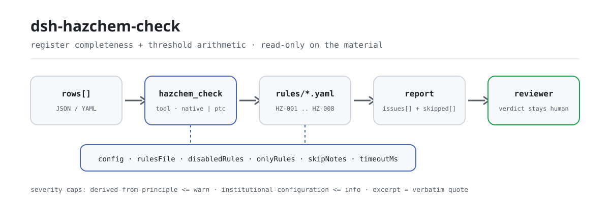

<div align="center">

<picture>
  <source media="(prefers-color-scheme: dark)" srcset="docs/assets/dsh-hazchem-check-flow-dark.svg">
  
</picture>

# dsh-hazchem-check

**核对危险化学品台账与重大危险源辨识记录的齐备与算术——输出「哪一行、哪一栏、差什么」的清单，结论留给审核人。**

面向 DeepSeek Harness 的数据型核查插件：读取一份危险化学品台账（厂区表头加每种化学品一行），按随包的版本化规则包（HZ-001..HZ-008）逐条核对，只列台账内部能逐条指认的差异，不判合规、不认定责任。

[安装](#三步上手) · [配置](#配置) · [FAQ](#faq) · [简体中文](README.md) · [English](README.en.md) · [Español](README.es.md) · [Português](README.pt.md) · [हिन्दी](README.hi.md)

[](LICENSE)
[](#兼容性)
[](https://www.npmjs.com/package/dsh-hazchem-check)
[](https://github.com/PerryLink/dsh-hazchem-check/actions/workflows/ci.yml)
[](#兼容性)

[](https://github.com/PerryLink/dsh-hazchem-check/stargazers)
[](https://www.npmjs.com/package/dsh-hazchem-check)
[](https://dshfind.com/plugins/PerryLink/dsh-hazchem-check?ref=badge)
[](https://securityscorecards.dev/viewer/?uri=github.com/PerryLink/dsh-hazchem-check)
[](https://dsh.market/)
[](https://gitee.com/perrylink/dsh-hazchem-check)

```sh
dsh plugin --profile <name> add dsh-hazchem-check
```

</div>

<sub>社区插件，与 DeepSeek 官方无关。唯一仓库：<https://github.com/PerryLink/dsh-hazchem-check>（Gitee 为镜像）。</sub>

## 它是什么

`dsh-hazchem-check` 读取一份危险化学品台账与其重大危险源辨识记录——厂区表头加每种化学品一行——核对这份台账自身的齐备与算术：每种化学品是否写明名称与危险性类别、储存量是否可解析为数值、是否记录了临界量、「是否重大危险源」的判定是否与台账自己写的储存量和临界量的关系相符、有储存量的化学品是否记录了安全技术说明书编号、CAS 号是否重复、表头是否声明辨识依据、品名栏是否残留模板占位符。

它不判定某个单元是否构成重大危险源、是否必须备案登记、是否需要进行安全评估，也不判定其是否属于重大隐患。

- **给谁用**：安全管理员、危险化学品管理岗；不用懂命令行，在对话里把材料交给它即可。
- **你交什么**：这项核对用到的原始材料（表格、清单或文书）；不改原件。Excel 可先转成 JSON/YAML，对话里也能代转。
- **它交什么**：一份「哪一行、哪一栏、差什么、怎么补」的清单；没能执行的检查逐条列入 `skipped` 并写明原因。

## 三步上手

1. **安装**（三选一）：

   ```sh
   # git 通道（最新 main；等价于 git+https://github.com/PerryLink/dsh-hazchem-check.git）
   dsh plugin --profile <name> add github:PerryLink/dsh-hazchem-check
   # npm 通道（已发布版本）
   dsh plugin --profile <name> add dsh-hazchem-check
   # tarball 通道：本仓库 pnpm pack 后
   dsh plugin --profile <name> add ./dsh-hazchem-check-<version>.tgz
   ```

2. **最小配置**（默认即可用；bundle 行不带 `config` 时全部走默认值，规则包路径指向随包的 `rules/hazchem-check.yaml`）：

   ```yaml
   - insert:
       - id: dsh-hazchem-check
         name: dsh-hazchem-check
   ```

3. **验证已生效**（试跑需先 `pnpm run build` 产出 `lib/`）：

   ```sh
   dsh --profile <name> --dump-config | grep 'dsh-hazchem-check'
   node samples/quickstart/run.mjs --json
   # => {"tool":"hazchem_check","issueCount":1,"summary":{"error":0,"warn":1,"info":0},"skippedCount":0}
   ```

**卸载**：`dsh plugin --profile <name> remove dsh-hazchem-check`（或从 profile patch 删掉该行）。

<details>
<summary>在 WorkBuddy / 扣子中使用</summary>

在 WorkBuddy / 扣子搜「安全合规核对包」（本检查是其中一项；上架以商城为准）即可调用同一套核对能力，无需命令行。

</details>

<details>
<summary>从 DSH Desktop 市场安装</summary>

所有 PerryLink 插件均可在 DSH Desktop 内置市场中浏览：**市场 → 来源 → 添加来源 → 粘贴** `https://perrylink-dsh-catalog.perrylink.workers.dev/catalog-source.json` **→ 选中**。安装仍需通过市场的 npm 身份校验与你的确认。

</details>

## 核心能力

`dsh-hazchem-check` 注册 `hazchem_check` 工具：读入一份危险化学品台账，套用版本化规则包，返回一份报告。

- **八条规则一包带走** —— 规则包是数据不是代码（`rules/hazchem-check.yaml`），换掉规则包即换掉整套检查，不动一行 TypeScript。
- **只读材料** —— 接受 JSON 或 YAML，原件永不修改；纯 ESM，无网络请求、不调用模型。
- **引文不造假** —— 每条规则带 `document` / `number` / `clause` / `excerpt` / `kind` / `source`；`excerpt` 必须是逐字引文，本次未取得原文的规则在 `excerpt` 里如实写明并标为 `derived-from-principle`。
- **严重级跟着证据走** —— `derived-from-principle` 最高 `warn`，本机构配置（`institutional-configuration`）最高 `info`，并有测试断言。
- **空清单 ≠ 没问题** —— 每条没能执行的检查都进 `skipped` 并写明原因；必填清单未配置的规则自我报告 `skipped`，绝不静默通过。
- **措辞不作裁决** —— 报告只列差异，不判定合规、责任或正确性；措辞守卫（wording guard）强制执行，报告永远附带免责声明。

| 规则 | 核对内容 | 严重级 | 依据类别 |
|---|---|---|---|
| `HZ-001` | 名称与危险性类别已记录 | warn | principle |
| `HZ-002` | 储存量可解析为数字 | warn | principle |
| `HZ-003` | 判定结论与储存量、临界量的关系相符 | warn | principle |
| `HZ-004` | 临界量已记录 | warn | principle |
| `HZ-005` | 表头声明了辨识依据 | warn | principle |
| `HZ-006` | 有储存量的化学品记录了安全技术说明书编号 | warn | principle |
| `HZ-007` | CAS 号不重复 | warn | principle |
| `HZ-008` | 品名栏没有未替换的占位符 | warn | principle |

### 示例

以下为插件真实入口；安装后调用一次即可。第一行是详细走查，其余是简短案例。详细走查是本插件对自己 `HZ-002` 测试夹具的**真实输出**，不是示意图；规则库不伪造引文，因此每条发现都会同时写明所引条款，以及该条款原文本次未取得。

**详细示例** —— 工具 `hazchem_check`，输入：

```json
{"rows":[{"化学品名称":"甲醇","最大储存量":"满罐","计量单位":"t"}]}
```

输出：

```json
{
  "id": "dsh-hazchem-check.HZ-002.de09b5a6",
  "ruleId": "HZ-002",
  "severity": "warn",
  "locator": {
    "field": "maxStorage",
    "row": 1
  },
  "found": "第 1 行「maxStorage」的值「满罐」无法解析为数字",
  "expected": "「maxStorage」应填写数字",
  "fix": "储存量应填写数值；本条只核对可解析性，不判断数量是否真实"
}
```

*Observed from `tests/fixtures/HZ-002/HZ-002-unsafe.json (cases.json expects HZ-002 count 1); run via lib/index.mjs rules/hazchem-check.yaml`*

| 你会问 | 它怎么答 |
|---|---|
| 台账写的是「否」，但储存量超过了旁边写的临界量，能查出来吗？ | 能。`HZ-003` 拿台账自己写的两个数相比，判定与这个关系不符时逐行报出；某个单元是否真的构成重大危险源，它不作判断。 |
| 某行的临界量栏是空的，会被报出吗？ | 会。`HZ-004` 要求每行都填写临界量。它只核对这一栏是否填了，不判断填的值是不是该品种的临界量——填 `0` 也会通过。 |
| 化学品名称填了，危险性类别空着。 | `HZ-001` 要求每行同时有名称与危险性类别，缺其一即报出该行。它不判断类别填得对不对。 |
| 储存量写的是 `1,500 kg`，还读得出来吗？ | 读得出来。`HZ-002` 取其中的数字部分，只有解析不了的储存量才报出。数量是否真实、是否按设计最大量填写，它不核对。 |
| 哪些行必须填写安全技术说明书编号？ | `HZ-006`：凡是填了储存量的行。它只核对编号栏是否填写，不判断说明书是否完整、是否与该化学品对应。 |
| 同一个 CAS 号在两个库房各出现一次。 | `HZ-007` 会报出重复的 CAS 号，因为重复既妨碍去重，也让储存量合计被重复计算。同一物质分库房登记属于正常情形：请在储存位置栏加以区分，或停用本条。台账没有 CAS 号栏时，本条报告「无法执行」，而不是静默通过。 |

## 依据的标准

| 文件 | 文号 | 引用它的规则 |
|---|---|---|
| 《危险化学品安全管理条例》 | 国务院令第591号（2002年1月26日国务院令第344号公布，2011年2月16日国务院第144次常务会议修订通过，自2011年12月1日起施行） | HZ-001, HZ-002, HZ-003, HZ-004, HZ-006, HZ-008 |
| 《危险化学品重大危险源辨识》 | GB 18218—2018（2018-11-19发布，2019-03-01实施；全部技术内容为强制性；代替GB 18218—2009） | HZ-002, HZ-003 |
| 《危险化学品重大危险源辨识》 | GB 18218—2018（本次未取得条文） | HZ-005 |
| 《危险化学品安全管理条例》 | 国务院令第591号（本次未取得条文） | HZ-007 |

**边界：** 本插件核对一份**危险化学品台账与重大危险源辨识记录**的齐备性与算术——每种化学品是否写明自身名称与危险性类别，储存量是否可解析，是否记录临界量，**重大危险源判定结论是否与「储存量相对于台账写明的临界量」的比较结果一致**，在库化学品是否记录安全技术说明书编号，CAS 号是否不重复，台账是否声明辨识依据，以及是否残留占位符。它**不**判定某单元是否构成重大危险源、是否必须备案登记、是否需要进行安全评估，也不判定其是否属于重大隐患。

> ### ⚠️ 标准怎么规定，以及本插件找不到的四类错误
>
> **GB 18218—2018 已经取得并逐字阅读**（见 `rules/evidence/clause-verification-tables.md`）：**2018-11-19 发布，2019-03-01 实施**，前言写明「**本标准的全部技术内容为强制性的**」——整部标准都是强制性的——且它**取代 GB 18218—2009**（2000 年版与 2009 年版均已废止，引用它们本身就是错误的）。临界量（3.3）、单元（3.2）与重大危险源（3.4）的定义、判定规则 4.1.2，以及**表 1 的前 35 行**，都在该报告中引录。
>
> **表 1 只完整到第 35 行，表 2 本次未取得**，因此没有内置任何临界量数值，也无法核对任何数值。`HZ-003` 把储存量与**台账自身记录的**临界量相比较，并核对判定结论是否一致。因此它**找不到四类错误**，其说明也这样写明：
>
> 1. **临界量取自错误的物质或危险性类别**——4.1.2 要求：列名物质用表 1，其他物质用表 2。
> 2. **具有多种危险性的物质未被取最低临界量**——4.1.2 b)：「若一种危险化学品具有多种危险性，按其中最低的临界量确定」。台账只记一个数字，因此向上取整会漏掉重大危险源。
> 3. **多物质校正**——在同一单元内，`S = q₁/Q₁ + q₂/Q₂ + … + qₙ/Qₙ ≥ 1` 同样构成重大危险源。**本插件不进行这项求和**，因为辨识是按**生产或储存单元**（3.2、3.5、3.6）进行的，而台账列出物质时并不按单元分组。
> 4. **数量基准**——4.2.2 要求数量**按设计最大量**取，而台账可能记录的是实际库存量。
>
> ⚠️ **不要超出标准的适用范围。** 第 1 章排除**危险化学品的场外运输**（铁路、公路、水路、航空、管道）、核设施与军事设施、采矿（不含加工与储存），以及海上石油天然气开采。把本插件用于**运输**货物属于超出范围——那由危险货物运输规则管辖，而不是 GB 18218。
>
> 因此，一条发现只意味着“**你写的这两个数字与你自己的判定结论不一致**”。上述四项需要在标准下逐单元计算，那是安全评价与监管认定的任务。**每条 `excerpt` 仍写着“本次未取得”，每条规则也仍为 `warn` 或 `info`**，因为本插件核对的是台账的内部一致性，而不是某个临界量数值是否正确。

## 配置

全部可调参数都是 `src/config.ts` 里的 Schemastery `Config` 字段（可从 cordis.yml 覆盖），逐条阈值在 `rules/` 下的规则库文件里。按 id 覆盖会替换整行——请重述所有需要的键。

| 键 | 类型 | 默认值 | 说明 |
|---|---|---|---|
| `rulesFile` | string | `rules/hazchem-check.yaml` | 规则库文件路径，相对插件包根目录 |
| `disabledRules` | string[] | `[]` | 要停用的规则 id 列表；每条都会出现在 `skipped` 中 |
| `onlyRules` | string[] | `[]` | 只执行这些规则 id；留空表示执行全部规则 |
| `skipNotes` | string | `""` | 附加到每条 `skipped` 说明后的备注 |
| `timeoutMs` | number | `120000` | 工具协作式超时预算（毫秒） |

值得了解的规则级参数：

- `HZ-003` `valueField` / `limitField` / `verdictField` / `overValues` / `atMostValues` / `tolerance` —— 储存量、临界量与判定结论三栏，外加两套判定用词；判为「是」的默认 `[是, Y, yes, true, 构成, 重大危险源, √]`，判为「否」的默认 `[否, N, no, false, 不构成, 未构成]`。
- `HZ-008` `terms` —— 要在品名栏里找的占位符词表。

profile patch 覆盖示例：

```yaml
- insert:
    - id: dsh-hazchem-check
      name: dsh-hazchem-check
      config:
        disabledRules: [HZ-007]
        timeoutMs: 180000
```

## 材料格式

工具接受 JSON 或 YAML：

```yaml
company: 某某化工有限公司
site: 某某厂区
assessmentAt: 2026-03-01
basis: GB 18218—2018 与 2025 年版危险化学品目录
rows:
  - { 序号: '1', 化学品名称: 甲醇, CAS号: 67-56-1, 危险性类别: 易燃液体,
      储存位置: 罐区 T-01, 最大储存量: '80', 计量单位: t, 临界量: '500',
      是否重大危险源: 否, 安全技术说明书编号: SDS-2026-0018, 保管人: 李工 }
```

列名匹配忽略大小写，并忽略空格、下划线与连字符；台账自己的列名会被保留，因此发现里写明的列就是它实际读到的列。字段在读取层是可选的，由检查引擎校验，因此部分导出的材料会产生「缺项」类差异，而不是让程序崩溃。

## 规则来源

规则数据在 `rules/hazchem-check.yaml`，与代码分离：每条规则都带文件名、文号、按原文自身编号体系的条款号、逐字摘录与来源地址。规则包头部说明本插件不内置任何临界量数值、也不做多物质求和，每条规则的 `note` 复述与该条相关的部分。加载期守卫仍然强制每条规则都有 `document`、`clause`、`excerpt` 与 `source`，也仍然禁止依据仅为原则性条款（`kind: derived-from-principle`，最高 `warn`）或本机构配置（`kind: institutional-configuration`，最高 `info`）的检查被标为 `error`；`excerpt` 必须是不少于八个字符的真实引文。夸大依据的规则库会在加载期失败，而不会产出一份看起来很有底气的报告。核验中确认的边界与「刻意没有作出的结论」随包收录在 `rules/evidence/` 目录。

## FAQ

<details>
<summary>它会替我们下「合规 / 不合规」的结论吗？</summary>

不会。它只列出材料内部能逐条指认的差异（哪一行、哪一栏、差什么、怎么补），不下事实判断，也不评价合规性——结论永远留给审核人。报告措辞由措辞守卫（wording guard）强制约束，且每份报告都带免责声明。

</details>

<details>
<summary>我的台账是 Excel，能直接用吗？</summary>

可以，先转成 JSON 或 YAML；平台支持时在对话里就能代为转换。工具只读材料，永不修改原件。

</details>

<details>
<summary>`HZ-003` 为什么没发现某个单元其实是重大危险源？</summary>

因为本规则库不内置任何临界量数值，也不做 GB 18218 的多物质求和。`HZ-003` 比较的是储存量与**台账自己写的**临界量，并核对判定结论是否与这个关系一致；临界量是否取自正确的物质、多物质是否按最低临界量取、是否按设计最大量计算，都需要在标准下逐单元人工计算。

</details>

<details>
<summary>`issues` 为空能当作「没问题」吗？</summary>

不能。每条没能执行的检查都列在 `skipped` 里并写明原因（例如缺 CAS 号栏、强制清单未配置）。而且有些规则只核对「填了没有」：`HZ-004` 的临界量填 `0` 也会通过。判读报告时请把 `issues` 与 `skipped` 一起看完。

</details>

<details>
<summary>一整个厂区几百行台账一起查，性能吃得消吗？</summary>

工具在 `native` 与 `ptc` 两种模式都能跑；批量校验（例如整本台账或整个目录）建议 `ptc`，schema 成本只付一次。检查本身是纯本地的列匹配与数值比较，无网络请求、不调用模型；`timeoutMs`（默认 120 秒）是协作式超时预算。

</details>

## 排障

- **`HZ-003` 放过了一个我知道不对的临界量。** 它比的是台账自己写的临界量；那个数值是否属于该物质与危险性类别，是实体判断，本条不碰。
- **一个应该是重大危险源的单元没被标出。** 本插件没有临界量表，也不做 GB 18218 的多物质求和；这类单元请在标准下自行计算。
- **`HZ-004` 放过了临界量 `0`。** 该条只核对这一栏是否填写，不核对内容；值对不对只能由人对着标准判断。
- **`HZ-007` 从不执行。** 台账没有记录 CAS 号。没有唯一标识时，本条报告「无法执行」，而不是去核对错误的列。
- **`HZ-007` 对同一物质在两个库房的登记报错。** 这是合法的台账形态——在储存位置栏注明，并按你的台账组织方式停用该条。
- **某条规则没有执行。** 查看 `skipped` 数组，其中写明了规则 id 与原因。
- **插件装上了但工具不出现。** 确认 `main` 解析到 `lib/index.mjs`，且 `pnpm run build` 已产出该文件；`main` 写错会让加载器静默跳过该条目。
- **`dsh plugin add` 以不兼容为由拒绝安装。** peer 范围覆盖 `0.1.x` 与 `0.2.x`；若运行时在其之外，可显式豁免：`dsh plugin --profile <name> allow-version dsh-hazchem-check@0.1.0 --dsh-version <runtime> --accept-risk`
- **`check` 把 `manifest-peers` 报为失败。** 静态检查器比对的是一份早于 0.2 世代的硬编码 peer 范围；安装期的 peer 校验以运行时为准，声明的范围才是正确的。这是 `dsh-plugin-dev` 的已知上游问题。
- **时间看起来偏移。** 全部计算都是对输入字符串做墙上时钟运算，不做时区换算。

## 兼容性

| 项目 | 状态 |
|---|---|
| Harness | 对等版本范围 `>=0.1.2-rc.1 <0.2.0 \|\| >=0.2.0-0 <0.3.0` —— 已实测同时接受 `0.2.0-rc.2` 与 `0.2.1-rc.2`。已声明 `engines.dsh`：0.2.1 起由宿主单独裁决，范围为 `>=0.2.1-0 <0.3.0` |
| Node | `^22.19.0 \|\| >=24.0.0` |
| 平台 | 全平台（纯 ESM；无原生代码、无联网、不调用模型） |
| 工具模式 | `native` / `ptc` 均可；批量校验整本台账时建议 `ptc`，schema 成本只付一次 |

## 生态与质量

- [Gitee 镜像](https://gitee.com/perrylink/dsh-hazchem-check)（同步镜像，以 GitHub 为准）
- [dshfind 插件页](https://dshfind.com/plugins/PerryLink/dsh-hazchem-check)（安装量与排名）
- [OpenSSF Scorecard 报告](https://securityscorecards.dev/viewer/?uri=github.com/PerryLink/dsh-hazchem-check)（由 [.github/workflows/scorecard.yml](.github/workflows/scorecard.yml) 驱动）
- [DSH Market](https://dsh.market/)（已上架）
- **1024 商店渠道**：先 `npm i -g dsh1024`，再 `dsh1024 plugin --profile <name> add dsh-hazchem-check`（计入 [deepseek1024.com](https://deepseek1024.com) 安装排行）
- [生态实测知识库](https://perrylink.github.io/dsh-plugin-guide/)：插件开发指南 · 选型实测数据 · 维护取舍判据

## 开发

```sh
pnpm install                                        # node ^22.19 || >=24
pnpm run typecheck                                  # tsc --noEmit
pnpm test                                           # vitest：共享表格插件套件 + 成对夹具
pnpm run build                                      # tsdown -> lib/index.mjs + lib/index.d.mts
pnpm run verify:self-contained                      # 依赖 spec 均来自 registry
pnpm run check:lockfile                             # lockfile 漂移检查
pnpm run check:readmes                              # 五语 README 一致性
pnpm run check:citations                            # 规则包引文基线
node ../scripts/sync-shared.mjs dsh-hazchem-check   # 从 ../_shared 刷新 src/shared
pnpm pack                                           # 发布 tarball
```

本插件是**数据型**的：`src/model.ts` 声明表格结构，共享套件提供读取器与检查引擎，规则包声明每一条检查。本地样例试跑（需先 `pnpm run build` 产出 `lib/`）：

```sh
node samples/quickstart/run.mjs --json
# => {"tool":"hazchem_check","issueCount":1,"summary":{"error":0,"warn":1,"info":0},"skippedCount":0}
```

样例输入在 `samples/quickstart/input/`，期望输出在 `samples/quickstart/expected/result.json`，截图见 `docs/assets/quickstart.png`。README 配图由 [`scripts/gen-readme-assets.py`](scripts/gen-readme-assets.py) 程序化生成（Python + Pillow），可重复执行；旧的单版流程图与演示图保留在 `docs/assets/` 供外链使用，README 只引用新生成的深浅双版。

Topics：`deepseek-harness`, `dsh`, `dsh-plugin`, `cordis`, `hazchem`

## 家族与致谢

本项目是 [PerryLink](https://github.com/PerryLink) 维护的 DeepSeek Harness 插件家族成员（全部 Apache-2.0）。完整家族索引见[按材料选核查器](https://perrylink.github.io/zh/checkers/choose/)与[全部插件](https://github.com/PerryLink)。如果这个插件帮到了你，**给个 star**——它不解锁任何功能，但会让下一个人更容易找到它。

- [@PerryLink](https://github.com/PerryLink) —— 创建者与维护者：数据型规则包（HZ-001..HZ-008）、`hazchem_check` 工具、GB 18218—2018 条文核验记录与五语文档。

<details>
<summary>展开全部插件</summary>

| 插件 | 状态 |
|---|---|
| **[dsh-aqua-input-check](https://github.com/PerryLink/dsh-aqua-input-check)** |  |
| **[dsh-archive-check](https://github.com/PerryLink/dsh-archive-check)** |  |
| **[dsh-auto-review](https://github.com/PerryLink/dsh-auto-review)** |  |
| **[dsh-autotier](https://github.com/PerryLink/dsh-autotier)** | 🧊 已冻结 — 见仓库 README |
| **[dsh-bid-ca-precheck](https://github.com/PerryLink/dsh-bid-ca-precheck)** |  |
| **[dsh-bid-qual-check](https://github.com/PerryLink/dsh-bid-qual-check)** |  |
| **[dsh-cert-mcp](https://github.com/PerryLink/dsh-cert-mcp)** | 🧊 已冻结 — 见仓库 README |
| **[dsh-checkpoint-rewind](https://github.com/PerryLink/dsh-checkpoint-rewind)** |  |
| **[dsh-click](https://github.com/PerryLink/dsh-click)** |  |
| **[dsh-composer-history](https://github.com/PerryLink/dsh-composer-history)** |  |
| **[dsh-contract-stance](https://github.com/PerryLink/dsh-contract-stance)** |  |
| **[dsh-customs-doc-check](https://github.com/PerryLink/dsh-customs-doc-check)** |  |
| **[dsh-data-quality](https://github.com/PerryLink/dsh-data-quality)** | 🧊 已冻结 — 见仓库 README |
| **[dsh-demurrage-ledger](https://github.com/PerryLink/dsh-demurrage-ledger)** |  |
| **[dsh-doublecheck](https://github.com/PerryLink/dsh-doublecheck)** |  |
| **[dsh-drill-script-check](https://github.com/PerryLink/dsh-drill-script-check)** |  |
| **[dsh-eia-guide-check](https://github.com/PerryLink/dsh-eia-guide-check)** |  |
| **[dsh-emergency-plan](https://github.com/PerryLink/dsh-emergency-plan)** |  |
| **[dsh-essay-rubric-check](https://github.com/PerryLink/dsh-essay-rubric-check)** |  |
| **[dsh-evidence-check](https://github.com/PerryLink/dsh-evidence-check)** |  |
| **[dsh-export-ctl-check](https://github.com/PerryLink/dsh-export-ctl-check)** |  |
| **[dsh-fast](https://github.com/PerryLink/dsh-fast)** |  |
| **[dsh-fmea-table-check](https://github.com/PerryLink/dsh-fmea-table-check)** |  |
| **[dsh-forecast-penalty](https://github.com/PerryLink/dsh-forecast-penalty)** |  |
| **[dsh-fund-research](https://github.com/PerryLink/dsh-fund-research)** |  |
| **[dsh-github](https://github.com/PerryLink/dsh-github)** |  |
| **[dsh-gongwen-flow-check](https://github.com/PerryLink/dsh-gongwen-flow-check)** |  |
| **[dsh-gongwen-word-check](https://github.com/PerryLink/dsh-gongwen-word-check)** |  |
| **[dsh-guard-plan-qc](https://github.com/PerryLink/dsh-guard-plan-qc)** |  |
| **[dsh-hazchem-check](https://github.com/PerryLink/dsh-hazchem-check)** |  |
| **[dsh-hazplan-check](https://github.com/PerryLink/dsh-hazplan-check)** |  |
| **[dsh-hidden-risk-map](https://github.com/PerryLink/dsh-hidden-risk-map)** |  |
| **[dsh-hs-classify](https://github.com/PerryLink/dsh-hs-classify)** |  |
| **[dsh-icd-rule-check](https://github.com/PerryLink/dsh-icd-rule-check)** |  |
| **[dsh-industry-research](https://github.com/PerryLink/dsh-industry-research)** |  |
| **[dsh-lawcite-adapter](https://github.com/PerryLink/dsh-lawcite-adapter)** |  |
| **[dsh-laya](https://github.com/PerryLink/dsh-laya)** |  |
| **[dsh-lc-doc-check](https://github.com/PerryLink/dsh-lc-doc-check)** |  |
| **[dsh-learning-gap-check](https://github.com/PerryLink/dsh-learning-gap-check)** |  |
| **[dsh-library](https://github.com/PerryLink/dsh-library)** |  |
| **[dsh-local-ai](https://github.com/PerryLink/dsh-local-ai)** |  |
| **[dsh-lsp-actions](https://github.com/PerryLink/dsh-lsp-actions)** |  |
| **[dsh-mask](https://github.com/PerryLink/dsh-mask)** |  |
| **[dsh-mcp-panel](https://github.com/PerryLink/dsh-mcp-panel)** |  |
| **[dsh-medrec-qc](https://github.com/PerryLink/dsh-medrec-qc)** |  |
| **[dsh-memento](https://github.com/PerryLink/dsh-memento)** | 🧊 已冻结 — 见仓库 README |
| **[dsh-nsfc-form-check](https://github.com/PerryLink/dsh-nsfc-form-check)** |  |
| **[dsh-nurse-record-check](https://github.com/PerryLink/dsh-nurse-record-check)** |  |
| **[dsh-observe](https://github.com/PerryLink/dsh-observe)** |  |
| **[dsh-origin-rvc-check](https://github.com/PerryLink/dsh-origin-rvc-check)** |  |
| **[dsh-ota-review-check](https://github.com/PerryLink/dsh-ota-review-check)** |  |
| **[dsh-output-styles](https://github.com/PerryLink/dsh-output-styles)** |  |
| **[dsh-paper-doc-adapter](https://github.com/PerryLink/dsh-paper-doc-adapter)** |  |
| **[dsh-permission-rules](https://github.com/PerryLink/dsh-permission-rules)** |  |
| **[dsh-permit-report-check](https://github.com/PerryLink/dsh-permit-report-check)** |  |
| **[dsh-pipeline-check](https://github.com/PerryLink/dsh-pipeline-check)** |  |
| **[dsh-pleading-draft](https://github.com/PerryLink/dsh-pleading-draft)** |  |
| **[dsh-plugin-doctor](https://github.com/PerryLink/dsh-plugin-doctor)** | 🚫 已退役（仓库已归档） |
| **[dsh-plugin-guide](https://github.com/PerryLink/dsh-plugin-guide)** |  |
| **[dsh-plugin-kit](https://github.com/PerryLink/dsh-plugin-kit)** | 🚫 已退役（仓库已归档） |
| **[dsh-plugin-upgrade](https://github.com/PerryLink/dsh-plugin-upgrade)** | 🚫 已退役（仓库已归档） |
| **[dsh-policy-brief-draft](https://github.com/PerryLink/dsh-policy-brief-draft)** |  |
| **[dsh-power-loss-split](https://github.com/PerryLink/dsh-power-loss-split)** |  |
| **[dsh-power-ticket-check](https://github.com/PerryLink/dsh-power-ticket-check)** |  |
| **[dsh-ppap-check](https://github.com/PerryLink/dsh-ppap-check)** |  |
| **[dsh-protest-deadline](https://github.com/PerryLink/dsh-protest-deadline)** |  |
| **[dsh-railway-window](https://github.com/PerryLink/dsh-railway-window)** |  |
| **[dsh-repair-order-qc](https://github.com/PerryLink/dsh-repair-order-qc)** |  |
| **[dsh-research-report](https://github.com/PerryLink/dsh-research-report)** |  |
| **[dsh-review-reply-check](https://github.com/PerryLink/dsh-review-reply-check)** |  |
| **[dsh-rulefile-check](https://github.com/PerryLink/dsh-rulefile-check)** |  |
| **[dsh-safety-brief-check](https://github.com/PerryLink/dsh-safety-brief-check)** |  |
| **[dsh-score](https://github.com/PerryLink/dsh-score)** | 🧊 已冻结 — 见仓库 README |
| **[dsh-session-sync](https://github.com/PerryLink/dsh-session-sync)** |  |
| **[dsh-site-log-check](https://github.com/PerryLink/dsh-site-log-check)** |  |
| **[dsh-skill-pack-security](https://github.com/PerryLink/dsh-skill-pack-security)** |  |
| **[dsh-soe-decision-check](https://github.com/PerryLink/dsh-soe-decision-check)** |  |
| **[dsh-soilwater-check](https://github.com/PerryLink/dsh-soilwater-check)** |  |
| **[dsh-sop-sync-check](https://github.com/PerryLink/dsh-sop-sync-check)** |  |
| **[dsh-spc-gbt-adapter](https://github.com/PerryLink/dsh-spc-gbt-adapter)** |  |
| **[dsh-talk](https://github.com/PerryLink/dsh-talk)** |  |
| **[dsh-tender-extract](https://github.com/PerryLink/dsh-tender-extract)** |  |
| **[dsh-tender-matrix](https://github.com/PerryLink/dsh-tender-matrix)** |  |
| **[dsh-test-drive](https://github.com/PerryLink/dsh-test-drive)** |  |
| **[dsh-ticktick](https://github.com/PerryLink/dsh-ticktick)** | 🚫 已退役（仓库已归档） |
| **[dsh-translate](https://github.com/PerryLink/dsh-translate)** |  |
| **[dsh-warranty-calc](https://github.com/PerryLink/dsh-warranty-calc)** |  |
| **[dsh-budget](https://github.com/PerryLink/dsh-budget)** | 🧊 已冻结 — 见仓库 README |
| **[dsh-claude-move](https://github.com/PerryLink/dsh-claude-move)** | 🧊 已冻结 — 见仓库 README |
| **[dsh-defend](https://github.com/PerryLink/dsh-defend)** | 🧊 已冻结 — 见仓库 README |
| **[dsh-draw](https://github.com/PerryLink/dsh-draw)** | 🧊 已冻结 — 见仓库 README |
| **[dsh-reach](https://github.com/PerryLink/dsh-reach)** | 🧊 已冻结 — 见仓库 README |
| **[dsh-background-agents](https://github.com/PerryLink/dsh-background-agents)** | 🚫 已退役（仓库已归档） |
| **[dsh-session-pin](https://github.com/PerryLink/dsh-session-pin)** | 🚫 已退役（仓库已归档） |
| **[dsh-team-rooms](https://github.com/PerryLink/dsh-team-rooms)** | 🚫 已退役（仓库已归档） |

</details>

## License

[LICENSE](LICENSE)（Apache License 2.0）© 2026 dsh-hazchem-check contributors

<p align="center"><sub>Apache-2.0 · 社区插件，与 DeepSeek 无关。</sub></p>
