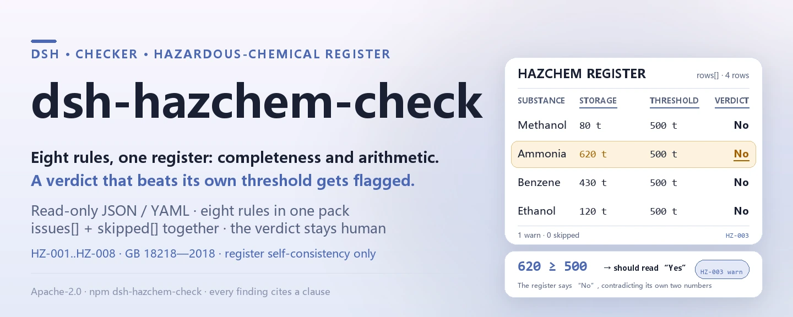
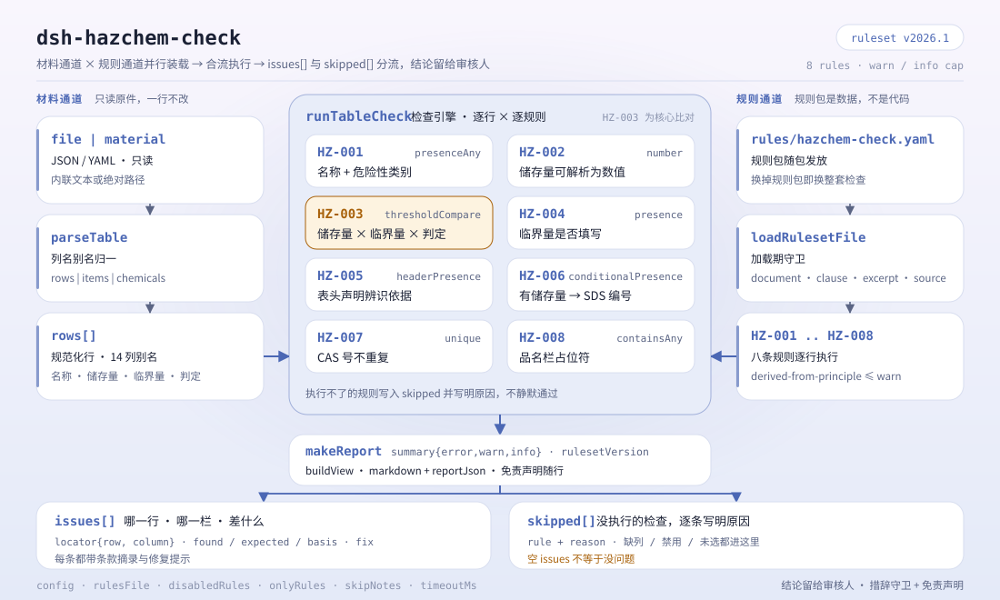

<div align="center">

<picture>
  <source media="(prefers-color-scheme: dark)" srcset="docs/assets/dsh-hazchem-check-hero-en-dark.webp">
  
</picture>

# dsh-hazchem-check

**Verifica a completude e a aritmética de limiares de um registo de produtos químicos perigosos e da sua identificação de fontes de perigo maior — devolve uma lista de que linha, que coluna e o que falta; o veredicto fica com o revisor.**

Complemento verificador de apenas dados para o DeepSeek Harness: lê um registo de produtos químicos perigosos (o cabeçalho do local mais uma linha por substância), aplica o pacote de regras versionado que traz (HZ-001..HZ-008) e lista apenas as diferenças que consegue apontar dentro do registo — nunca um veredicto de conformidade, nunca uma atribuição de responsabilidade.

[Instalar](#instalação-em-três-passos) · [Configuração](#configuração) · [FAQ](#faq) · [简体中文](README.md) · [English](README.en.md) · [Español](README.es.md) · [Português](README.pt.md) · [हिन्दी](README.hi.md)

[](LICENSE)
[](#compatibilidade)
[](https://www.npmjs.com/package/dsh-hazchem-check)
[](https://github.com/PerryLink/dsh-hazchem-check/actions/workflows/ci.yml)
[](#compatibilidade)

[](https://github.com/PerryLink/dsh-hazchem-check/stargazers)
[](https://www.npmjs.com/package/dsh-hazchem-check)
[](https://dshfind.com/plugins/PerryLink/dsh-hazchem-check?ref=badge)
[](https://securityscorecards.dev/viewer/?uri=github.com/PerryLink/dsh-hazchem-check)
[](https://dsh.market/)
[](https://gitee.com/perrylink/dsh-hazchem-check)

```sh
dsh plugin --profile <name> add dsh-hazchem-check
```

</div>

<sub>Complemento da comunidade, sem relação com a DeepSeek. Repositório canónico: <https://github.com/PerryLink/dsh-hazchem-check> (o Gitee é um espelho).</sub>

## O que é

O `dsh-hazchem-check` lê um registo de produtos químicos perigosos em conjunto com o seu registo de identificação de fontes de perigo maior — o cabeçalho do local mais uma linha por substância — e verifica a completude e a aritmética desse mesmo registo: se cada substância traz nome e classe de perigo, se a quantidade armazenada é analisável como número, se existe um limiar registado, se o veredicto de «fonte de perigo maior» concorda com a relação entre a quantidade armazenada e o limiar que o próprio registo declara, se cada substância armazenada tem número de ficha de dados de segurança, se não há números CAS repetidos, se o cabeçalho declara a base de identificação e se não sobra nenhum marcador de modelo na coluna do nome.

Não decide se uma unidade constitui uma fonte de perigo maior, se tem de ser registada, se é necessária uma avaliação de segurança ou se é um perigo oculto maior.

- **Para quem**: responsáveis de segurança e de produtos químicos perigosos; não é preciso usar a linha de comandos, basta entregar o material no chat.
- **O que entrega**: o material original sobre o qual a verificação trabalha (uma tabela, um registo ou um documento); o original nunca é alterado. O Excel pode ser convertido antes para JSON/YAML, no próprio chat se a plataforma o permitir.
- **O que recebe**: uma lista de «que linha, que coluna, o que falta, como corrigir»; cada verificação que não pôde ser executada aparece em `skipped` com o respetivo motivo.

<picture>
  <source media="(prefers-color-scheme: dark)" srcset="docs/assets/dsh-hazchem-check-flow-v5-dark.svg">
  
</picture>

## Instalação em três passos

1. **Instalar** (escolha um canal):

   ```sh
   # canal git (último main; equivale a git+https://github.com/PerryLink/dsh-hazchem-check.git)
   dsh plugin --profile <name> add github:PerryLink/dsh-hazchem-check
   # canal npm (versões publicadas)
   dsh plugin --profile <name> add dsh-hazchem-check
   # canal tarball: depois de pnpm pack neste repositório
   dsh plugin --profile <name> add ./dsh-hazchem-check-<version>.tgz
   ```

2. **Configuração mínima** (os valores por omissão já servem; uma linha de bundle sem `config` usa todos os valores por omissão, com o caminho do pacote de regras a apontar para o `rules/hazchem-check.yaml` incluído):

   ```yaml
   - insert:
       - id: dsh-hazchem-check
         name: dsh-hazchem-check
   ```

3. **Confirmar que ficou montado** (o teste de exemplo exige `pnpm run build` antes, para gerar `lib/`):

   ```sh
   dsh --profile <name> --dump-config | grep 'dsh-hazchem-check'
   node samples/quickstart/run.mjs --json
   # => {"tool":"hazchem_check","issueCount":1,"summary":{"error":0,"warn":1,"info":0},"skippedCount":0}
   ```

**Desinstalar**: `dsh plugin --profile <name> remove dsh-hazchem-check` (ou apague a linha do patch do perfil).

<details>
<summary>Usar no WorkBuddy / Coze</summary>

Procure «Safety Compliance Suite» no WorkBuddy / Coze (o conjunto completo; esta verificação é uma das suas partes; disponibilidade conforme o catálogo) para usar a mesma capacidade de verificação sem linha de comandos.

</details>

<details>
<summary>Instalar a partir do mercado do DSH Desktop</summary>

Todos os complementos da PerryLink aparecem no mercado integrado do DSH Desktop: **Mercado → Origens → Adicionar origem → colar** `https://perrylink-dsh-catalog.perrylink.workers.dev/catalog-source.json` **→ selecionar**. A instalação continua a exigir a verificação de identidade npm do mercado e a sua confirmação.

</details>

## Capacidades principais

O `dsh-hazchem-check` regista a ferramenta `hazchem_check`: lê um registo de produtos químicos perigosos, aplica um pacote de regras versionado e devolve um relatório.

- **Oito regras num pacote de dados** — o pacote de regras é dados, não código (`rules/hazchem-check.yaml`); substituí-lo troca todo o conjunto de regras sem tocar numa linha de TypeScript.
- **Apenas leitura sobre o material** — aceita JSON ou YAML e nunca altera o original; ESM puro, sem pedidos de rede e sem chamadas ao modelo.
- **Nenhuma citação inventada** — cada regra traz `document` / `number` / `clause` / `excerpt` / `kind` / `source`; `excerpt` tem de ser uma citação literal, e as regras cujo texto não foi obtido nesta passagem dizem-no no próprio `excerpt` e ficam marcadas como `derived-from-principle`.
- **A gravidade segue a evidência** — `derived-from-principle` tem teto `warn`, a configuração institucional (`institutional-configuration`) tem teto `info`, e um teste verifica-o.
- **Uma lista vazia nunca significa «não há nada errado»** — cada verificação que não pôde ser executada é reportada em `skipped` com o motivo; uma regra cuja lista obrigatória não está configurada declara-se a si mesma em `skipped` em vez de passar em silêncio.
- **Redação que não adjudica** — o relatório enumera diferenças e nunca se pronuncia sobre conformidade, responsabilidade ou correção; um guarda de redação impõe-no e todo o relatório leva o aviso legal.

| Regra | Verificação | Gravidade | Tipo de base |
|---|---|---|---|
| `HZ-001` | o nome e a classe de perigo estão registados | warn | principle |
| `HZ-002` | a quantidade armazenada é analisável como número | warn | principle |
| `HZ-003` | o veredicto concorda com a quantidade e o limiar | warn | principle |
| `HZ-004` | existe um limiar registado | warn | principle |
| `HZ-005` | o cabeçalho declara a base de identificação | warn | principle |
| `HZ-006` | uma substância armazenada regista o número da ficha de dados de segurança | warn | principle |
| `HZ-007` | os números CAS não se repetem | warn | principle |
| `HZ-008` | a coluna do nome não guarda marcadores por substituir | warn | principle |

### Exemplos

Estes são os pontos de entrada reais do complemento; instale uma vez e chame um. A primeira linha da tabela seguinte é o caso detalhado e as restantes são casos breves. O caso detalhado é a **saída real** deste complemento sobre o seu próprio fixture de teste `HZ-002`, não uma simulação: o pacote de regras não inventa citações, por isso cada achado nomeia a cláusula aplicada e avisa que o seu texto não foi obtido nesta passagem.

**Exemplo detalhado** — ferramenta `hazchem_check`, entrada:

```json
{"rows":[{"化学品名称":"甲醇","最大储存量":"满罐","计量单位":"t"}]}
```

Saída:

```json
{
  "id": "dsh-hazchem-check.HZ-002.de09b5a6",
  "ruleId": "HZ-002",
  "severity": "warn",
  "locator": {
    "field": "maxStorage",
    "row": 1
  },
  "found": "第 1 行「maxStorage」的值「满罐」无法解析为数字",
  "expected": "「maxStorage」应填写数字",
  "fix": "储存量应填写数值；本条只核对可解析性，不判断数量是否真实"
}
```

*Observed from `tests/fixtures/HZ-002/HZ-002-unsafe.json (cases.json expects HZ-002 count 1); run via lib/index.mjs rules/hazchem-check.yaml`*

| Você pergunta | O que ele responde |
|---|---|
| O registo diz «否», mas a quantidade armazenada excede o limiar escrito ao lado — isso é detetado? | Sim. `HZ-003` compara os dois números que o próprio registo contém e assinala a linha quando o veredicto não concorda com eles. Não decide se a unidade constitui realmente uma fonte de perigo maior. |
| Uma linha não tem limiar. Isso é reportado? | Sim. `HZ-004` exige que a coluna do limiar esteja preenchida em todas as linhas. Verifica que exista um valor, não que seja o valor correto para essa substância — um `0` passa. |
| O nome está preenchido, mas a classe de perigo está vazia. | `HZ-001` exige ambos em cada linha e assinala a linha à qual falta um deles. Não julga se a classe está correta. |
| A quantidade está escrita como `1,500 kg` — ainda é lida? | Sim. `HZ-002` toma a parte numérica e só reporta uma quantidade que não consegue analisar. Não verifica se o valor é real nem se foi tomado no máximo de projeto. |
| Que linhas têm de trazer número de ficha de dados de segurança? | `HZ-006`: todas as linhas com quantidade armazenada. A regra verifica que o número está preenchido, não que a ficha esteja completa ou corresponda a essa substância. |
| O mesmo número CAS aparece duas vezes, em dois armazéns. | `HZ-007` reporta um número CAS repetido, porque prejudica tanto a deduplicação como o total das quantidades. Uma substância repartida por armazéns é uma forma legítima: distinga-a na coluna de localização ou desative a regra. Sem coluna CAS, a regra reporta que não pôde ser executada em vez de passar em silêncio. |

## Normas que segue

| Documento | Número | Regras que o citam |
|---|---|---|
| Regulamento de gestão da segurança de produtos químicos perigosos (título chinês canónico em `rules/evidence/`) | Decreto do Conselho de Estado n.º 591 (publicado em 2002-01-26 como Decreto n.º 344, revisto na 144.ª reunião executiva do Conselho de Estado em 2011-02-16, em vigor desde 2011-12-01) | HZ-001, HZ-002, HZ-003, HZ-004, HZ-006, HZ-008 |
| Identificação de fontes de perigo maior de produtos químicos perigosos | GB 18218—2018 (publicada em 2018-11-19, em vigor em 2019-03-01; todo o conteúdo técnico é obrigatório; substitui a GB 18218—2009) | HZ-002, HZ-003 |
| Identificação de fontes de perigo maior de produtos químicos perigosos | GB 18218—2018 (texto dos artigos não obtido nesta passagem) | HZ-005 |
| Regulamento de gestão da segurança de produtos químicos perigosos | Decreto do Conselho de Estado n.º 591 (texto dos artigos não obtido nesta passagem) | HZ-007 |

**Limite:** este complemento verifica a completude e a aritmética de um **registo de produtos químicos perigosos em conjunto com o seu registo de identificação de fontes de perigo maior** — que cada produto químico se nomeie a si mesmo e à sua classe de perigo, que a quantidade armazenada seja analisável, que exista um limiar registado, que **o veredicto de fonte de perigo maior concorde com a relação entre a quantidade armazenada e o limiar que o registo declara**, que cada substância armazenada registe o número da ficha de dados de segurança, que os números CAS não se repitam, que o registo declare a sua base de identificação e que não sobrem marcadores. **Não** decide se uma unidade constitui uma fonte de perigo maior, se tem de ser registada, se é necessária uma avaliação de segurança ou se é um perigo oculto maior.

> ### ⚠️ O que a norma diz e quais são os quatro erros que este complemento não consegue encontrar
>
> **A GB 18218—2018 foi obtida e lida literalmente** (ver `rules/evidence/clause-verification-tables.md`): publicada em **2018-11-19, em vigor em 2019-03-01**, com um prólogo que declara que **todo o conteúdo técnico desta norma é obrigatório** (citado aqui em tradução; o original chinês literal está nesse ficheiro de evidência) — a norma inteira é obrigatória — e **substitui a GB 18218—2009** (as edições de 2000 e 2009 estão revogadas, pelo que citá-las é simplesmente um erro). As definições de quantidade-limiar (3.3), unidade (3.2) e fonte de perigo maior (3.4), a regra de determinação 4.1.2 e **as primeiras 35 linhas da tabela 1** estão citadas nesse relatório.
>
> **A tabela 1 só está completa até à linha 35 e a tabela 2 não foi obtida**, por isso não há nenhum valor de limiar incorporado e nenhum pode ser verificado. O `HZ-003` compara a quantidade armazenada com o limiar **que o próprio registo regista** e verifica se o veredicto concorda. Por isso **não consegue encontrar quatro classes de erro**, e a sua própria nota diz isso:
>
> 1. **Um limiar tirado da substância ou da classe de perigo erradas** — a 4.1.2 exige a tabela 1 para as substâncias listadas e a tabela 2 nos restantes casos.
> 2. **Uma substância com várias perigosidades à qual não é dado o limiar mais baixo** — a 4.1.2 b) exige que, quando um produto químico perigoso tem várias perigosidades, se aplique o limiar mais baixo de todos (citado em tradução). O registo leva um único valor, pelo que arredondar para cima deixa de fora uma fonte de perigo maior.
> 3. **A correção multi-substância** — dentro de uma unidade, `S = q₁/Q₁ + q₂/Q₂ + … + qₙ/Qₙ ≥ 1` também constitui uma fonte de perigo maior. **Este complemento não faz esse somatório**, porque a identificação é feita por **unidade de produção ou armazenamento** (3.2, 3.5, 3.6) e um registo enumera substâncias sem as agrupar por unidade.
> 4. **A base da quantidade** — a 4.2.2 exige tomar a quantidade **no máximo de projeto**, enquanto um registo pode anotar existências reais.
>
> ⚠️ **Não saia do âmbito da norma.** O artigo 1 exclui o **transporte de produtos químicos perigosos fora do local** (ferrovia, estrada, via navegável, aéreo, conduta), as instalações nucleares e militares, a mineração (exceto o processamento e o armazenamento) e a extração marítima de petróleo e gás. Usar este complemento num envio em **transporte** fica fora do âmbito — isso é regido pelas normas de transporte de mercadorias perigosas, não pela GB 18218.
>
> Por isso, um achado significa apenas «**os dois números que escreveu não concordam com o seu próprio veredicto**». Os quatro pontos acima exigem um cálculo unidade a unidade ao abrigo da norma, que é tarefa da avaliação de segurança e da determinação regulatória. **Cada `excerpt` continua a dizer que o texto não foi obtido, e cada regra continua em `warn` ou `info`**, porque o que este complemento verifica é a consistência interna de um registo, não se um valor de limiar está correto.

## Configuração

Todos os parâmetros ajustáveis são campos `Config` do Schemastery em `src/config.ts` (alteráveis a partir do cordis.yml); os limiares por regra vivem no pacote de regras em `rules/`. Uma substituição dirigida por id substitui a linha inteira — repita todas as chaves de que precisa.

| Chave | Tipo | Predefinição | Descrição |
|---|---|---|---|
| `rulesFile` | string | `rules/hazchem-check.yaml` | Caminho do pacote de regras, relativo à raiz do pacote |
| `disabledRules` | string[] | `[]` | Ids de regras a desativar; cada uma aparece em `skipped` |
| `onlyRules` | string[] | `[]` | Executar apenas estas regras; vazio executa todas |
| `skipNotes` | string | `""` | Nota acrescentada a cada motivo de `skipped` |
| `timeoutMs` | number | `120000` | Orçamento de tempo limite cooperativo da ferramenta |

Parâmetros por regra que vale a pena conhecer:

- `HZ-003` `valueField` / `limitField` / `verdictField` / `overValues` / `atMostValues` / `tolerance` — as colunas da quantidade armazenada, do limiar e do veredicto, mais os dois vocabulários de veredicto. Os valores por omissão são a redação do registo chinês, pelo que um registo escrito em chinês não precisa de configuração:

  ```yaml
  overValues: [是, Y, yes, true, 构成, 重大危险源, √]
  atMostValues: [否, N, no, false, 不构成, 未构成]
  ```

- `HZ-008` `terms` — os marcadores a procurar na coluna do nome.

Exemplo de substituição no patch do perfil:

```yaml
- insert:
    - id: dsh-hazchem-check
      name: dsh-hazchem-check
      config:
        disabledRules: [HZ-007]
        timeoutMs: 180000
```

## Formato do material

A ferramenta aceita JSON ou YAML:

```yaml
company: 某某化工有限公司
site: 某某厂区
assessmentAt: 2026-03-01
basis: GB 18218—2018 与 2025 年版危险化学品目录
rows:
  - { 序号: '1', 化学品名称: 甲醇, CAS号: 67-56-1, 危险性类别: 易燃液体,
      储存位置: 罐区 T-01, 最大储存量: '80', 计量单位: t, 临界量: '500',
      是否重大危险源: 否, 安全技术说明书编号: SDS-2026-0018, 保管人: 李工 }
```

Os nomes das colunas são comparados sem distinguir maiúsculas de minúsculas e ignorando espaços, sublinhados e hífenes; os nomes de coluna do próprio registo são preservados, pelo que o achado nomeia a coluna que realmente leu. Os campos são opcionais na camada de leitura e validados pelo motor de verificação, pelo que um registo exportado parcialmente produz achados de «falta um dado» em vez de uma falha.

## Fontes das regras

Os dados das regras estão em `rules/hazchem-check.yaml`, separados do código: cada regra traz documento, número, cláusula na numeração própria da fonte, extrato literal e URL de origem. O cabeçalho do pacote declara que o complemento não incorpora qualquer tabela de limiares e não faz qualquer correção multi-substância, e a `note` de cada regra repete a parte que lhe diz respeito. O guarda de carregamento continua a exigir `document`, `clause`, `excerpt` e `source` em cada regra, e continua a proibir que uma verificação baseada apenas num princípio (`kind: derived-from-principle`, teto `warn`) ou numa configuração institucional (`kind: institutional-configuration`, teto `info`) seja marcada como `error`; um `excerpt` tem de ser uma citação real de pelo menos oito caracteres. Um pacote que exagere a sua base falha ao carregar em vez de produzir um relatório com aparência segura. Os limites confirmados durante a verificação e as conclusões deliberadamente **não** tiradas seguem no diretório `rules/evidence/` incluído.

## FAQ

<details>
<summary>Decide a conformidade por nós?</summary>

Não. Apenas enumera as diferenças que consegue apontar dentro do material (que linha, que coluna, o que falta, como corrigir) e não decide factos nem conformidade — a conclusão fica sempre com o revisor. Um guarda de redação impõe o texto do relatório e todo o relatório leva o aviso legal.

</details>

<details>
<summary>O meu registo é um ficheiro Excel, posso usá-lo diretamente?</summary>

Sim — converta-o antes para JSON ou YAML; no chat a plataforma pode fazer a conversão, se o permitir. A ferramenta apenas lê o material e nunca altera o original.

</details>

<details>
<summary>Porque é que o `HZ-003` não detetou uma unidade que é mesmo uma fonte de perigo maior?</summary>

Porque o pacote não incorpora qualquer valor de limiar e não faz o somatório multi-substância da GB 18218. O `HZ-003` compara a quantidade armazenada com o limiar **que o próprio registo declara** e verifica se o veredicto concorda com essa comparação. Se o limiar pertence à substância certa, se uma substância com várias perigosidades recebeu o seu limiar mais baixo e se a quantidade foi tomada no máximo de projeto são questões que exigem um cálculo unidade a unidade ao abrigo da norma, feito por uma pessoa.

</details>

<details>
<summary>Uma lista `issues` vazia pode ser lida como «não há nada errado»?</summary>

Não. Cada verificação que não pôde ser executada aparece em `skipped` com o motivo (falta a coluna CAS, uma lista obrigatória não configurada). Além disso, algumas regras só verificam presença: o `HZ-004` aceita um limiar `0`. Leia `issues` e `skipped` em conjunto antes de tirar qualquer conclusão de um relatório.

</details>

<details>
<summary>Aguenta um registo com várias centenas de linhas de uma vez?</summary>

A ferramenta funciona nos modos `native` e `ptc`; para trabalho em lote (um registo completo ou um diretório) use `ptc`, onde o custo do esquema é pago uma só vez. As verificações são comparação local de colunas e aritmética numérica — sem pedidos de rede e sem chamadas ao modelo; `timeoutMs` (120 s por omissão) é o orçamento cooperativo de tempo limite.

</details>

## Resolução de problemas

- **O `HZ-003` deixou passar um limiar que sei estar errado.** Compara com o limiar que o registo declara; se esse valor pertence à substância e à classe de perigo corretas é uma questão substantiva que esta regra não toca.
- **Não assinalou uma unidade que devia ser fonte de perigo maior.** Não tem tabela de limiares e não faz o somatório multi-substância da GB 18218. Calcule a unidade ao abrigo da norma.
- **O `HZ-004` aceita um limiar de `0`.** A regra verifica que a coluna está preenchida, não o seu conteúdo; só uma pessoa que compare com a norma pode julgar o valor.
- **O `HZ-007` nunca é executado.** O registo não anota números CAS. Sem identificador único, a regra reporta que não pôde ser executada em vez de verificar a coluna errada.
- **O `HZ-007` assinala uma substância presente em dois armazéns.** É uma forma legítima de registo: indique-o na coluna de localização e desative a regra se o seu registo se organizar assim.
- **Uma regra não foi executada.** Leia o vetor `skipped`; indica o id da regra e o motivo.
- **O complemento instala mas a ferramenta não aparece.** Confirme que `main` resolve para `lib/index.mjs` e que `pnpm run build` o gerou; um `main` errado faz o carregador ignorar a entrada em silêncio.
- **`dsh plugin add` recusa o pacote por incompatibilidade.** O intervalo de peers cobre `0.1.x` e `0.2.x`; se o seu runtime ficar fora dele, conceda uma isenção explícita: `dsh plugin --profile <name> allow-version dsh-hazchem-check@0.1.0 --dsh-version <runtime> --accept-risk`
- **O `check` reporta `manifest-peers` como falha.** O verificador estático compara com um intervalo de peers fixo no código anterior à linha 0.2; o runtime aplica a compatibilidade de peers na instalação, pelo que o intervalo declarado é o correto. É um problema conhecido do `dsh-plugin-dev`.
- **As horas parecem deslocadas.** Toda a aritmética é de relógio de parede sobre as cadeias de entrada, sem conversão de fuso horário.

## Compatibilidade

| Superfície | Estado |
|---|---|
| Harness | Intervalo de peers `>=0.1.2-rc.1 <0.2.0 \|\| >=0.2.0-0 <0.3.0` — verificado para aceitar tanto `0.2.0-rc.2` como `0.2.1-rc.2`. `engines.dsh` é declarado como `>=0.2.1-0 <0.3.0` e o host aplica-o desde 0.2.1 |
| Node | `^22.19.0 \|\| >=24.0.0` |
| Plataformas | Todas (ESM puro; sem código nativo, sem rede, sem chamada ao modelo) |
| Modo de ferramenta | Funciona em `native` e `ptc`; para um registo completo use `ptc` |

## Ecossistema e qualidade

- [Espelho no Gitee](https://gitee.com/perrylink/dsh-hazchem-check) (espelho sincronizado; o GitHub é o canónico)
- [Página do complemento no dshfind](https://dshfind.com/plugins/PerryLink/dsh-hazchem-check) (instalações e ranking)
- [Relatório OpenSSF Scorecard](https://securityscorecards.dev/viewer/?uri=github.com/PerryLink/dsh-hazchem-check) (gerado por [.github/workflows/scorecard.yml](.github/workflows/scorecard.yml))
- [DSH Market](https://dsh.market/) (publicado)
- **Canal da loja 1024**: `npm i -g dsh1024` uma vez e depois `dsh1024 plugin --profile <name> add dsh-hazchem-check` (conta para o ranking de instalações de [deepseek1024.com](https://deepseek1024.com))
- [Base de conhecimento do ecossistema](https://perrylink.github.io/dsh-plugin-guide/) — guia de desenvolvimento de complementos · dados medidos de seleção · critérios de manutenção

## Desenvolvimento

```sh
pnpm install                                        # node ^22.19 || >=24
pnpm run typecheck                                  # tsc --noEmit
pnpm test                                           # vitest: suite partilhada de plugins de tabela + fixtures emparelhadas
pnpm run build                                      # tsdown -> lib/index.mjs + lib/index.d.mts
pnpm run verify:self-contained                      # as dependências resolvem-se a partir do registry
pnpm run check:lockfile                             # verificação de deriva do lockfile
pnpm run check:readmes                              # consistência dos README em cinco idiomas
pnpm run check:citations                            # linha de base de citações do pacote de regras
node ../scripts/sync-shared.mjs dsh-hazchem-check   # refrescar src/shared a partir de ../_shared
pnpm pack                                           # o tarball publicado
```

O complemento é **de apenas dados**: `src/model.ts` declara a forma da tabela, o kit partilhado fornece o leitor e o motor de verificação, e o pacote de regras declara cada verificação. Teste local com o exemplo (exige `pnpm run build` antes para gerar `lib/`):

```sh
node samples/quickstart/run.mjs --json
# => {"tool":"hazchem_check","issueCount":1,"summary":{"error":0,"warn":1,"info":0},"skippedCount":0}
```

A entrada do exemplo está em `samples/quickstart/input/`, a saída esperada em `samples/quickstart/expected/result.json` e uma captura em `docs/assets/quickstart.png`. As imagens dos README são geradas programaticamente por [`scripts/gen-readme-assets.py`](scripts/gen-readme-assets.py) (Python + Pillow) e podem ser executadas novamente sem risco; o antigo diagrama de fluxo de uma só versão e as imagens de demonstração ficam em `docs/assets/` para ligações externas, enquanto os README só referenciam o novo par claro/escuro.

Topics: `deepseek-harness`, `dsh`, `dsh-plugin`, `cordis`, `hazchem`

## Família e agradecimentos

Este projeto faz parte da família de complementos do DeepSeek Harness da [PerryLink](https://github.com/PerryLink) (todos Apache-2.0). Índice completo da família: [escolher um verificador pelo material](https://perrylink.github.io/zh/checkers/choose/) e [todos os complementos](https://github.com/PerryLink). Se lhe for útil, **uma estrela ajuda a que a próxima pessoa o encontre** — não desbloqueia nada.

- [@PerryLink](https://github.com/PerryLink) — criador e mantenedor: o pacote de regras de apenas dados (HZ-001..HZ-008), a ferramenta `hazchem_check`, o registo de verificação de artigos da GB 18218—2018 e a documentação em cinco idiomas.

<details>
<summary>Expandir todos os plugins</summary>

| Plugin | Estado |
|---|---|
| **[dsh-aqua-input-check](https://github.com/PerryLink/dsh-aqua-input-check)** |  |
| **[dsh-archive-check](https://github.com/PerryLink/dsh-archive-check)** |  |
| **[dsh-auto-review](https://github.com/PerryLink/dsh-auto-review)** |  |
| **[dsh-autotier](https://github.com/PerryLink/dsh-autotier)** | 🧊 CONGELADO — ver o README do repo |
| **[dsh-bid-ca-precheck](https://github.com/PerryLink/dsh-bid-ca-precheck)** |  |
| **[dsh-bid-qual-check](https://github.com/PerryLink/dsh-bid-qual-check)** |  |
| **[dsh-cert-mcp](https://github.com/PerryLink/dsh-cert-mcp)** | 🧊 CONGELADO — ver o README do repo |
| **[dsh-checkpoint-rewind](https://github.com/PerryLink/dsh-checkpoint-rewind)** |  |
| **[dsh-click](https://github.com/PerryLink/dsh-click)** |  |
| **[dsh-composer-history](https://github.com/PerryLink/dsh-composer-history)** |  |
| **[dsh-contract-stance](https://github.com/PerryLink/dsh-contract-stance)** |  |
| **[dsh-customs-doc-check](https://github.com/PerryLink/dsh-customs-doc-check)** |  |
| **[dsh-data-quality](https://github.com/PerryLink/dsh-data-quality)** | 🧊 CONGELADO — ver o README do repo |
| **[dsh-demurrage-ledger](https://github.com/PerryLink/dsh-demurrage-ledger)** |  |
| **[dsh-doublecheck](https://github.com/PerryLink/dsh-doublecheck)** |  |
| **[dsh-drill-script-check](https://github.com/PerryLink/dsh-drill-script-check)** |  |
| **[dsh-eia-guide-check](https://github.com/PerryLink/dsh-eia-guide-check)** |  |
| **[dsh-emergency-plan](https://github.com/PerryLink/dsh-emergency-plan)** |  |
| **[dsh-essay-rubric-check](https://github.com/PerryLink/dsh-essay-rubric-check)** |  |
| **[dsh-evidence-check](https://github.com/PerryLink/dsh-evidence-check)** |  |
| **[dsh-export-ctl-check](https://github.com/PerryLink/dsh-export-ctl-check)** |  |
| **[dsh-fast](https://github.com/PerryLink/dsh-fast)** |  |
| **[dsh-fmea-table-check](https://github.com/PerryLink/dsh-fmea-table-check)** |  |
| **[dsh-forecast-penalty](https://github.com/PerryLink/dsh-forecast-penalty)** |  |
| **[dsh-fund-research](https://github.com/PerryLink/dsh-fund-research)** |  |
| **[dsh-github](https://github.com/PerryLink/dsh-github)** |  |
| **[dsh-gongwen-flow-check](https://github.com/PerryLink/dsh-gongwen-flow-check)** |  |
| **[dsh-gongwen-word-check](https://github.com/PerryLink/dsh-gongwen-word-check)** |  |
| **[dsh-guard-plan-qc](https://github.com/PerryLink/dsh-guard-plan-qc)** |  |
| **[dsh-hazchem-check](https://github.com/PerryLink/dsh-hazchem-check)** |  |
| **[dsh-hazplan-check](https://github.com/PerryLink/dsh-hazplan-check)** |  |
| **[dsh-hidden-risk-map](https://github.com/PerryLink/dsh-hidden-risk-map)** |  |
| **[dsh-hs-classify](https://github.com/PerryLink/dsh-hs-classify)** |  |
| **[dsh-icd-rule-check](https://github.com/PerryLink/dsh-icd-rule-check)** |  |
| **[dsh-industry-research](https://github.com/PerryLink/dsh-industry-research)** |  |
| **[dsh-lawcite-adapter](https://github.com/PerryLink/dsh-lawcite-adapter)** |  |
| **[dsh-laya](https://github.com/PerryLink/dsh-laya)** |  |
| **[dsh-lc-doc-check](https://github.com/PerryLink/dsh-lc-doc-check)** |  |
| **[dsh-learning-gap-check](https://github.com/PerryLink/dsh-learning-gap-check)** |  |
| **[dsh-library](https://github.com/PerryLink/dsh-library)** |  |
| **[dsh-local-ai](https://github.com/PerryLink/dsh-local-ai)** |  |
| **[dsh-lsp-actions](https://github.com/PerryLink/dsh-lsp-actions)** |  |
| **[dsh-mask](https://github.com/PerryLink/dsh-mask)** |  |
| **[dsh-mcp-panel](https://github.com/PerryLink/dsh-mcp-panel)** |  |
| **[dsh-medrec-qc](https://github.com/PerryLink/dsh-medrec-qc)** |  |
| **[dsh-memento](https://github.com/PerryLink/dsh-memento)** | 🧊 CONGELADO — ver o README do repo |
| **[dsh-nsfc-form-check](https://github.com/PerryLink/dsh-nsfc-form-check)** |  |
| **[dsh-nurse-record-check](https://github.com/PerryLink/dsh-nurse-record-check)** |  |
| **[dsh-observe](https://github.com/PerryLink/dsh-observe)** |  |
| **[dsh-origin-rvc-check](https://github.com/PerryLink/dsh-origin-rvc-check)** |  |
| **[dsh-ota-review-check](https://github.com/PerryLink/dsh-ota-review-check)** |  |
| **[dsh-output-styles](https://github.com/PerryLink/dsh-output-styles)** |  |
| **[dsh-paper-doc-adapter](https://github.com/PerryLink/dsh-paper-doc-adapter)** |  |
| **[dsh-permission-rules](https://github.com/PerryLink/dsh-permission-rules)** |  |
| **[dsh-permit-report-check](https://github.com/PerryLink/dsh-permit-report-check)** |  |
| **[dsh-pipeline-check](https://github.com/PerryLink/dsh-pipeline-check)** |  |
| **[dsh-pleading-draft](https://github.com/PerryLink/dsh-pleading-draft)** |  |
| **[dsh-plugin-doctor](https://github.com/PerryLink/dsh-plugin-doctor)** | 🚫 APOSENTADO (repo arquivado) |
| **[dsh-plugin-guide](https://github.com/PerryLink/dsh-plugin-guide)** |  |
| **[dsh-plugin-kit](https://github.com/PerryLink/dsh-plugin-kit)** | 🚫 APOSENTADO (repo arquivado) |
| **[dsh-plugin-upgrade](https://github.com/PerryLink/dsh-plugin-upgrade)** | 🚫 APOSENTADO (repo arquivado) |
| **[dsh-policy-brief-draft](https://github.com/PerryLink/dsh-policy-brief-draft)** |  |
| **[dsh-power-loss-split](https://github.com/PerryLink/dsh-power-loss-split)** |  |
| **[dsh-power-ticket-check](https://github.com/PerryLink/dsh-power-ticket-check)** |  |
| **[dsh-ppap-check](https://github.com/PerryLink/dsh-ppap-check)** |  |
| **[dsh-protest-deadline](https://github.com/PerryLink/dsh-protest-deadline)** |  |
| **[dsh-railway-window](https://github.com/PerryLink/dsh-railway-window)** |  |
| **[dsh-repair-order-qc](https://github.com/PerryLink/dsh-repair-order-qc)** |  |
| **[dsh-research-report](https://github.com/PerryLink/dsh-research-report)** |  |
| **[dsh-review-reply-check](https://github.com/PerryLink/dsh-review-reply-check)** |  |
| **[dsh-rulefile-check](https://github.com/PerryLink/dsh-rulefile-check)** |  |
| **[dsh-safety-brief-check](https://github.com/PerryLink/dsh-safety-brief-check)** |  |
| **[dsh-score](https://github.com/PerryLink/dsh-score)** | 🧊 CONGELADO — ver o README do repo |
| **[dsh-session-sync](https://github.com/PerryLink/dsh-session-sync)** |  |
| **[dsh-site-log-check](https://github.com/PerryLink/dsh-site-log-check)** |  |
| **[dsh-skill-pack-security](https://github.com/PerryLink/dsh-skill-pack-security)** |  |
| **[dsh-soe-decision-check](https://github.com/PerryLink/dsh-soe-decision-check)** |  |
| **[dsh-soilwater-check](https://github.com/PerryLink/dsh-soilwater-check)** |  |
| **[dsh-sop-sync-check](https://github.com/PerryLink/dsh-sop-sync-check)** |  |
| **[dsh-spc-gbt-adapter](https://github.com/PerryLink/dsh-spc-gbt-adapter)** |  |
| **[dsh-talk](https://github.com/PerryLink/dsh-talk)** |  |
| **[dsh-tender-extract](https://github.com/PerryLink/dsh-tender-extract)** |  |
| **[dsh-tender-matrix](https://github.com/PerryLink/dsh-tender-matrix)** |  |
| **[dsh-test-drive](https://github.com/PerryLink/dsh-test-drive)** |  |
| **[dsh-ticktick](https://github.com/PerryLink/dsh-ticktick)** | 🚫 APOSENTADO (repo arquivado) |
| **[dsh-translate](https://github.com/PerryLink/dsh-translate)** |  |
| **[dsh-warranty-calc](https://github.com/PerryLink/dsh-warranty-calc)** |  |
| **[dsh-budget](https://github.com/PerryLink/dsh-budget)** | 🧊 CONGELADO — ver o README do repo |
| **[dsh-claude-move](https://github.com/PerryLink/dsh-claude-move)** | 🧊 CONGELADO — ver o README do repo |
| **[dsh-defend](https://github.com/PerryLink/dsh-defend)** | 🧊 CONGELADO — ver o README do repo |
| **[dsh-draw](https://github.com/PerryLink/dsh-draw)** | 🧊 CONGELADO — ver o README do repo |
| **[dsh-reach](https://github.com/PerryLink/dsh-reach)** | 🧊 CONGELADO — ver o README do repo |
| **[dsh-background-agents](https://github.com/PerryLink/dsh-background-agents)** | 🚫 APOSENTADO (repo arquivado) |
| **[dsh-session-pin](https://github.com/PerryLink/dsh-session-pin)** | 🚫 APOSENTADO (repo arquivado) |
| **[dsh-team-rooms](https://github.com/PerryLink/dsh-team-rooms)** | 🚫 APOSENTADO (repo arquivado) |

</details>

## Licença

[LICENSE](LICENSE) (Apache License 2.0) © 2026 dsh-hazchem-check contributors

<p align="center"><sub>Apache-2.0 · Complemento da comunidade, sem relação com a DeepSeek.</sub></p>
